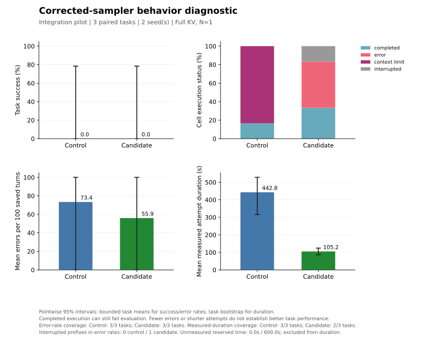

# Foundation repair and baseline reporting

The shared CPU validation passed **149 tests**, with one numerical module skipped
because this profile lacks PyTorch and eight live integration tests deselected.
The code changes are committed on `dev/yenna`; GPU execution and AppWorld remain
separate validation requirements. [Evidence](foundation-repair-2026-11-08.json)
identifies the source chunks and check artifacts.

The changes retain partial work when generation fails, record recovery decisions
before execution, and preserve admission, consumed allowance, failure and timing
after exceptions. Completed-work FLOPs estimates are distinguished from work
scheduled in a failed batch. Metadata-only interrupted-run finalization uses the
ordinary compatibility checks and cannot initialize inference or AppWorld. It
preserves terminal artifacts below the budget and counts durable over-budget
completions as timeouts.

GPU selection now accepts an explicitly named device under the
[authorized hardware policy](../experimental-hardware.md). A mismatch is rejected,
and freeze checks selected-device pilot evidence. Existing configs without a
device name retain their original hardware requirement.

The reporting path accepts explicitly declared prompt/agent differences only for
paired train/dev protocol comparisons, while requiring matching tasks, seeds,
numerical settings, source, dependencies, hardware and evaluator. Ordinary run
analysis keeps its strict compatibility checks. Recovery summaries expose
admissions, refusals, failures, recorded costs and coverage. Unobserved reserved
budget is separate from measured attempt duration.

## Existing corrected-sampler evidence

The new reporting path reproduced the previously completed
[corrected-sampler comparison](sampling-repair-2026-11-08-results.md). This is a
reanalysis, not a new experiment. Both arms scored **0/6** across three targeted
dev tasks and two seeds. One guarded attempt was interrupted. The chart includes
nondegenerate success intervals, task-normalized error rates and measurement
coverage; fewer errors and shorter guarded attempts do not establish better
task performance.



The new executable-action prompt has a separate
[declared diagnostic plan](execution-prompt-2026-11-08-plan.md). It still requires
live execution, offline scoring, and broader dev confirmation if useful. Nothing
in these CPU checks resolves retention, recovery or budget-matched best-of-N.

Reproduce the historical chart from intact original run directories in a managed
CPU environment with the locked optional plotting dependency:

```sh
comet compare-protocol "$CONTROL_RUN" "$GUARD_RUN" --protocol-field agent \
  --output "$REPORT_DIR/comparison.json"
comet plot-baseline "$REPORT_DIR/comparison.json" \
  --output "$REPORT_DIR/baseline.svg" --title "Corrected-sampler behavior diagnostic"
```

Keep the output outside both immutable execution directories. The full comparison
records local artifact locations; the committed evidence retains portable run
identities, hashes and summaries instead.
