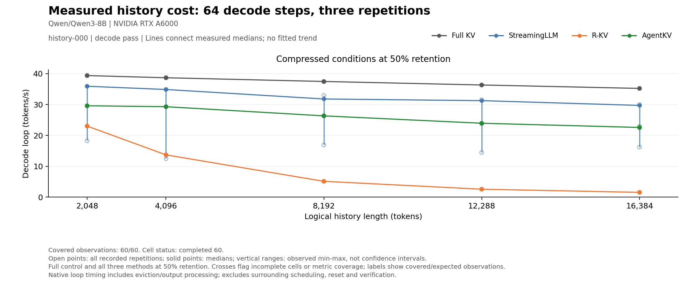
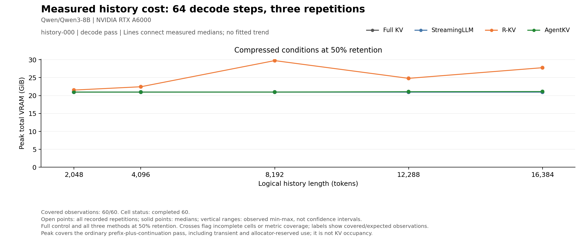

# Five-point matched-history cost results

The declared 2,048/4,096/8,192/12,288/16,384-token timing grid completed all
150 cells and 450 passes. Each length used ten conditions, three repetitions
and 64 forced decode forwards. All 790 copied files (6,811,767 bytes) were
independently hash-verified. The five A6000 allocations totaled 3,119 seconds
(52 minutes); no cell received a replacement or relaxed cap. The
[portable evidence record](history-timing-grid-2026-11-08.json) identifies every
source run, all raw points, reporting source hashes and 54 figure exports.

The two main figures use the predeclared 50% cross-method view: ordinary decode
throughput and peak total VRAM over the ordinary prefix-plus-continuation pass.
They show a clear cost distinction on this fixed history, without claiming task
quality or recovery benefit.

[Vector SVG](figures/history-timing-2026-11-08/main-decode-throughput.svg) |
[PDF](figures/history-timing-2026-11-08/main-decode-throughput.pdf)

[Vector SVG](figures/history-timing-2026-11-08/main-decode-peak-vram.svg) |
[PDF](figures/history-timing-2026-11-08/main-decode-peak-vram.pdf)

These six committed exports are byte-identical to the verified artifact copies.
Their hashes are included in the evidence record.

| Logical tokens | Full KV tok/s | StreamingLLM 50% tok/s | R-KV 50% tok/s | AgentKV 50% tok/s |
| ---: | ---: | ---: | ---: | ---: |
| 2,048 | 39.361 | 35.906 | 23.023 | 29.590 |
| 4,096 | 38.656 | 34.857 | 13.700 | 29.289 |
| 8,192 | 37.452 | 31.784 | 5.143 | 26.324 |
| 12,288 | 36.317 | 31.248 | 2.591 | 23.937 |
| 16,384 | 35.208 | 29.702 | 1.571 | 22.574 |

These are all-three medians. The figures retain every raw repetition and its
observed min-max range, including substantial StreamingLLM first-use differences.
Lines connect measured medians without smoothing or fitting. The synchronized
native loop includes eviction and output processing, while surrounding reset,
scheduling and verification remain outside that rate. Whole-pass elapsed is a
separate supporting metric. The ranges are technical repetition ranges, not
confidence intervals or proof of steady performance.

| Logical tokens | Full KV GiB | StreamingLLM 50% GiB | R-KV 50% GiB | AgentKV 50% GiB |
| ---: | ---: | ---: | ---: | ---: |
| 2,048 | 20.966 | 20.968 | 21.534 | 20.970 |
| 4,096 | 20.966 | 20.968 | 22.458 | 20.972 |
| 8,192 | 20.966 | 20.968 | 29.747 | 20.980 |
| 12,288 | 20.966 | 20.968 | 24.804 | 21.077 |
| 16,384 | 20.966 | 20.970 | 27.773 | 21.118 |

These memory medians cover the entire ordinary decode pass, including its prefix,
transient allocation and allocator reservation. R-KV memory is non-monotone with
logical length. The all-retention supplement also preserves its larger 4k 80%
peak of 36.812 GiB. No allocator cause or monotone fit is inferred. The fixed
4.50014 GiB reserved KV pool, occupied KV, allocated tensors, allocator reservation
and total VRAM remain separate. Reducing occupied KV does not imply proportional
total-VRAM savings under this preallocated implementation.

The artifact group `history-timing-five-point-20261108` contains:

- `main-decode-throughput.{png,svg,pdf}` and
  `main-decode-peak-vram.{png,svg,pdf}` as the two main figures.
- Supporting 50% views for occupied KV, reserved pool, prefill-only peak VRAM,
  prefill throughput, whole decode-pass time, selection and compaction.
- Nine complete all-retention supplements, each faceted by method with the full
  control and 80/50/25% conditions, in the same three formats.
- `analysis.json` and an export inventory. The evidence record pins every file's
  hash and size. Both main PNGs and rendered PDF exports, plus the all-retention
  decode-memory PNG, were visually checked. All eighteen SVGs parsed and all
  eighteen PDFs contain one page. The decode-memory axis uses the concise label
  "Peak total VRAM (GiB)" while its subtitle and footnote retain the decode-pass
  boundary; prefill plots remain distinct. Single-panel length labels are
  horizontal and narrow facets retain angled labels. Eighteen unchanged existing
  focused tests passed. Two temporary layout cases and four actual-data canvas
  boundary checks passed as ad hoc verification; their executed source and
  results are preserved as artifacts, with tracked tests unchanged. The
  rendering correction changed no measured cells, points or ranges.

Occupied KV is supporting accounting evidence: at equal retention the compressed
methods coincide by definition, so these curves are not a method difference.
Selection and compaction are synchronized totals over the whole instrumented
prefix-plus-continuation replay. They are nested inside inference, not per-token
rates or additional costs to add again. Instrumented throughput never substitutes
for the ordinary measurement.

All runs used immutable engine source `312691d`, configuration commit `94bd8b0`,
the same pinned Qwen3-8B BF16 model and runtime, A6000 hardware, a 40 GiB cap,
32k context, 6 GiB workspace reserve, 256-token prefill chunks and six-thread
OMP/MKL policy. Shared analysis checked compatible runtime and source-history
identity across lengths. Every ordinary/instrumented pair matched forced outputs
and retention events. Standard synthetic warmup, fixed condition order and all
first repetitions remained; persistent caches mean a first repetition is not
necessarily cold.

This is one forced historical train/dev sequence. It executes no task tools or
evaluator, establishes no model-accuracy or task-success result, and supplies no
task-bootstrap uncertainty. It is an authorized A6000 cost diagnostic, not a frozen final task evaluation. Prior numerical qualification limits remain.
The separately preserved [32,600-token feasibility failure](history-feasibility-32600-2026-11-08.md)
contains seven completed conditions and three failed R-KV conditions. It was
excluded before this repeated grid was declared and is not silently pooled or
dropped from feasibility reporting. No further timing job or sweep is submitted.
