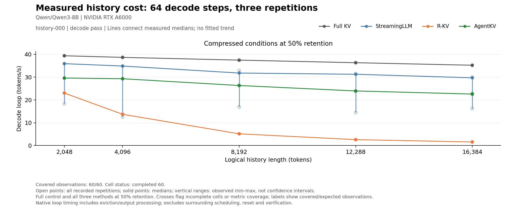
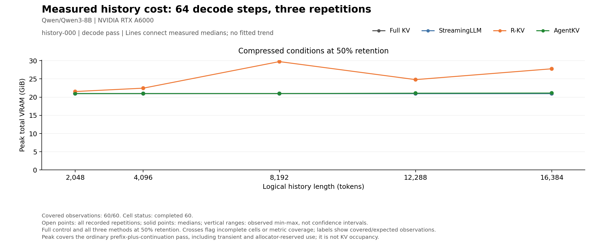

# Legacy results worth carrying forward

These are historical diagnostics, not a frozen final evaluation or the next
experiment plan. Detailed evidence is archived at
[commit 55fca50](https://github.com/looooonk/comet/tree/55fca50bfe3c69dfaa4420585e78850da1b3aaf4/documents/records).
The [compact summary](legacy-results.json) pins retained figures and the later
GPU retention check. Consolidation added no experiments.

## Task success remained too low

| Completed diagnostic | Result | Limit |
| --- | --- | --- |
| Corrected Qwen3-8B control and candidate | Each 0/6 task-seed cells | Each retained one timeout and one context-limit failure |
| Separate Qwen3-14B executable-action pilot | 0/6 task-seed cells | All six completed normally |
| Qwen3-4B-Instruct-2507 targeted pilot | 0/6 task-seed cells | All six completed normally; three tasks, two seeds |
| Earlier Qwen3-14B retention pilot | Full KV 1/8; AgentKV 80/50/25% each 0/8 | Small exploratory study with timeouts and an interruption |

These do not establish a useful success range for the intended comparison or
population-level model inability. Task-seed cells are not independent tasks.
Corrected scoring recognized real mutations. The 4B audit reconstructed all 69
generation prefixes: observations and API documentation were complete, while
authentication, task interpretation and pagination errors remained.
[Corrected 8B/14B scores](https://github.com/looooonk/comet/blob/55fca50bfe3c69dfaa4420585e78850da1b3aaf4/documents/records/appworld-corrected-pilot-scoring-2026-11-08.md),
[4B audit](https://github.com/looooonk/comet/blob/55fca50bfe3c69dfaa4420585e78850da1b3aaf4/documents/records/execution-qwen4b-instruct-2026-11-08-results.md),
[earlier retention study](https://github.com/looooonk/comet/blob/55fca50bfe3c69dfaa4420585e78850da1b3aaf4/documents/records/retention-pilot-2026-10-20.md).

## Fixed-history costs were measurable

Qwen3-8B BF16 on A6000, under a 40 GiB cap, completed **150 cells and 450 passes**
over 2,048/4,096/8,192/12,288/16,384 logical tokens. Each point used three
repetitions and 64 forced decode forwards. These views compare full KV with all
methods at 50% retention.

[SVG](figures/history-timing-2026-11-08/main-decode-throughput.svg) |
[PDF](figures/history-timing-2026-11-08/main-decode-throughput.pdf)

[SVG](figures/history-timing-2026-11-08/main-decode-peak-vram.svg) |
[PDF](figures/history-timing-2026-11-08/main-decode-peak-vram.pdf)

Raw repetitions and min-max ranges remain; lines connect measured medians
without smoothing. R-KV throughput fell from 23.023 to 1.571 tokens/s over this
range, versus full KV's 39.361 to 35.208. Instrumented replays located much of
R-KV's cost in pairwise selection. Native throughput includes eviction and
output processing but excludes surrounding reset, scheduling and verification.
Memory covers the ordinary prefix-plus-continuation pass, including transient
allocation and allocator reservation. R-KV memory was non-monotone; occupied
KV, the reserved pool and total VRAM are distinct.

This is one forced history, with no task tools or evaluator. It establishes
neither task quality nor recovery benefit; ranges are technical repetitions,
not task-bootstrap intervals. Separate 32,600-token feasibility measurements
retained seven completed conditions and three R-KV cap failures.
[Measurement inventory](https://github.com/looooonk/comet/blob/55fca50bfe3c69dfaa4420585e78850da1b3aaf4/documents/records/history-timing-grid-2026-11-08.json),
[capacity failures](https://github.com/looooonk/comet/blob/55fca50bfe3c69dfaa4420585e78850da1b3aaf4/documents/records/history-feasibility-32600-2026-11-08.md).

## Foundation checks and limits

- Retain the [seeded-sampling](https://github.com/looooonk/comet/blob/55fca50bfe3c69dfaa4420585e78850da1b3aaf4/documents/records/sampling-repair-2026-11-07.md)
  and [AppWorld scoring](https://github.com/looooonk/comet/blob/55fca50bfe3c69dfaa4420585e78850da1b3aaf4/documents/records/appworld-scoring-repair-2026-11-08.md)
  repairs. Older defective-sampler or provisional-score results are not corrected
  performance evidence.
- Live [checkpoint branching](https://github.com/looooonk/comet/blob/55fca50bfe3c69dfaa4420585e78850da1b3aaf4/documents/records/checkpoint-branch-validation-2026-11-08.json)
  and [resume](https://github.com/looooonk/comet/blob/55fca50bfe3c69dfaa4420585e78850da1b3aaf4/documents/records/resume-validation-2026-11-08.md)
  checks validated isolated state, preserved completed artifacts, conservative
  interruption charging and recovery without tool replay.
- [First-reset profiling](https://github.com/looooonk/comet/blob/55fca50bfe3c69dfaa4420585e78850da1b3aaf4/documents/records/appworld-reset-cost-2026-11-08.md)
  identified lazy imports/base-database setup. Use the unfrozen monotonic clock;
  do not retroactively subtract setup from historical budgets.
- Structural success does not settle numerical correctness. Native-versus-FP32
  heldout JS exceedances remained on
  [L40](https://github.com/looooonk/comet/blob/55fca50bfe3c69dfaa4420585e78850da1b3aaf4/documents/records/qwen4b-l40-numerical-diagnosis-2026-11-08.md)
  and [L4](https://github.com/looooonk/comet/blob/55fca50bfe3c69dfaa4420585e78850da1b3aaf4/documents/records/qwen4b-l4-validation-2026-11-08.md).
  Those checks granted no task or final-study qualification.

The later A6000 job **13840330 passed all 24 method/retention pairs** at
25/30/40/50/60/70/80/90%. It checked occupancy, checkpoint continuation,
full-history recovery and RNG preservation with 4B BF16 under 40 GiB. Runtime
source `2c93d943` and external fixture `6558d446` remained separate; all five
engine files matched and runtime identities stayed unchanged. All 47 outputs
were hash-verified. The preceding L40 job 13840266 was canceled only while
pending, with zero runtime. This is short-history structural evidence only.
[Source/runtime/fixture and artifact hashes](legacy-results.json) include
`gpu.json` SHA-256
`45160a299273da0e619fda1e1e32a7ea58d1e9fa8666d4e187bbe6a6169324d9`.
