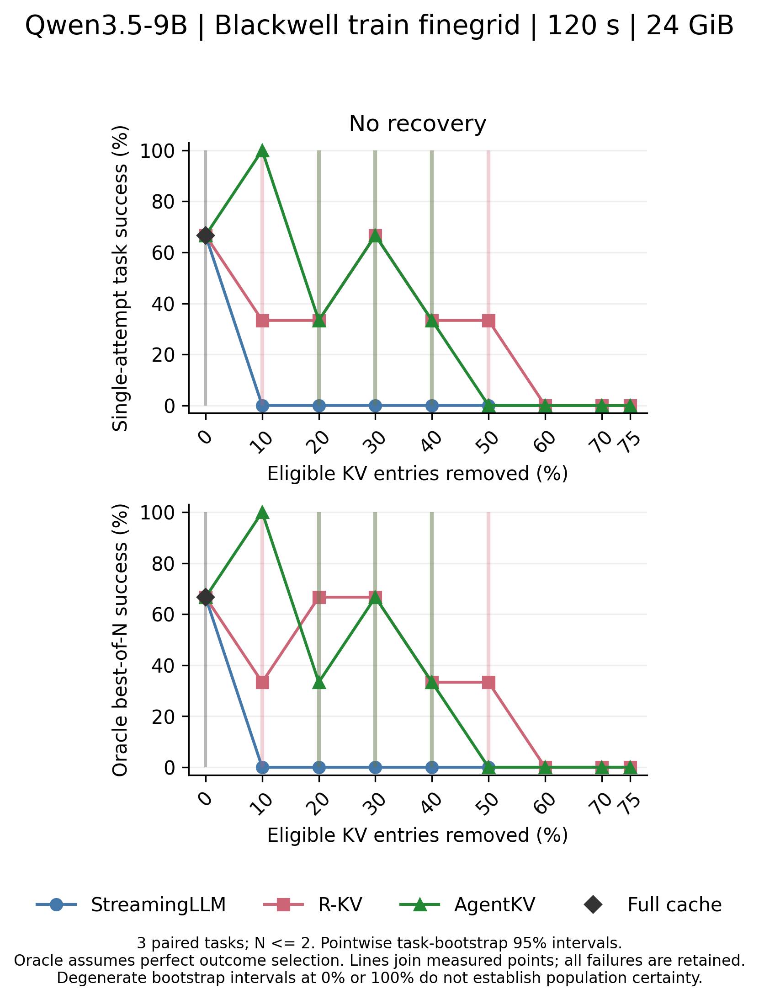
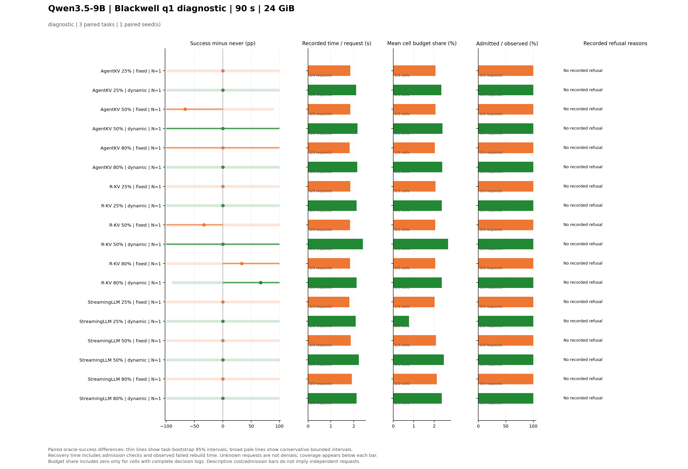

# Qwen3.5-9B: three-family Blackwell comparisons

The supplemental train grid and common-checkpoint diagnostic completed on one
NVIDIA RTX PRO 6000 Blackwell Server Edition with a qualified 24 GiB cap.
They show an intermediate success regime, one best-of-N gain and both benefits
and harms from recovery. These are **three train families and one seed**, not
additional held-out test observations. They remain separate from the
[frozen L4 evaluation](qwen9b-findings.md).

Both runs use source `47596b5`, the pinned 9B model and shared hybrid backend,
16,384-token context, v4 prompt and seed 17. The families are file organization
(`34d9492_1`), arithmetic (`76f2c72_1`) and phone deletion (`771d8fc_1`), selected
before execution. The GPU allocations used four CPUs and 24 GiB host RAM.
Execution, offline scoring and trajectory auditing finished with exit zero;
local scored-run validation confirms complete paired cells and matching saved
execution. No test outcomes selected these families or configurations.

## Fresh-start fine grid

The [configuration](../../configs/qwen9b/train-finegrid-blackwell-v2.json)
uses 120 seconds shared across up to two sequential attempts per task/condition,
with a separate N=1 full-cache control. All **78 cells and 130 attempts** are in
the [summary](qwen9b-train-finegrid-blackwell-summary.json) and
[analysis](qwen9b-train-finegrid-blackwell-analysis.json).

| Retained KV | StreamingLLM | R-KV | AgentKV |
| ---: | ---: | ---: | ---: |
| 90% | 0/3 | 1/3 | 3/3 |
| 80% | 0/3 | 2/3 | 1/3 |
| 70% | 0/3 | 2/3 | 2/3 |
| 60% | 0/3 | 1/3 | 1/3 |
| 50% | 0/3 | 1/3 | 0/3 |
| 40% | 0/3 | 0/3 | 0/3 |
| 30% | 0/3 | 0/3 | 0/3 |
| 25% | 0/3 | 0/3 | 0/3 |

Entries are oracle successes within budget, assuming perfect post-hoc selection.
Full-cache N=1 and N=2 each solve **2/3** tasks. R-KV 80% improves from **1/3
first-attempt success to 2/3 oracle success** because its second attempt solves
another task. Every other compressed setting has identical first/oracle success.
AgentKV therefore has a useful, nonmonotonic transition between the lightly
compressed points and the uniformly unsuccessful 50%-and-lower settings.
Three paired tasks provide little population precision; the 0/3 and 3/3
bootstrap degeneracies must not be read as certainty.

The 130 attempts include 35 completions, 43 timeouts, 44 errors and eight
context-limit stops. Peak total VRAM reaches 23.11 GiB, below the 24 GiB cap.
The largest budget overshoot is 7.69 seconds and belongs to a failed cell.
Two successful cells also overshoot during later unsuccessful attempts/cleanup;
their successful first attempts finish at 93.49 and 102.07 seconds, within the
120-second budget. No late success or replacement budget is credited.

## Q1: recovery from identical saved state

The [diagnostic configuration](../../configs/qwen9b/q1-diagnostic-blackwell-v2.json)
branches all policies from the same full-cache state after two tools in each
family. The 90-second branch budget includes source preparation and restore;
N=1 and one rebuild maximum apply. Source preparation costs 5.31, 6.06 and
6.85 seconds for the file, arithmetic and phone families respectively. All
**84 branches** are preserved in the
[summary](qwen9b-q1-diagnostic-blackwell-summary.json) and
[analysis](qwen9b-q1-diagnostic-blackwell-analysis.json).

| Method | Retained KV | Never | Fixed | Dynamic |
| --- | ---: | ---: | ---: | ---: |
| StreamingLLM | 80% | 0/3 | 0/3 | 0/3 |
| StreamingLLM | 50% | 0/3 | 0/3 | 0/3 |
| StreamingLLM | 25% | 0/3 | 0/3 | 0/3 |
| R-KV | 80% | 1/3 | 2/3 | **3/3** |
| R-KV | 50% | 1/3 | 0/3 | 1/3 |
| R-KV | 25% | 0/3 | 0/3 | 0/3 |
| AgentKV | 80% | 2/3 | 2/3 | 2/3 |
| AgentKV | 50% | 2/3 | 0/3 | 2/3 |
| AgentKV | 25% | 0/3 | 0/3 | 0/3 |

The full-cache reference succeeds on 2/3 families. R-KV 80% dynamic recovery
improves by **66.7 percentage points** versus never (paired task-bootstrap 95%
interval [0, 100] points) and by 33.3 points versus fixed ([0, 100]). Conversely,
AgentKV 50% fixed recovery loses 66.7 points versus never ([-100, 0]).
Conservative bounded intervals include zero throughout. These observations
support a conditional benefit from recovery, with insufficient evidence to
recommend one trigger universally. Unlike the one-family L4 diagnostic, no
25% condition succeeds in this cohort.

All **52 requested rebuilds are admitted**: 27 fixed and 25 dynamic. Fixed
recovery costs 1.61-2.04 seconds; dynamic costs 2.04-3.06 seconds. The two
missing dynamic requests are StreamingLLM 25% branches that stop before the
trigger. The 84 attempts contain 42 completions, 20 timeouts, 18 errors and
four context-limit stops; completed does not itself mean correct. No observed
peak exceeds 24 GiB. The maximum 10.48-second budget overshoot is a timeout
whose trajectory-saving calls consume 32.74 seconds cumulatively. Other large
overshoots also fail. Shared-storage timing is part of this measured cohort,
not evidence of a model-quality or GPU-throughput effect.

## Artifacts and limits

The fresh-start run is `comet-run:d4dcbbba-3768-45fa-b490-1d6219eb6efa`; the
checkpoint diagnostic is `comet-run:65d3bf00-8c5d-4bf8-b3d9-8e1466743bf9`.
Both complete output directories, including diagnostic checkpoints, were
retrieved. The [fine-grid export inventory](qwen9b-train-finegrid-blackwell-figures.json)
contains 12 PNG/SVG/PDF files covering aggressivity, resources, attempts and
success versus time. The [diagnostic export inventory](qwen9b-q1-diagnostic-blackwell-figures.json)
contains 15 exports covering recovery, triggers and resources under each policy.
Resource panels distinguish occupied attention KV from total VRAM; estimated
FLOPs omit recurrent updates, eviction and elementwise operations.

Different budgets, starting states, hardware, caps and storage costs separate
these cohorts from each other and from L4. Do not pool them or interpret their
differences as a controlled hardware comparison. The optional held-out
Blackwell replication is separately gated by dev confirmation and the recorded
launch deadline; this document does not count it as completed evidence.
