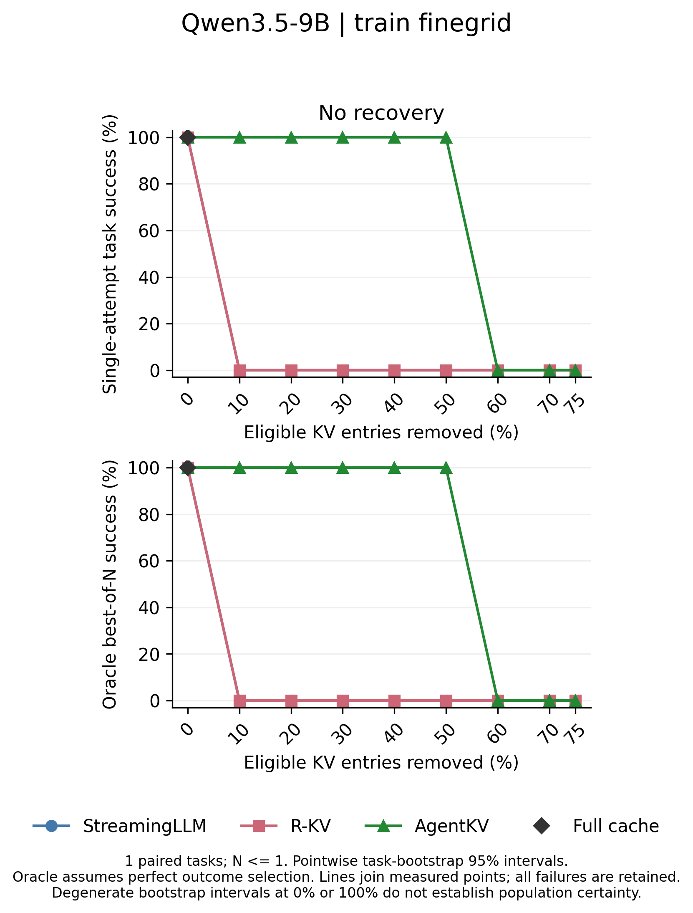

# Qwen3.5-9B: verified findings, November 9

**Interim result:** the shared hybrid backend supports the required methods at
16,384 tokens on one L4 under a 21 GiB cap, and the corrected full-cache agent
solves 3/4 declared train tasks. The train grid now shows an AgentKV transition
between 50% and 40% retention on one arithmetic fixture. The common-checkpoint
diagnostic shows selective recovery benefits. Final test evaluation is running;
queued or running experiments are not counted as completed evidence.

## Capability and cost

The v4 pilot uses one attempt per task, seed 17, a 300-second task budget and
the same four train families declared before execution. Evaluation runs after
execution. The [saved results](qwen9b-protocol-v4.json) contain every outcome:

| Task | Outcome | Time (s) | Tools | Raw tokens |
| --- | --- | ---: | ---: | ---: |
| File organization, `34d9492_1` | Correct | 124.1 | 16 | 11,699 |
| Arithmetic, `76f2c72_1` | Correct | 57.3 | 11 | 8,837 |
| Phone deletion, `771d8fc_1` | Correct | 51.6 | 11 | 10,089 |
| Spotify reviews, `692c77d_1` | API-error stop | 112.8 | 16 | 11,950 |

The 75% success estimate has a task-bootstrap 95% interval of 25-100%; four
families and one seed provide weak population precision. The remaining failure
confuses review IDs with song IDs and repeats authorization/duplicate-review
errors. No task reached the context or memory limit. Aggregate decoding
throughput is 13.34 tokens/s, computed as total decoded tokens divided by total
decode time. Mean task latency is 86.4 seconds, including the failed task.

Earlier pilot versions scored 0/4 and 1/4 and remain in the
[execution record](qwen9b-study-2026-11-09.md). Prompt, context and backend changes
separate those versions from v4; their difference is not a controlled estimate
of any individual change. General API examples use observed credentials and
never supply task answers.

## What the memory saving means


The [capacity record](qwen9b-l4-context-16384.json) measures the same 16,384-token
synthetic history for each method. At 25% retention, stored full-attention KV
falls from 512 MiB to 128 MiB. Recurrent/convolution state remains 49.5 MiB.
These are different quantities from the approximately 20 GiB total GPU peak,
which also includes weights, allocator reservations and other runtime memory.

Full-history recovery temporarily rebuilds all 512 MiB of attention KV, then
reapplies retention. It takes 21.6 seconds for StreamingLLM, 22.8 for R-KV and
21.6 for AgentKV. The sampled peak including recovery is 20.05 GiB for all three,
below the unchanged 21 GiB cap. A 75% reduction in retained KV therefore does
not imply a 75% reduction in total peak GPU memory. Recovering at this history
length consumes about 18-19% of a 120-second task budget; actual task costs
depend on history length at the trigger.

These are single synthetic observations, not task-quality measurements or a
throughput benchmark. Total VRAM is sampled every 10 ms and at forward
boundaries; shorter external-memory transients can be missed. FLOPs elsewhere
in the analysis are estimates and omit recurrent updates, eviction, elementwise
operations and vision. The bounded R-KV workspace passed five live numerical
checks; the managed local suite passed 339 tests, with GPU checks run separately.

## Completed L4 train/dev results

The [pilot summary](qwen9b-pilot-summary.json) covers all 109 cells and 125
attempts across six completed runs. No observed device peak exceeded 21 GiB.
Measured task-budget overshoot was at most 2.56 seconds, from noninterruptible
work and cleanup; most runs stayed within 0.06 seconds. Failures remain in the
success denominators and did not receive replacement attempts.

The single-task, no-recovery [fine grid](qwen9b-train-finegrid-analysis.json)
solved the arithmetic task with full cache and AgentKV at 90/80/70/60/50%
retention. AgentKV failed at 40/30/25%; StreamingLLM and R-KV failed at every
measured compressed point. This identifies a transition on this fixture, with
insufficient task coverage for a population claim. With N=1, single-attempt
and oracle success are identical.

Representative saved traces distinguish several failure modes. StreamingLLM
at 90% retention guessed nonexistent directory APIs and stopped after four
errors. AgentKV at 40% similarly guessed documentation APIs before progressing.
R-KV at 90% reached task completion but summed electricity bills without the
requested year filter, producing an incorrect answer. These examples support
API-guidance and task-constraint loss as hypotheses; they do not isolate the
causal contribution of any particular evicted token. Evaluator feedback was
used only for this post-hoc analysis.



The independently executed [budget sweep](qwen9b-independent-budgets.json)
solved 1/2 train tasks with full cache at both 90 and 120 seconds and 2/2 at
150 seconds. Every 25%-retention arm scored 0/2 at all three budgets, including
AgentKV fixed/dynamic recovery. Full-cache N=2 added no oracle success over
its first attempt on this sample. In the separate two-family
[dev confirmation](qwen9b-dev-confirmation-analysis.json), however, a second
full-cache attempt solved one task: oracle success was 1/2 versus 0/2 first
attempts. All compressed 25% dev arms failed. These are small, paired results
with wide uncertainty, not evidence that a second attempt generally helps.

## Q1: recovery from a common checkpoint

The [28-arm diagnostic](qwen9b-q1-diagnostic-analysis.json) restores the same
saved full-cache arithmetic state after two tools. Each branch receives a
90-second budget including preparation/restore and at most one rebuild.
The saved source contains 4,146 processed tokens and zero prior rebuilds;
its measured 9.11-second preparation cost is charged to every branch.
The full-cache reference succeeds. The table reports each branch's evaluated
outcome; rows are settings on one task, not independent task samples.

| Method | Retained KV | Never | Fixed | Dynamic |
| --- | ---: | --- | --- | --- |
| StreamingLLM | 80% | Fail | Fail | Fail |
| StreamingLLM | 50% | Fail | Fail | Fail |
| StreamingLLM | 25% | Fail | Fail | Fail |
| R-KV | 80% | Fail | Fail | Fail |
| R-KV | 50% | Pass | Pass | Fail |
| R-KV | 25% | Fail | Fail | Pass |
| AgentKV | 80% | Pass | Fail | Pass |
| AgentKV | 50% | Fail | Pass | Fail |
| AgentKV | 25% | Fail | Fail | Pass |

Dynamic recovery changes failure to success at 25% for R-KV and AgentKV;
fixed recovery helps AgentKV at 50%. Recovery also harms two previously
successful settings. Each binary change is 100 percentage points on this
single fixture. Task-bootstrap intervals are degenerate with one task;
conservative bounded intervals span the full difference range, so these
observations do not establish population effects.

All 17 requested rebuilds were admitted; no memory refusal occurred. Fixed
rebuilds took 4.7-5.2 seconds and dynamic rebuilds 6.2-7.7 seconds. The
StreamingLLM 25% dynamic branch stopped before its trigger. Separate
[live AppWorld checks](qwen9b-l4-appworld-recovery.json) passed for all three
methods, preserving tool effects, RNG state and independent environment restore.
This diagnostic starts after two full-cache tools; its success cannot be
substituted for fresh-start final evaluation.

## Final evaluation and additional coverage

The [frozen L4 study](../../configs/qwen9b/final-l4-v1.json) started on November 9
at approximately 07:18 ET after the declared train/dev gates passed. It uses
two predeclared test families, one seed, 120 seconds, N=2, all 29 core conditions
plus five intermediate AgentKV points. Unmeasured intermediate competitor test
points must not be implied. No test outcome may select a task or change settings.

After access was restored and the user extended the stop time to 14:00 ET, a
separate three-task Blackwell train grid was declared and submitted. It retains
the full eight-level grid for every method and includes single/oracle views.
It must pass fresh hardware qualification and will be analyzed separately from
L4. Final results and resource cleanup remain pending.

## Reproduction and exports

Model, dependency and source revisions are recorded in the linked JSON files.
The backend revision for the v4/16K evidence is `0d438bf`; the v4 run identifier
is `comet-run:1fb4b489-1af3-42f1-b754-f998fb6b3aa1`. Large trajectories remain
outside tracked source. The [figure inventory](qwen9b-qualification-figures.json)
records portable source/export paths and hashes.

After activating the managed CPU profile, regenerate the capacity figure with:

```bash
python scripts/plot_hybrid_qualification.py \
  documents/records/qwen9b-l4-context-16384.json \
  --output documents/figures/qwen9b/qualification-16k
```

Exports: [PNG](../figures/qwen9b/qualification-16k.png),
[SVG](../figures/qwen9b/qualification-16k.svg),
[PDF](../figures/qwen9b/qualification-16k.pdf).
