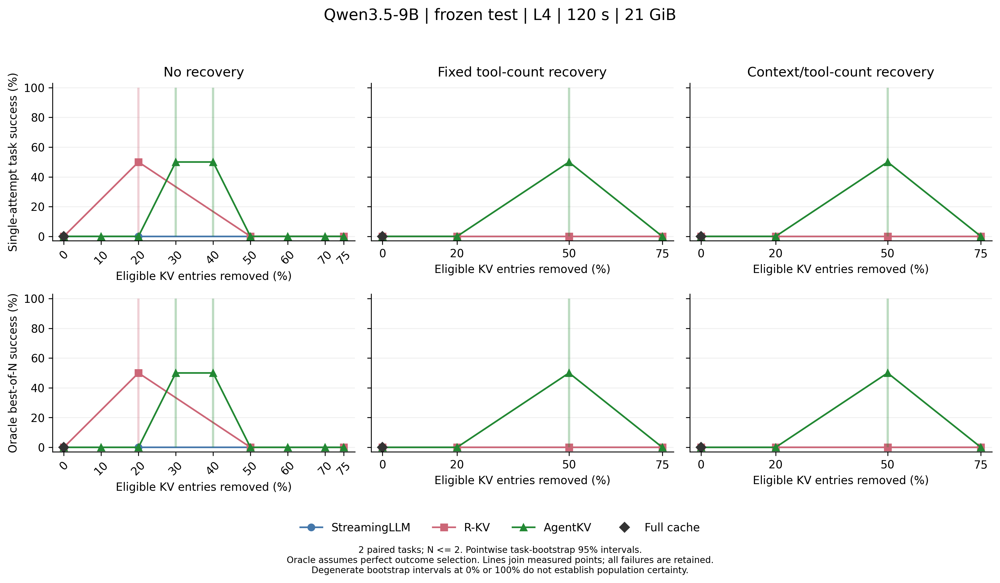
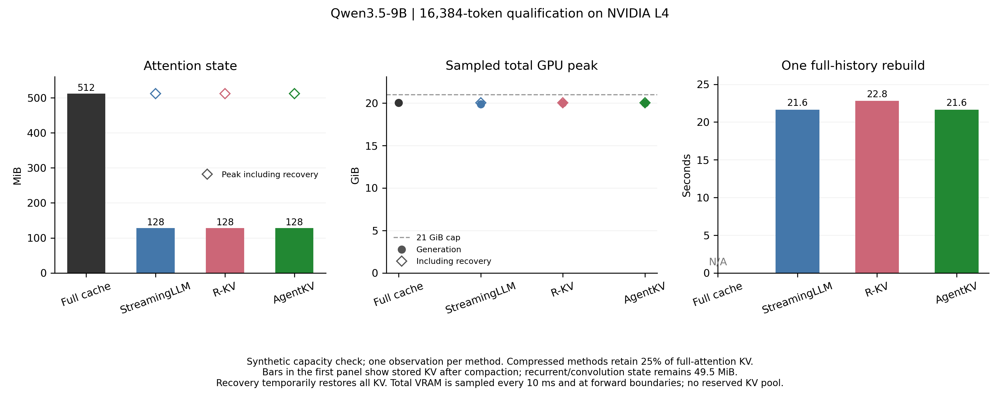

# Qwen3.5-9B: verified findings, November 9

**Frozen test result:** recovering history at 50% AgentKV retention solved one
of two test tasks, versus zero without recovery or with full cache, under the
same 120-second budget and 21 GiB cap. Recovery also removed the only R-KV
success at 80% retention. Additional attempts added no test success, and dynamic
recovery did not outperform the fixed trigger. These are selective effects on
two families and one seed, not evidence of a general recovery advantage.

The shared Qwen3.5-9B hybrid backend supports all three required methods at
16,384 tokens. The completed study includes capability checks, independent
runtime budgets, a train aggressivity grid, a common-checkpoint diagnostic,
separate dev confirmation and fresh-start frozen test evaluation. The completed
[three-family Blackwell comparisons](qwen9b-blackwell-findings.md) add a fuller
train grid and checkpoint diagnostic, analyzed separately below.

## Q2: frozen fresh-start evaluation



The [frozen configuration](../../configs/qwen9b/final-l4-v1.json) covers two
predeclared test families, seed 17, 34 conditions and **68 task/condition cells**.
Each cell has one shared 120-second budget, a 21 GiB peak total-VRAM cap and at
most two sequential attempts; the single-attempt full-cache control has N=1.
All attempts start from the initial task environment. Scoring occurred only
after execution finished. The [summary](qwen9b-final-summary.json) and
[complete analysis](qwen9b-final-analysis.json) retain all outcomes and paired
comparisons.

| Method | Retained KV | Never | Fixed | Dynamic |
| --- | ---: | ---: | ---: | ---: |
| StreamingLLM | 80% | 0/2 | 0/2 | 0/2 |
| StreamingLLM | 50% | 0/2 | 0/2 | 0/2 |
| StreamingLLM | 25% | 0/2 | 0/2 | 0/2 |
| R-KV | 80% | **1/2** | 0/2 | 0/2 |
| R-KV | 50% | 0/2 | 0/2 | 0/2 |
| R-KV | 25% | 0/2 | 0/2 | 0/2 |
| AgentKV | 80% | 0/2 | 0/2 | 0/2 |
| AgentKV | 50% | 0/2 | **1/2** | **1/2** |
| AgentKV | 25% | 0/2 | 0/2 | 0/2 |

Entries are oracle success counts within budget: an upper bound assuming
perfect outcome selection, not an online selection policy. Full-cache N=1 and
N=2 both score **0/2**. Every successful condition solves its task on the first
attempt, so first-attempt and oracle curves coincide here. The five supplemental
AgentKV no-recovery points score 1/2 at 70% and 60%, and 0/2 at 90%, 40% and 30%.
Together with the required anchors, this is a measured, nonmonotonic curve;
unmeasured competitor points are not interpolated into evidence.

AgentKV 50% recovery improves success by **50 percentage points** against both
never-rebuild and full-cache best-of-N. Its paired task-bootstrap 95% interval
is **[0, 100] points**; the conservative bounded interval is **[-100, 100]**.
R-KV 80% recovery instead changes success by -50 points versus never-rebuild
(bootstrap [-100, 0], bounded [-100, 100]). All five successful condition/task
cells concern the same playlist-update family; the second family is never
solved. The two tasks and one seed cannot establish a reliable population
ranking, a monotonic optimum or a dynamic-trigger advantage. No settings or
task selections changed after the freeze.

### What recovery changed in the saved trajectories

In the [post-hoc case study](qwen9b-final-case-study.json), full cache completes
the playlist task but assigns incorrect genre labels. AgentKV 50% without
recovery repeats failed logins and stops. Fixed recovery follows its first
failed login, at four tool calls and 7,671 raw tokens; the rebuild takes 7.80
seconds. Dynamic recovery happens before the first login, at three calls and
7,427 tokens, costing 7.62 seconds. Both continuations then retrieve the profile,
log in successfully and pass all six evaluator checks, finishing their first
attempts in 91.43 and 71.12 seconds respectively. This supports an
authentication-context explanation without identifying particular causal tokens.
It does not establish that the earlier trigger is generally better.

### Attempts, limits and costs

All **101 attempts** remain in the analysis: nine completed (five correct),
60 timed out, 21 stopped on errors and 11 reached the context limit. All 30
requested rebuilds were admitted, with observed costs of 3.58-8.35 seconds;
there were no memory refusals. AgentKV 25% attempts stop after only one or two
tool calls, so neither recovery trigger is reached. Peak total VRAM is recorded
for every attempt and reaches at most **20.05 GiB**, below the 21 GiB cap.
The maximum recorded budget overshoot is 0.77 seconds from in-flight work and
cleanup; no failed attempt receives a replacement budget.

AgentKV 50% recovery fits three attempts across the two tasks, versus four for
both never-rebuild and full-cache best-of-N. Its success therefore does not come
from more attempts. Mean per-cell peak occupied KV is 412 MiB for full-cache
best-of-N and 227 MiB for AgentKV 50% dynamic recovery, while mean total peaks
are approximately 20.04 and 20.01 GiB. Task histories and stopping times differ,
so this comparison is not an isolated memory experiment; the matched-history
capacity check below supplies that measurement. R-KV 80% without recovery spends
51.4 seconds per cell on compaction, illustrating a substantial implementation
cost that the FLOPs estimate does not include.

The supporting exports cover [resources without recovery](../figures/qwen9b/final-resources.pdf),
[fixed](../figures/qwen9b/final-resources-fixed.pdf) and
[dynamic](../figures/qwen9b/final-resources-dynamic.pdf) recovery, plus
[recovery effects/costs](../figures/qwen9b/final-recovery.pdf),
[trigger inputs](../figures/qwen9b/final-triggers.pdf),
[attempt counts](../figures/qwen9b/final-attempts.pdf) and
[success versus time](../figures/qwen9b/final-success-time.pdf).

## Capability and cost

The v4 pilot uses one attempt per task, seed 17, a 300-second task budget and
the same four train families declared before execution. Evaluation runs after
execution. The [saved results](qwen9b-protocol-v4.json) contain every outcome:

| Task | Outcome | Time (s) | Tools | Raw tokens |
| --- | --- | ---: | ---: | ---: |
| File organization, `34d9492_1` | Correct | 124.1 | 16 | 11,699 |
| Arithmetic, `76f2c72_1` | Correct | 57.3 | 11 | 8,837 |
| Phone deletion, `771d8fc_1` | Correct | 51.6 | 11 | 10,089 |
| Spotify reviews, `692c77d_1` | API-error stop | 112.8 | 16 | 11,950 |

The 75% success estimate has a task-bootstrap 95% interval of 25-100%; four
families and one seed provide weak population precision. The remaining failure
confuses review IDs with song IDs and repeats authorization/duplicate-review
errors. No task reached the context or memory limit. Aggregate decoding
throughput is 13.34 tokens/s, computed as total decoded tokens divided by total
decode time. Mean task latency is 86.4 seconds, including the failed task.

Earlier pilot versions scored 0/4 and 1/4 and remain in the
[execution record](qwen9b-study-2026-11-09.md). Prompt, context and backend changes
separate those versions from v4; their difference is not a controlled estimate
of any individual change. General API examples use observed credentials and
never supply task answers.

## What the memory saving means



The [capacity record](qwen9b-l4-context-16384.json) measures the same 16,384-token
synthetic history for each method. At 25% retention, stored full-attention KV
falls from 512 MiB to 128 MiB. Recurrent/convolution state remains 49.5 MiB.
These are different quantities from the approximately 20 GiB total GPU peak,
which also includes weights, allocator reservations and other runtime memory.

Full-history recovery temporarily rebuilds all 512 MiB of attention KV, then
reapplies retention. It takes 21.6 seconds for StreamingLLM, 22.8 for R-KV and
21.6 for AgentKV. The sampled peak including recovery is 20.05 GiB for all three,
below the unchanged 21 GiB cap. A 75% reduction in retained KV therefore does
not imply a 75% reduction in total peak GPU memory. Recovering at this history
length consumes about 18-19% of a 120-second task budget; actual task costs
depend on history length at the trigger.

These are single synthetic observations, not task-quality measurements or a
throughput benchmark. Total VRAM is sampled every 10 ms and at forward
boundaries; shorter external-memory transients can be missed. FLOPs elsewhere
in the analysis are estimates and omit recurrent updates, eviction, elementwise
operations and vision. The bounded R-KV workspace passed five live numerical
checks; the managed local suite passed 339 tests, with GPU checks run separately.

## Completed L4 train/dev results

The [pilot summary](qwen9b-pilot-summary.json) covers all 109 cells and 125
attempts across six completed runs. No observed device peak exceeded 21 GiB.
Measured task-budget overshoot was at most 2.56 seconds, from noninterruptible
work and cleanup; most runs stayed within 0.06 seconds. Failures remain in the
success denominators and did not receive replacement attempts.

The single-task, no-recovery [fine grid](qwen9b-train-finegrid-analysis.json)
solved the arithmetic task with full cache and AgentKV at 90/80/70/60/50%
retention. AgentKV failed at 40/30/25%; StreamingLLM and R-KV failed at every
measured compressed point. This identifies a transition on this fixture, with
insufficient task coverage for a population claim. With N=1, single-attempt
and oracle success are identical.

Representative saved traces distinguish several failure modes. StreamingLLM
at 90% retention guessed nonexistent directory APIs and stopped after four
errors. AgentKV at 40% similarly guessed documentation APIs before progressing.
R-KV at 90% reached task completion but summed electricity bills without the
requested year filter, producing an incorrect answer. These examples support
API-guidance and task-constraint loss as hypotheses; they do not isolate the
causal contribution of any particular evicted token. Evaluator feedback was
used only for this post-hoc analysis.


The independently executed [budget sweep](qwen9b-independent-budgets.json)
solved 1/2 train tasks with full cache at both 90 and 120 seconds and 2/2 at
150 seconds. Every 25%-retention arm scored 0/2 at all three budgets, including
AgentKV fixed/dynamic recovery. Full-cache N=2 added no oracle success over
its first attempt on this sample. In the separate two-family
[dev confirmation](qwen9b-dev-confirmation-analysis.json), however, a second
full-cache attempt solved one task: oracle success was 1/2 versus 0/2 first
attempts. All compressed 25% dev arms failed. These are small, paired results
with wide uncertainty, not evidence that a second attempt generally helps.

## Q1: L4 recovery from a common checkpoint

The [28-arm diagnostic](qwen9b-q1-diagnostic-analysis.json) restores the same
saved full-cache arithmetic state after two tools. Each branch receives a
90-second budget including preparation/restore and at most one rebuild.
The saved source contains 4,146 processed tokens and zero prior rebuilds;
its measured 9.11-second preparation cost is charged to every branch.
The full-cache reference succeeds. The table reports each branch's evaluated
outcome; rows are settings on one task, not independent task samples.

| Method | Retained KV | Never | Fixed | Dynamic |
| --- | ---: | --- | --- | --- |
| StreamingLLM | 80% | Fail | Fail | Fail |
| StreamingLLM | 50% | Fail | Fail | Fail |
| StreamingLLM | 25% | Fail | Fail | Fail |
| R-KV | 80% | Fail | Fail | Fail |
| R-KV | 50% | Pass | Pass | Fail |
| R-KV | 25% | Fail | Fail | Pass |
| AgentKV | 80% | Pass | Fail | Pass |
| AgentKV | 50% | Fail | Pass | Fail |
| AgentKV | 25% | Fail | Fail | Pass |

Dynamic recovery changes failure to success at 25% for R-KV and AgentKV;
fixed recovery helps AgentKV at 50%. Recovery also harms two previously
successful settings. Each binary change is 100 percentage points on this
single fixture. Task-bootstrap intervals are degenerate with one task;
conservative bounded intervals span the full difference range, so these
observations do not establish population effects.

All 17 requested rebuilds were admitted; no memory refusal occurred. Fixed
rebuilds took 4.7-5.2 seconds and dynamic rebuilds 6.2-7.7 seconds. The
StreamingLLM 25% dynamic branch stopped before its trigger. Separate
[live AppWorld checks](qwen9b-l4-appworld-recovery.json) passed for all three
methods, preserving tool effects, RNG state and independent environment restore.
This diagnostic starts after two full-cache tools; its success cannot be
substituted for fresh-start final evaluation.

## Additional hardware coverage

The completed [Blackwell study](qwen9b-blackwell-findings.md) adds 78 fresh-start
train cells and 84 common-checkpoint branches across three declared families,
using a separately qualified 24 GiB cap. AgentKV no-recovery success varies from
3/3 at 90% retention to 0/3 at 50% and below. R-KV 80% gains one task from its
second attempt. In Q1, R-KV 80% dynamic recovery raises success from 1/3 to 3/3,
while AgentKV 50% fixed recovery lowers it from 2/3 to 0/3. All 52 requested
rebuilds are admitted. Wide paired uncertainty and differences from L4 reinforce
the conditional nature of these effects. These are train observations, not
additional test samples or a controlled hardware comparison.

The additional Blackwell dev check passed, but the optional held-out replication
[was not executed](qwen9b-final-blackwell-status.json): queue estimates exceeded
the available completion window. Its frozen configurations are preserved as
prepared protocols, not measured test evidence. All owned compute jobs have
ended; the [resource handoff](qwen9b-resource-handoff.json) records retrieved
artifacts and the retained cloud backup.

## Reproduction and exports

Model, dependency and source revisions are recorded in the linked JSON files.
The backend revision for the v4/16K evidence is `0d438bf`; the v4 run identifier
is `comet-run:1fb4b489-1af3-42f1-b754-f998fb6b3aa1`. Large trajectories remain
outside tracked source. The [figure inventory](qwen9b-qualification-figures.json)
records portable source/export paths and hashes.

Frozen test run `comet-run:b4c4ade9-2ab1-4c76-8863-6cc727920d8b` executed source
`cc9057a`. Its [export inventory](qwen9b-final-figures.json) identifies all 24
PNG/SVG/PDF files, the frozen configuration and analysis. The central plot is
available as [PNG](../figures/qwen9b/final-aggressivity.png),
[SVG](../figures/qwen9b/final-aggressivity.svg) and
[PDF](../figures/qwen9b/final-aggressivity.pdf). The completed per-plan archive
was retrieved and verified independently of the later cloud-wide upload timeout;
that infrastructure failure did not interrupt execution or scoring.

After activating the managed CPU profile, regenerate the central test plot with:

```bash
comet plot-aggressivity documents/records/qwen9b-final-analysis.json \
  --output documents/figures/qwen9b/final-aggressivity \
  --title 'Qwen3.5-9B | frozen test | L4 | 120 s | 21 GiB'
```

The same analysis feeds `plot-resources`, `plot-recovery`, `plot-triggers`,
`plot-attempts` and `plot-success-time`. Regenerate the capacity figure with:

```bash
python scripts/plot_hybrid_qualification.py \
  documents/records/qwen9b-l4-context-16384.json \
  --output documents/figures/qwen9b/qualification-16k
```

Exports: [PNG](../figures/qwen9b/qualification-16k.png),
[SVG](../figures/qwen9b/qualification-16k.svg),
[PDF](../figures/qwen9b/qualification-16k.pdf).
