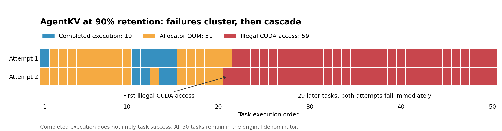

# AgentKV 90% failure investigation

The November 10 investigation establishes that the original **2/50 (4%)**
AgentKV result at 90% retention is contaminated by execution bugs. It cannot
be interpreted as a clean accuracy effect of retaining more KV. The original
measurement and all failures remain in the [final study](test50-final.md).
No success estimate is computed by discarding failed tasks.

## What failed

[Vector PDF](figures/agentkv90-failure-timeline.pdf). Task order is the original
execution order; blue means execution completed, not necessarily task success.

The original partition executed StreamingLLM 90%, R-KV 90%, then AgentKV 90%
in the same process. AgentKV's 100 attempts comprise ten completed executions,
31 allocator OOMs and 59 CUDA illegal-memory-access errors. Completed execution
is distinct from successful offline evaluation.

The first illegal access occurred on task `fd1f8fa_3`, the 21st task, during
its second attempt after 140 generated tokens. The following **58 attempts on
29 tasks** failed almost immediately without generating tokens. The runner
continued using a poisoned CUDA context. NVIDIA documents that an illegal
address leaves the process inconsistent and requires a restart:
[CUDA error definitions](https://docs.nvidia.com/cuda/archive/12.6.0/cuda-driver-api/group__CUDA__TYPES.html).
These are one initial CUDA fault followed by a cascade, not 59 independent
accuracy failures. The originating kernel is not identified by the saved logs.

All 59 OOM attempts in the original grid belong to R-KV 90% (28) and AgentKV
90% (31). They hit the experimental allocator allowance, not physical GPU
exhaustion: the first AgentKV OOM reports 71.96 GiB physically free, a 22.46 GiB
PyTorch allowance, and a failed 112 MiB allocation. The allowance reserves
external-runtime memory and 1 GiB headroom within the unchanged 24 GiB total
cap. [PyTorch documents this allocator limit](https://docs.pytorch.org/docs/main/generated/torch.cuda.memory.set_per_process_memory_fraction.html).
Increasing the allowance would change the comparison and is not this repair.

A second confirmed runner bug stores exception objects in the inference and
recovery loop. Each exception retains its traceback, including failed-operation
local tensors, until cyclic garbage collection. A regression test reproduces
retained objects with collection disabled for both operations; saving only the
exception text releases them immediately. This can amplify memory pressure
across attempts. The exact fraction of the historical 59 OOMs caused by it is
not established; fragmentation and transient working memory remain possible.

## Repairs and evidence

- `22f97ea`: stop after fatal CUDA errors, preserve the failed cell and its
  original budget reservation, and leave later cells unstarted. A compatible
  fresh-process resume continues only unstarted work. Ordinary allocator OOM
  handling remains separate.
- `49740e2`: store failure text instead of exception objects, releasing failed
  inference/recovery frames without waiting for cyclic garbage collection.
- `d97c49d`: save inference/recovery stack traces as text for any recurrence;
  45 pipeline checks pass, including preserved trace text and released frames.
- CPU checks: 363 passed, two optional Torch modules skipped, 17 live checks
  deselected. Tests cover fatal failures during generation, synchronization
  and memory measurement, preserved journals on resume, normal OOM handling,
  and object release for inference and recovery. Both object-release cases
  fail before the second repair and pass afterward.

Array `13857295` ran four fresh-process fixed-history checks on the original
engine: AgentKV 90%, AgentKV 80%, R-KV 90%, and full KV. Each completed two
16K-context prefill/decode passes without OOM or CUDA errors. Array `13857321`
replayed the saved first-OOM and first-CUDA histories at AgentKV 90% and 80%,
twice each; all eight passes also completed. The latter uses approximate
forward boundaries reconstructed from compaction events, extends the saved
pending input, and never replays tools or evaluates task success. It is not
bitwise reproduction of the interrupted execution.

All diagnostics use the pinned Qwen3.5-9B hybrid BF16 engine, RTX PRO 6000
Blackwell Server Edition, original 24 GiB total cap, and synchronous CUDA
launches to expose error locations. They explicitly clear state and collect
garbage between passes. Consequently, these passes establish fresh-process
feasibility but do not reproduce the original long-lived process, asynchronous
launch timing, or AppWorld workload. The first illegal access has not recurred. The approximate first-OOM history
replay peaks at 18.92 GiB allocated, compared with 21.86 GiB recorded for the
original failed attempt. This supports accumulated memory pressure as a
contributor without identifying the cause of every OOM.
Initial diagnostic array `13857261` failed before inference because its helper
passed an unsupported settings field; the replacement uses a separate version.

## Corrective replication decision

The user authorized additional Insomnia experiments to investigate the anomaly.
The new comparison repeats **all 50 original tasks** for AgentKV 90% and 80%,
R-KV 90% and 80%, and full-cache N=2. Every condition uses repaired runner code,
the same model/runtime/device, BF16, seed 17, prompt, sampling, 16K context,
24 GiB cap and 120-second shared two-attempt budget. Each condition receives a
separate process and GPU. This removes condition-order carryover uniformly.

A [two-task dev gate](../../../configs/qwen9b/blackwell/cuda-repair-dev-v1.json)
uses the two previously declared dev families for all five conditions. It must
finish without OOM, CUDA errors or infeasibility before freezing and launching
the [proposed replication](../../../configs/qwen9b/blackwell/test50-cuda-repair-proposed-v1.json).
Ordinary task errors and timeouts remain observations. No method, retention,
prompt or budget is selected using the new success scores.

This is a separate corrective replication on previously inspected held-out
tasks, not a fresh test set. It does not replace failed original attempts,
pool cohorts, or rewrite the original curve. All new failures remain in their
own denominators. Bootstrap paired tasks, report first-attempt and oracle
success, and compare AgentKV 90% with 80% within the repaired cohort. Historical
before/after comparisons also include run-time variation and should not be
attributed entirely to either code change.

Compact audit and launch evidence are in [the investigation record](agentkv90-investigation.json).
Raw trajectories, diagnostic reports and source snapshots remain in external
project storage under their recorded portable artifact IDs.
