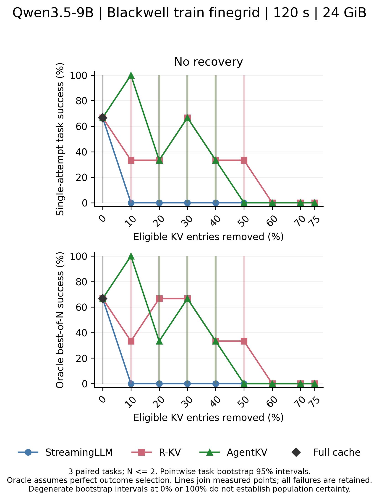
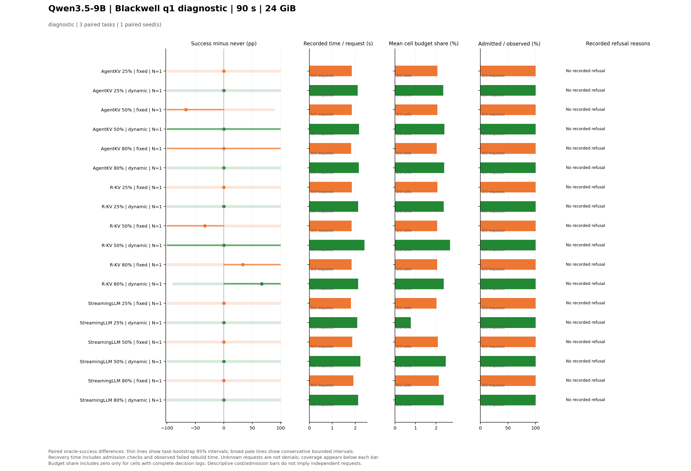

# Qwen3.5-9B: Blackwell findings

The later [fifty-task held-out study](test50-final.md) completed all 26 conditions
on November 10, 2026. Its results are separate from the small train/dev and
recovery observations below.

The supplemental study covers three predeclared train families and one seed
on one RTX PRO 6000 Blackwell Server Edition at a separately qualified 24 GiB
cap. It shows intermediate success, one best-of-N gain and both benefits and
harms from recovery. These are not additional held-out test observations and
must remain separate from the [L4 study](findings.md).

Both main runs use source `47596b5`, the pinned 9B model/backend, 16,384-token
context, v4 prompt and seed 17. The families are file organization (`34d9492_1`),
arithmetic (`76f2c72_1`) and phone deletion (`771d8fc_1`). The allocations used
four CPUs and 24 GiB host RAM. Execution, offline scoring and trajectory auditing
finished successfully; saved execution and scored cells were verified locally.

## Fresh-start fine grid

The [configuration](../../../configs/qwen9b/blackwell/finegrid-v2.json) gives each
task/condition 120 seconds shared across at most two sequential attempts, plus
an N=1 full-cache control. The [summary](train-finegrid-blackwell-summary.json)
and [analysis](analysis/train-finegrid-blackwell-analysis.json) retain all
78 cells and 130 attempts.

| Retained KV | StreamingLLM | R-KV | AgentKV |
| ---: | ---: | ---: | ---: |
| 90% | 0/3 | 1/3 | 3/3 |
| 80% | 0/3 | 2/3 | 1/3 |
| 70% | 0/3 | 2/3 | 2/3 |
| 60% | 0/3 | 1/3 | 1/3 |
| 50% | 0/3 | 1/3 | 0/3 |
| 40% | 0/3 | 0/3 | 0/3 |
| 30% | 0/3 | 0/3 | 0/3 |
| 25% | 0/3 | 0/3 | 0/3 |

Entries are oracle successes within budget, assuming perfect post-hoc selection.
Full-cache N=1 and N=2 each solve 2/3. R-KV 80% improves from 1/3 first-attempt
to 2/3 oracle success through a second attempt. Every other compressed setting
has identical first/oracle success. Three tasks provide little population
precision; degenerate 0/3 and 3/3 bootstrap intervals do not imply certainty.

Attempts include 35 completions, 43 timeouts, 44 errors and eight context-limit
stops. Total VRAM peaks at 23.11 GiB. The largest budget overshoot is 7.69 seconds
in a failed cell. Two successful cells overshoot during later unsuccessful
attempts/cleanup, but their successful first attempts finish within 120 seconds.
No late success or replacement budget is credited.

## Recovery diagnostic

The [diagnostic](../../../configs/qwen9b/blackwell/diagnostic-v2.json) branches
from the same full-cache state after two tools in each family. Each 90-second
branch budget includes source preparation and restore, with N=1 and at most
one rebuild. Preparation costs 5.31, 6.06 and 6.85 seconds for the three families.
All 84 branches remain in the [summary](q1-diagnostic-blackwell-summary.json)
and [analysis](analysis/q1-diagnostic-blackwell-analysis.json).

| Method | Retained KV | Never | Fixed | Dynamic |
| --- | ---: | ---: | ---: | ---: |
| StreamingLLM | 80% | 0/3 | 0/3 | 0/3 |
| StreamingLLM | 50% | 0/3 | 0/3 | 0/3 |
| StreamingLLM | 25% | 0/3 | 0/3 | 0/3 |
| R-KV | 80% | 1/3 | 2/3 | 3/3 |
| R-KV | 50% | 1/3 | 0/3 | 1/3 |
| R-KV | 25% | 0/3 | 0/3 | 0/3 |
| AgentKV | 80% | 2/3 | 2/3 | 2/3 |
| AgentKV | 50% | 2/3 | 0/3 | 2/3 |
| AgentKV | 25% | 0/3 | 0/3 | 0/3 |

The full-cache reference succeeds on 2/3. R-KV 80% dynamic recovery gains
66.7 percentage points versus never (paired bootstrap 95% interval [0, 100])
and 33.3 points versus fixed ([0, 100]). AgentKV 50% fixed recovery loses
66.7 points versus never ([-100, 0]). Conservative bounded intervals include
zero throughout. No 25% condition succeeds in this cohort.

All 52 requested rebuilds were admitted: 27 fixed and 25 dynamic. Fixed recovery
costs 1.61-2.04 seconds and dynamic 2.04-3.06 seconds. Two StreamingLLM 25%
branches stop before the dynamic trigger. Attempts include 42 completions,
20 timeouts, 18 errors and four context-limit stops. Completed does not mean
correct. No observed peak exceeds 24 GiB. The maximum budget overshoot is
10.48 seconds in a timeout with substantial trajectory-saving time; shared-storage
costs are part of this cohort, not a GPU-throughput or model-quality effect.

## Dev confirmation and provenance

Separate [dev confirmation](dev-confirmation-blackwell-summary.json) covers
14 cells and 20 attempts at 120 seconds/24 GiB. Full-cache first attempts score
0/2 and oracle N=2 scores 1/2; every 25% compressed condition fails. All five
rebuild requests were admitted. The [analysis](analysis/dev-confirmation-blackwell-analysis.json)
retains every outcome. This repeats the L4 dev direction on the same families,
not a larger independent sample. The optional frozen Blackwell test was not
executed because of queue capacity; its historical plan is in Git. That optional
plan is distinct from the later completed fifty-task study.

Run IDs are `comet-run:d4dcbbba-3768-45fa-b490-1d6219eb6efa` (fine grid) and
`comet-run:65d3bf00-8c5d-4bf8-b3d9-8e1466743bf9` (diagnostic). Complete raw outputs,
including diagnostic checkpoints, were retrieved. The analyses can regenerate
resource, trigger, attempt and success-time views through the shared plotting
commands. Selected PDFs: [fine grid](figures/train-finegrid-blackwell-aggressivity.pdf),
[recovery](figures/q1-diagnostic-blackwell-recovery.pdf).

The failed [21 GiB qualification](validation/blackwell-cap21-failure.json) and
successful [24 GiB qualification](validation/blackwell-cap24.json) remain explicit.
Different budgets, starting states, hardware and storage costs separate cohorts;
do not pool them or interpret differences as a controlled hardware comparison.
