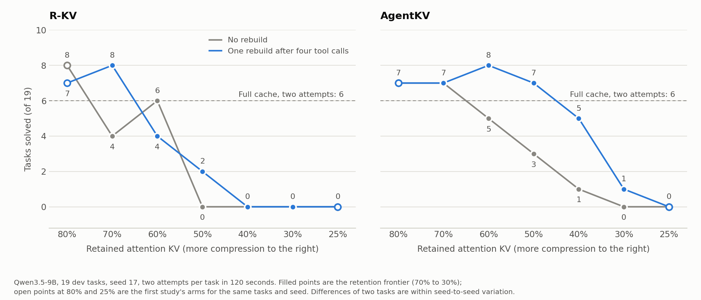

# Qwen3.5-9B: the retention range over which one rebuild helps

At seed 17, AgentKV without a rebuild loses tasks steadily as retention falls
from 70% to 30%: 7, 5, 3, 1 and 0 of 19 dev tasks. With one rebuild after four
tool calls it solves 7, 8, 7, 5 and 1, staying at or above full cache (6) down
to 50% retention. The rebuild gained three, four and four tasks at 60%, 50% and
40% and lost none; it changed nothing at 70% and gained one task at 30%. R-KV
shows no such range: the rebuild gained four tasks at 70%, lost a net two at
60% and gained two at 50%, and R-KV solved nothing at 40% or 30% either way.
The 50% conditions solved the same tasks as the first study. One seed, 19 dev
tasks, [declared before execution](dev19-recovery-design.md#supplemental-retention-frontier);
the [seed replicate](dev19-recovery.md#seed-replicate) shows that the same arm
moves by up to three tasks between seeds.

[PDF](figures/dev19-frontier.pdf) |
[Compact evidence](dev19-frontier.json) |
[First study](dev19-recovery.md) |
[Trigger timing](dev19-trigger-timing.md) |
[Failure reading](dev19-task-characteristics.md)

## Outcomes by retention

The [declared configuration](../../../configs/qwen9b/blackwell/dev19-frontier-v1.json)
ran unchanged: 21 conditions, 19 tasks, seed 17, 399 cells and 735 attempts,
each cell allowing two attempts in 120 seconds. Rows at 80% and 25% are the
first study's arms for the same tasks and seed. Differences are paired
task-bootstrap intervals from the shared analysis (10,000 draws), fixed minus
never.

| AgentKV, retained KV | Never | Fixed | Fixed minus never | Tasks gained / lost | Never arm opened with the listing | Context limits, never / fixed |
| --- | ---: | ---: | --- | ---: | ---: | ---: |
| 80% (first study) | 7/19 | 7/19 | 0.0 points [-15.8, +15.8] | 1 / 1 | 38/38 | 3 / 2 |
| 70% | 7/19 | 7/19 | 0.0 [-15.8, +15.8] | 1 / 1 | 38/38 | 4 / 3 |
| 60% | 5/19 | 8/19 | +15.8 [0.0, +31.6] | 3 / 0 | 30/37 | 6 / 5 |
| 50% | 3/19 | 7/19 | **+21.1 [+5.3, +42.1]** | 4 / 0 | 13/38 | 23 / 19 |
| 40% | 1/19 | 5/19 | **+21.1 [+5.3, +42.1]** | 4 / 0 | 4/35 | 19 / 17 |
| 30% | 0/19 | 1/19 | +5.3 [0.0, +15.8] | 1 / 0 | 0/33 | 2 / 2 |
| 25% (first study) | 0/19 | 0/19 | 0.0 [0.0, 0.0] | 0 / 0 | 0/32 | 1 / 0 |

| R-KV, retained KV | Never | Fixed | Fixed minus never | Tasks gained / lost | Never arm opened with the listing |
| --- | ---: | ---: | --- | ---: | ---: |
| 80% (first study) | 8/19 | 7/19 | -5.3 points [-21.1, +10.5] | 1 / 2 | 34/35 |
| 70% | 4/19 | 8/19 | **+21.1 [+5.3, +42.1]** | 4 / 0 | 19/35 |
| 60% | 6/19 | 4/19 | -10.5 [-31.6, +10.5] | 1 / 3 | 19/35 |
| 50% | 0/19 | 2/19 | +10.5 [0.0, +26.3] | 2 / 0 | 7/30 |
| 40% | 0/19 | 0/19 | 0.0 [0.0, 0.0] | 0 / 0 | 1/31 |
| 30% | 0/19 | 0/19 | 0.0 [0.0, 0.0] | 0 / 0 | 0/33 |
| 25% (first study) | 0/19 | 0/19 | 0.0 [0.0, 0.0] | 0 / 0 | 0/33 |

Full cache with two attempts solved 6/19, as in the first study. Three
intervals exclude zero; they are pointwise over ten comparisons, each rests on
four tasks gained and none lost (exact sign test p = 0.13), and the
conservative bounded intervals include zero for every row. A degenerate
interval at 0/19 is not evidence of zero population success.

The design asked over what range of compression a single rebuild restores
success. For AgentKV at this seed the range is 60% to 40% retention. At 70%
there was nothing to restore, and at 30% and 25% the rebuild restored one task
and none. Against full cache with two attempts, AgentKV with the rebuild is
+5.3 points [0.0, +15.8] at 70%, +10.5 [-10.5, +31.6] at 60%, +5.3
[-15.8, +26.3] at 50%, -5.3 [-21.1, +10.5] at 40% and -26.3 [-47.4, -10.5] at
30%. Without it AgentKV is -15.8 [-36.8, +5.3] at 50% and -26.3 [-47.4, -10.5]
at 40%. R-KV has no comparable range: its never-rebuild curve is not monotone
between 80% and 60% (8, 4 and 6 tasks), and the sign of the rebuild's effect
changes between adjacent retentions. Differences of two tasks between adjacent
R-KV points are inside the seed-to-seed variation the replicate measured.

The share of attempts that open with the prompt's API listing falls with
retention in both methods, from every AgentKV attempt at 70% to 30 of 37 at
60%, 13 of 38 at 50%, 4 of 35 at 40% and none at 30%. AgentKV attempts end at
the context limit mostly at 50% and 40%; at 30% they stop on four consecutive
failures instead. The rebuild's gains at 40% came with 36 of 38 attempts
rebuilt and 17 still ending at the context limit. That the rebuild helps where
some attempts still open on protocol is consistent with these counts and with
the [failure reading](dev19-task-characteristics.md); this study does not
isolate it.

## Consistency with the first study

Five conditions repeat the first study with the same tasks, seed and settings:
full cache with two attempts and the four 50% arms. The first study ran on
shared storage on another node; this study ran on node-local disk.

| Condition | Tasks solved, frontier / first study | Attempts compared | Identical actions | Identical until the deadline cut one short | A different action | Same score |
| --- | ---: | ---: | ---: | ---: | ---: | ---: |
| Full cache, two attempts | 6 / 6 | 38 | 37 | 0 | 1 | 38 |
| R-KV 50% never | 0 / 0 | 30 | 26 | 4 | 0 | 30 |
| R-KV 50% fixed | 2 / 2 | 32 | 24 | 8 | 0 | 32 |
| AgentKV 50% never | 3 / 3 | 38 | 34 | 4 | 0 | 38 |
| AgentKV 50% fixed | 7 / 7 | 38 | 38 | 0 | 0 | 38 |

Every repeated condition solved the same tasks, and all 176 attempts received
the same score. In 159 the actions are identical from first to last. Sixteen
ended on the shared 120-second budget at a different turn, with every turn
both runs generated identical; one of them reached the context limit in the
first study and timed out a few turns earlier here, so AgentKV 50% never has 23
context-limit endings against 24. One full-cache attempt differs in its last
action: the preceding observation printed a Python set in a different order,
and both versions submitted the same answer and failed. The 50% result of the
first study is therefore reproduced on different storage and a different node,
and the saved runs show no difference in generation given the same
observations.

Within this study, every fixed-recovery attempt repeated its never-rebuild
counterpart action for action up to its rebuild at all five retentions and
both methods (29 to 38 comparable attempts per pair).

## Cost and charged I/O

All 295 requested rebuilds were admitted and none was refused; one R-KV 40%
attempt ran out of budget during its rebuild. Rebuilds took 1.3% to 4.8% of
the cell budgets per condition. Mean peak occupied attention KV for AgentKV
without a rebuild fell from 250 MiB at 70% to 219 at 50% and 88 at 30%, against
317 MiB for full cache; with the rebuild it was 260 to 299 MiB from 70% to 40%
because the rebuild transiently holds the full history. Peak total GPU memory
reached at most 23.12 GiB under the 24 GiB cap. No attempt failed with a CUDA
or out-of-memory error; timeouts, four-consecutive-failure stops and context
limits remain in the denominators.

| Mean seconds per cell charged to the budget | Reset | Trajectory save | Tools | Cells at budget |
| --- | ---: | ---: | ---: | ---: |
| All 399 cells of this study | 0.9 | 0.1 | 1.3 | 135 |
| Full cache, two attempts: this study / first study | 1.1 / 1.0 | 0.1 / 6.6 | 0.7 / 2.7 | 0 / 0 |
| AgentKV 50% never: this study / first study | 1.0 / 1.1 | 0.1 / 0.1 | 0.4 / 0.4 | 4 / 3 |
| AgentKV 50% fixed: this study / first study | 1.1 / 1.0 | 0.1 / 0.9 | 0.5 / 0.6 | 1 / 1 |
| R-KV 50% never: this study / first study | 0.8 / 0.8 | 0.1 / 0.8 | 1.0 / 1.4 | 10 / 10 |
| R-KV 50% fixed: this study / first study | 0.9 / 0.9 | 0.1 / 0.4 | 2.7 / 3.0 | 11 / 11 |

The repeated conditions carried up to 6.5 seconds less saving per cell here and
reached the budget in the same number of cells, except one more for AgentKV
50% never. Four attempts spent 34 to 100 seconds in tool calls (R-KV 70% never,
AgentKV 40% never and fixed, R-KV 50% fixed), which raises those arms' tool
means to between 2.7 and 6.3 seconds; the same tasks produce such attempts in
the first study on shared storage. Per-arm times are in the
[evidence](dev19-frontier.json).

## Validation and provenance

Source `6164ba9` with the first study's runtime, device, cap and settings; only
the condition list differs. Seven condition groups ran on November 12, 2026
with at most four one-GPU workers at a time on one node, without preemption,
requeue or worker failure, on the node-local storage recorded in the
[design](dev19-recovery-design.md#node-local-execution-storage). A guard read
the saved cell timings from the first cell onward and did not trip; no
ten-cell window exceeded its limits. The groups were scored offline and
analyzed together through the shared analysis, and the first-action, rebuild
and consistency counts were read offline from saved attempts with
`comet.trigger_timing` and `comet.task_characteristics`. Run identifiers,
configuration digests, scheduler jobs and the export hash are in the evidence
record. An earlier launch of this study was voided, as the design records,
and is not used.

## Limits

One seed and 19 tasks. The replicate found the AgentKV 50% rebuild gain to be
four, one and three tasks net at seeds 17, 29 and 31, so the four-task gains
here are at the high end of what other seeds may show, and the range of 60% to
40% is a seed-17 observation. StreamingLLM and the dynamic trigger were omitted
by design. Oracle success is a best-of-two upper bound. The split by first
action is post hoc. The thresholds were inherited; these outcomes do not retune
the frozen test study.
