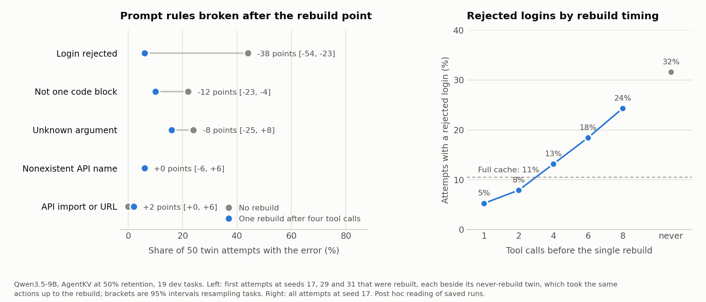

# Qwen3.5-9B: which prompt rules the compressed agent breaks, and which a rebuild restores

At 50% retention AgentKV had a login rejected in 40% of attempts (45 of 112
over three seeds), against 5% for full cache and 4% for AgentKV at 80%. With
one rebuild the share was 12% (fixed) and 11% (dynamic). Each rebuilt first
attempt can be set beside its never-rebuild twin, which took the same actions
up to the rebuild: after that point 6% of rebuilt attempts had a login rejected
against 44% of their twins, a difference of -38 points [-54, -23]. The earlier
the rebuild, the fewer rejected logins. The prompt states the login rule the
rejected calls break. StreamingLLM's failure needs no inference: its kept set
is positional, and at 80% retention it has evicted 656 of the system prompt's
669 tokens before the first action. All of this is a post hoc reading of saved
dev runs on 19 tasks; nothing was rerun.

[PDF](figures/dev19-instruction-errors.pdf) |
[Compact evidence](dev19-instruction-errors.json) |
[Recovery findings](dev19-recovery.md) |
[First-action reading](dev19-task-characteristics.md) |
[Claims review](dev19-claims-review.md)

## The rules and how they are read

The v4 system prompt gives explicit procedures. Five of them leave a mark in
the saved action or observation when broken, read with
`comet.instruction_errors`:

| Rule in the prompt | Counted when |
| --- | --- |
| Login: the username is the supervisor's email or phone number, "An app name is never the username", with a working login pattern | The observation says `Invalid credentials` |
| Return exactly one fenced code block | The runner answers `Invalid action` |
| Use the API names the documentation returns; do not guess names | The observation says the API does not exist |
| Read the documented argument names; do not guess arguments | The observation says `Unexpected parameter` |
| Never import the API objects; no `requests` or HTTP URLs | The action imports them, calls `requests` or contains a URL outside a comment |

Refusals that follow from the task, such as an expired payment card, are not
counted. Standard-library imports are allowed by the prompt and not counted.

## By condition

Share of attempts that broke each rule at least once, seeds 17, 29 and 31:

| Never-rebuild arm unless noted | Attempts | Login rejected | Not one code block | Unknown argument | Nonexistent API name | API import or URL | Passing attempts |
| --- | ---: | ---: | ---: | ---: | ---: | ---: | ---: |
| Full cache (N=2) | 114 | 5% | 2% | 15% | 11% | 0% | 33 |
| AgentKV 80% | 113 | 4% | 3% | 17% | 11% | 0% | 33 |
| R-KV 80% | 109 | 6% | 0% | 19% | 17% | 0% | 30 |
| AgentKV 50% | 112 | **40%** | 18% | 42% | 18% | 0% | 16 |
| AgentKV 50%, fixed rebuild | 113 | 12% | 11% | 31% | 20% | 1% | 29 |
| AgentKV 50%, dynamic rebuild | 114 | 11% | 12% | 32% | 24% | 1% | 34 |
| R-KV 50% | 94 | 11% | 12% | 41% | **60%** | 3% | 2 |
| R-KV 50%, fixed rebuild | 100 | 7% | 14% | 50% | 58% | 6% | 6 |
| AgentKV 25% | 100 | 17% | 24% | 17% | 38% | 20% | 0 |
| R-KV 25% | 93 | 8% | 56% | 4% | 28% | 42% | 0 |
| StreamingLLM 80% | 97 | 0% | **49%** | 1% | 0% | **66%** | 0 |
| StreamingLLM 50% | 91 | 1% | 58% | 0% | 0% | 53% | 0 |
| StreamingLLM 25% | 87 | 1% | 80% | 0% | 1% | 15% | 0 |

Full cache and the 80% arms of R-KV and AgentKV break these rules rarely and
alike. At 50% each method fails in its own way: AgentKV on the login rule and
on argument names, R-KV on API names that do not exist. StreamingLLM breaks the
format rule and the import rule from 80% on. Low login shares for StreamingLLM
and the 25% arms reflect attempts that never reach a login: 4 of 97
StreamingLLM 80% attempts tried one. By seed, AgentKV 50% had a login rejected
in 12 of 38, 16 of 37 and 17 of 37 attempts without a rebuild, 5, 3 and 5 with
the fixed trigger and 2, 6 and 4 with the dynamic trigger; full cache in 4, 1
and 1 of 38.

The rejected logins say which rule was lost. Full cache took the username from
a variable or the profile in all 134 of its successful logins, as the prompt's
pattern does. Of AgentKV 50%'s 74 rejected logins, 31 passed the app's name as
the username, which the prompt forbids in so many words, and 26 a literal
email. Every one of those attempts had called both `show_profile` and
`show_account_passwords`, so the values had been fetched; the rule for
combining them was not followed. The agent still logged in eventually in 87 of
the 88 attempts that tried, by trial and error.

## After the rebuild, against the never twin

A recovery arm and its never arm share seed and start, so a first attempt
repeats its twin action for action until the rebuild. Only the turns after
that point are compared, on first attempts that were rebuilt. Intervals
resample tasks with all of their pairs (10,000 draws).

| Twin pairs | Pairs | Login rejected after: rebuilt / never | Difference | Not one code block | Nonexistent API name | Passed: rebuilt / never |
| --- | ---: | ---: | --- | --- | --- | ---: |
| AgentKV 50% fixed, three seeds | 50 | 6% / 44% | **-38 points [-54, -23]** | -12 [-23, -4] | 0 [-6, +6] | 16 / 7 |
| AgentKV 50% dynamic, three seeds | 51 | 6% / 39% | **-33 [-47, -20]** | -10 [-24, +2] | +6 [-6, +16] | 19 / 7 |
| R-KV 50% fixed, three seeds | 49 | 2% / 10% | -8 [-15, -2] | +4 [-4, +12] | -12 [-27, +2] | 4 / 1 |
| AgentKV 80% fixed, three seeds | 57 | 0% / 2% | -2 [-5, 0] | -4 [-9, 0] | -2 [-5, 0] | 20 / 17 |
| AgentKV 60% fixed, seed 17 | 19 | 0% / 32% | **-32 [-53, -11]** | +5 [-11, +21] | -5 [-21, +11] | 8 / 5 |
| AgentKV 40% fixed, seed 17 | 19 | 11% / 32% | -21 [-47, +5] | -21 [-42, 0] | 0 [-21, +21] | 3 / 1 |

After the rebuild point the 50 rebuilt AgentKV 50% attempts took 416 turns with
8 rejected logins; their twins took 522 turns with 35. Both groups ended logged
in equally often (88%), so losing the rule costs turns and context, not access.
For R-KV the rebuild cut turns naming a nonexistent API from 210 to 48, but the
share of twin attempts with at least one such turn fell less clearly, from 45%
to 33%, and R-KV gained little success from the rebuild. The rebuild helps most
where it removes the method's characteristic violation.

## By rebuild timing and retention

AgentKV 50% at seed 17, share of all attempts with a rejected login:

| Rebuild after | 1 call | 2 calls | 4 calls | 6 calls | 8 calls | never | Full cache |
| --- | ---: | ---: | ---: | ---: | ---: | ---: | ---: |
| Attempts | 2/38 | 3/38 | 5/38 | 7/38 | 9/37 | 12/38 | 4/38 |

The share rises with every later threshold. With the rebuild after one tool
call, all 33 rebuilt attempts that looked up credentials did so after the
rebuild, and their later observations were compacted chunk by chunk exactly as
in the never arm. What differs between those arms is the state of the prompt
and the first observation, which is evidence that the lost item is the prompt's
rule and not the fetched credentials.

By retention at seed 17, never / fixed: 70% 7 of 38 / 4 of 36; 60% 11 of 37 /
1 of 37; 50% 12 of 38 / 5 of 38; 40% 12 of 35 / 8 of 38; 30% 2 of 33 / 5 of 35.
At 30% few attempts reach a login.

## StreamingLLM keeps none of the prompt's rules

StreamingLLM here keeps the first 16 tokens and the most recent ones up to the
retention target, so its kept set at the first action follows from the token
layout alone. The system prompt is tokens 3 to 671 of a first turn of 3,343 to
3,393 tokens: 669 tokens, the first 20% of the context. The rest is the task
description with the supervisor, app and API listings.

| Retention | Evicted before the first action | System prompt tokens kept | Rules with every token kept |
| --- | --- | ---: | ---: |
| 80% | tokens 16 to 683-693 | 13 of 669 | 0 of 10 |
| 50% | tokens 16 to 1,686-1,711 | 13 of 669 | 0 of 10 |
| 25% | tokens 16 to 2,522-2,559 | 13 of 669 | 0 of 10 |

At 80% retention the evicted fifth of the context is the system prompt, on
every task. The 13 kept tokens are the opening words. This accounts for
StreamingLLM solving nothing at any retention, opening on protocol in none of
818 attempts, and breaking the format and import rules, which are the first
two rules of the prompt. It is a consequence of applying a recency window to a
context whose instructions come first, with a 16-token sink; it says nothing
about StreamingLLM with a sink that covers the prompt.

## Reading

Observed: compression at 50% raises violations of specific prompt rules, each
method in its own pattern; one rebuild removes AgentKV's login violations
almost entirely, in every seed and at 60% retention, and earlier rebuilds
remove more. For StreamingLLM the eviction of the prompt is exact.

Hypothesis, consistent with the above and not isolated: R-KV and AgentKV lose
prompt rules because retention is applied after every 128-token chunk while
the prompt is prefilled, before the task has been read, and the rebuild
restores them by selecting once over the whole transcript. The saved runs do
not record which tokens those two methods kept. The published methods do not
describe compressing a prompt during prefill: R-KV is presented as a
decode-stage method and AgentKV compresses every 128 decode tokens under a
fixed token budget (read from the papers' web versions, not checked line by
line). The [prefill study](dev19-recovery-design.md#rebuild-before-the-first-action)
declared with this record tests the chunk-by-chunk part directly.

## Limits

Post hoc: the five markers were chosen after reading the errors, and the
credential result was noticed in the data it is reported on. The
[confirmation](dev38-recovery-design.md) declares it as a hypothesis on 38
other tasks. Nineteen tasks; attempts within a task are not independent; the
timing and retention tables are one seed. Twin pairs cover first attempts that
were rebuilt, 50 of 57 for AgentKV 50% fixed. Markers are read from the first
500 and last 160 characters of each observation, so a message in the middle of
a long observation is missed. A rejected login can also follow from a wrong
value and not from a forgotten rule; the split of rejected usernames above is
the evidence that most do not.
