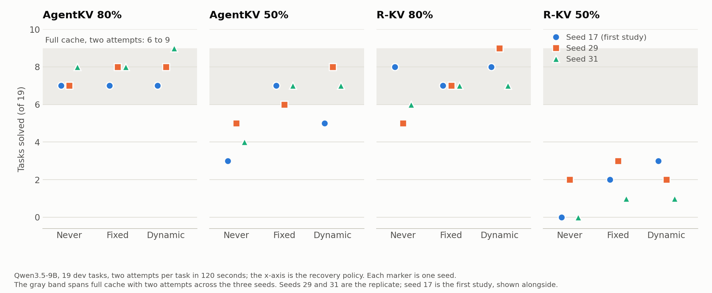

# Qwen3.5-9B: nineteen-family dev recovery findings

On 19 dev families, recovery raised success at 50% retention and changed
nothing at 80% or 25%. AgentKV at 50% went from 3/19 without recovery to 7/19
with the fixed trigger, matching or exceeding the full-cache controls (6/19).
R-KV and AgentKV at 80% were at full-cache level with or without recovery.
StreamingLLM solved nothing at any retention or policy. These are train/dev
observations; they do not open or retune the frozen test study.

A [seed replicate](#seed-replicate) on seeds 29 and 31 kept the direction of the
50% result and about half its size. AgentKV at 50% solved 5 and 4 of 19 tasks
without recovery, 6 and 7 with the fixed trigger and 8 and 7 with the dynamic
trigger. Fixed minus never is +10.5 points [-5.3, +28.9] across the two seeds,
against +21.1 [+5.3, +42.1] at seed 17, so the one interval that excluded zero
at seed 17 is not confirmed for oracle success. The sections from here to the
replicate describe seed 17.

[PDF](figures/dev19-recovery-aggressivity.pdf) |
[Recovery effects](figures/dev19-recovery-effects.png) |
[Three seeds](figures/dev19-recovery-seeds.png) |
[Retention frontier](dev19-frontier.md) |
[Compact evidence](dev19-recovery-summary.json) |
[Design](dev19-recovery-design.md)

## Oracle success within budget

The [declared configuration](../../../configs/qwen9b/blackwell/dev19-recovery-v1.json)
ran unchanged: 29 conditions, 19 tasks, seed 17, 120 seconds shared by at most
two attempts, 16K context and the 24 GiB cap on RTX PRO 6000 Blackwell GPUs.
All 551 cells and 963 attempts started from fresh task states and were scored
offline afterward.

| Method | Retained KV | Never | Fixed | Dynamic |
| --- | ---: | ---: | ---: | ---: |
| StreamingLLM | 80% | 0/19 | 0/19 | 0/19 |
| StreamingLLM | 50% | 0/19 | 0/19 | 0/19 |
| StreamingLLM | 25% | 0/19 | 0/19 | 0/19 |
| R-KV | 80% | 8/19 | 7/19 | 8/19 |
| R-KV | 50% | 0/19 | 2/19 | 3/19 |
| R-KV | 25% | 0/19 | 0/19 | 0/19 |
| AgentKV | 80% | 7/19 | 7/19 | 7/19 |
| AgentKV | 50% | 3/19 | 7/19 | 5/19 |
| AgentKV | 25% | 0/19 | 0/19 | 1/19 |

Full cache solved 6/19 with one attempt and 6/19 with two. Entries assume
perfect selection among attempts. First-attempt success differs from oracle
success by at most two tasks in any condition; the
[evidence](dev19-recovery-summary.json) lists both and the solved tasks.

## Recovery versus never

Paired task-bootstrap differences in oracle success, recovery minus never
within the same method and retention (10,000 draws):

| Condition | Fixed | Dynamic |
| --- | --- | --- |
| AgentKV 50% | **+21.1 points** [+5.3, +42.1] | +10.5 [0.0, +26.3] |
| R-KV 50% | +10.5 [0.0, +26.3] | +15.8 [0.0, +31.6] |
| AgentKV 25% | 0.0 [0.0, 0.0] | +5.3 [0.0, +15.8] |
| R-KV 80% | -5.3 [-21.1, +10.5] | 0.0 [-15.8, +15.8] |
| AgentKV 80% | 0.0 [-15.8, +15.8] | 0.0 [-15.8, +15.8] |

AgentKV 50% with the fixed trigger is the only comparison whose bootstrap
interval excludes zero; the conservative bounded intervals in the evidence
include zero for every comparison. No recovery arm lost more than one task
relative to never. StreamingLLM and the remaining 25% arms are 0/19 under both
policies; a degenerate interval there is not evidence of zero population
success. Against full-cache best-of-two, AgentKV 50% fixed is +5.3 points
[-15.8, +26.3] and AgentKV 50% never is -15.8 [-36.8, +5.3].

The four tasks AgentKV 50% gained under fixed recovery are `396c5a2_3`,
`50e1ac9_3`, `6c2c621_1` and `b119b1f_1`; it kept the three it already solved.
Without recovery that arm ended 24 of 38 attempts at the context limit; with
fixed recovery 19. This identifies where the gain occurred, not which tokens
caused it.

## Where recovery acted

From the saved cell records, without rerunning anything. At 50% retention
without recovery, 24 of AgentKV's 38 attempts ended because the raw transcript
reached the 16,384-token limit, after a median of five tool calls; full cache
had one such ending in 38 attempts. With fixed recovery that count was 19 and
with dynamic 21. The compressed agent therefore most often failed by filling
its context early, not by running out of time.

The fixed trigger rebuilt at the fourth tool call by definition, at a median
context of 5,539 tokens (10th-90th percentile 3,936-8,135) across all 228
admitted rebuilds; the dynamic trigger fired at a median of five tool calls and
6,447 tokens across 199. Median rebuild time was 1.9 and 2.2 seconds, with a
maximum of 6.1.

On the four tasks AgentKV 50% gained under fixed recovery, the solved attempts
finished in 8-16 tool calls after a rebuild at 5,483-9,179 context tokens,
similar to full-cache attempts on the same tasks (7-20 tool calls). Full cache
itself solved two of those four tasks (`396c5a2_3`, `6c2c621_1`) and not the
other two (`50e1ac9_3`, `b119b1f_1`). That the rebuild restores instructions
the compressed cache had lost is a hypothesis consistent with these counts, not
something this study isolates.

The [failure reading](dev19-task-characteristics.md) shows what those context
limits contain and which attempts the rebuild rescued.

## Cost and failures

All 427 requested rebuilds were admitted; none was refused by the memory cap.
For AgentKV 50% fixed, 30 rebuilds consumed 93.8 seconds in total, about 4% of
the cell budgets. Mean cell latency was 29 s for full cache with one attempt,
49 s with two, 47-58 s for the AgentKV 80% and 50% arms and 95-117 s for
StreamingLLM. Mean peak occupied attention KV fell from 284 MiB (full cache) to
252, 220 and 61 MiB for AgentKV at 80%, 50% and 25% without recovery; with
fixed recovery at 50% the peak returned to 280 MiB because the rebuild
transiently holds the full history. Mean peak total VRAM stayed at or below
23.1 GiB in every condition.

No attempt failed with a CUDA or out-of-memory error. Unsuccessful attempts
were timeouts, the agent's four-consecutive-failure stop and context limits;
all remain in the denominators and none received a replacement budget.

## Validation and provenance

Source `6164ba9` ran from its own checkout and managed hybrid runtime. Before
the study, 24 live checks passed on a Blackwell GPU at the 24 GiB cap (state,
compaction, recovery, AppWorld isolation and tool effects, and process
interruption), followed by the predeclared four-cell dev smoke, executed and
scored in research mode. The four condition groups then ran on one GPU each
without preemption or requeue and were scored and analyzed together through the
ordinary shared analysis. Run identifiers, configuration digests, scheduler job
numbers and the compact bundle hash are in the evidence record; complete run
directories remain in external project storage.

## Seed replicate

The [replicate configuration](../../../configs/qwen9b/blackwell/dev19-recovery-v2.json)
ran unchanged on November 11-12, 2026: the same 19 tasks, 29 conditions and
settings with seeds 29 and 31, 1,102 cells and 1,925 attempts, all from fresh
task states and scored offline afterward. Seeds 29 and 31 are analyzed together
through the shared analysis, which bootstraps tasks with their paired seeds
(10,000 draws). Seed 17 is set beside them and is not pooled.

[PDF](figures/dev19-recovery-seeds.pdf)

Tasks solved of 19, as seed 17 / seed 29 / seed 31:

| Method | Retained KV | Never | Fixed | Dynamic |
| --- | ---: | ---: | ---: | ---: |
| StreamingLLM | 80%, 50%, 25% | 0 / 0 / 0 | 0 / 0 / 0 | 0 / 0 / 0 |
| R-KV | 80% | 8 / 5 / 6 | 7 / 7 / 7 | 8 / 9 / 7 |
| R-KV | 50% | 0 / 2 / 0 | 2 / 3 / 1 | 3 / 2 / 1 |
| R-KV | 25% | 0 / 0 / 0 | 0 / 0 / 0 | 0 / 0 / 0 |
| AgentKV | 80% | 7 / 7 / 8 | 7 / 8 / 8 | 7 / 8 / 9 |
| AgentKV | 50% | 3 / 5 / 4 | 7 / 6 / 7 | 5 / 8 / 7 |
| AgentKV | 25% | 0 / 0 / 0 | 0 / 0 / 0 | 1 / 0 / 0 |

Full cache solved 6 / 7 / 7 with one attempt and 6 / 7 / 9 with two. The same
arm differs by up to three tasks between seeds (R-KV 80% never, AgentKV 50%
dynamic, full cache with two attempts), so a difference of two tasks at one
seed is inside seed-to-seed variation.

Paired task-bootstrap differences in oracle success, recovery minus never, for
seeds 29 and 31 together, with seed 17 beside them:

| Condition | Fixed, seeds 29 and 31 | Fixed, seed 17 | Dynamic, seeds 29 and 31 | Dynamic, seed 17 |
| --- | --- | --- | --- | --- |
| AgentKV 50% | +10.5 points [-5.3, +28.9] | +21.1 [+5.3, +42.1] | +15.8 [0.0, +34.2] | +10.5 [0.0, +26.3] |
| R-KV 50% | +5.3 [-5.3, +18.4] | +10.5 [0.0, +26.3] | +2.6 [-5.3, +13.2] | +15.8 [0.0, +31.6] |
| AgentKV 80% | +2.6 [-7.9, +13.2] | 0.0 [-15.8, +15.8] | +5.3 [-7.9, +18.4] | 0.0 [-15.8, +15.8] |
| R-KV 80% | +7.9 [-2.6, +18.4] | -5.3 [-21.1, +10.5] | **+13.2 [+2.6, +26.3]** | 0.0 [-15.8, +15.8] |
| AgentKV 25% | 0.0 [0.0, 0.0] | 0.0 [0.0, 0.0] | 0.0 [0.0, 0.0] | +5.3 [0.0, +15.8] |

Every recovery-minus-never estimate at 50% and 80% is positive in the
replicate, between +2.6 and +15.8 points, or half a task to three tasks of 19.
The AgentKV 50% fixed interval now includes zero. The one replicate interval
that excludes zero is R-KV 80% dynamic, which was 0.0 at seed 17 and rests on
R-KV 80% never falling from 8 tasks to 5 and 6. The intervals are pointwise
over 18 comparisons, and the conservative bounded intervals include zero for
every one of them.
StreamingLLM and every 25% arm are 0/19 under every policy in the replicate.

First-attempt success moved more than oracle success. For seeds 29 and 31 the
first-attempt difference is +15.8 points [+5.3, +28.9] for AgentKV 50% fixed,
+23.7 [+10.5, +39.5] for AgentKV 50% dynamic and +15.8 [+2.6, +31.6] for R-KV
80% dynamic. Never-rebuild arms recover part of that gap with their second
attempt, so the oracle differences are smaller.

By task, AgentKV 50% fixed gained and lost against never as follows:

| Seed | Gained | Lost |
| --- | --- | --- |
| 17 | `396c5a2_3`, `50e1ac9_3`, `6c2c621_1`, `b119b1f_1` | none |
| 29 | `37a8675_1`, `396c5a2_3`, `50e1ac9_3` | `6171bbc_2`, `fac291d_3` |
| 31 | `396c5a2_3`, `50e1ac9_3`, `6171bbc_2`, `b119b1f_1` | `6c2c621_1` |

`396c5a2_3` and `50e1ac9_3` were gained in all three seeds. The seed-17
observation that no recovery arm lost more than one task does not hold at seed
29. The dynamic trigger gained two, four and four tasks and lost none, one and
one.

Against full cache with two attempts, across seeds 29 and 31: AgentKV 50%
never is -18.4 points [-36.8, -2.6], fixed -7.9 [-21.1, +5.3] and dynamic -2.6
[-13.2, +7.9]. At seed 17 the same three were -15.8, +5.3 and -5.3 with
intervals that all included zero. Without recovery AgentKV 50% ended 24, 19 and
17 attempts at the context limit in the three seeds; with fixed recovery 19, 20
and 13; with dynamic 21, 16 and 13. The [failure reading](dev19-task-characteristics.md#seed-replicate)
repeats the first-action counts for both seeds.

### Charged I/O

The replicate ran with the run directory, AppWorld root, runtime and model on
node-local disk; the first study ran on shared storage. Resets, saves and tool
calls are charged to the 120-second budget in both.

| Mean seconds per cell charged to the budget | Reset | Trajectory save | Tools | Cells at budget |
| --- | ---: | ---: | ---: | ---: |
| Seed 17, first study, 551 cells | 0.9 | 2.2 | 1.4 | 236 |
| Seed 29, replicate, 551 cells | 0.9 | 0.2 | 0.7 | 239 |
| Seed 31, replicate, 551 cells | 0.9 | 0.1 | 0.9 | 222 |
| AgentKV 50% never, seeds 17 / 29 / 31 | 1.1 / 1.0 / 0.9 | 0.1 / 0.1 / 0.1 | 0.4 / 0.4 / 5.4 | 3 / 3 / 4 |
| AgentKV 50% fixed, seeds 17 / 29 / 31 | 1.0 / 1.0 / 0.9 | 0.9 / 0.1 / 0.1 | 0.6 / 0.4 / 0.5 | 1 / 1 / 3 |
| AgentKV 50% dynamic, seeds 17 / 29 / 31 | 1.0 / 1.0 / 1.0 | 0.2 / 0.1 / 0.1 | 5.2 / 0.6 / 4.0 | 2 / 0 / 4 |
| Full cache, two attempts, seeds 17 / 29 / 31 | 1.0 / 1.0 / 1.1 | 6.6 / 0.1 / 0.1 | 2.7 / 0.7 / 0.7 | 0 / 1 / 0 |

Replicate cells carry about two seconds less saving and under one second less
tool time than seed-17 cells. The three tool means above four seconds each come
from one attempt that spent 67 to 92 seconds in tool calls. Attempts with more
than 30 seconds of tool time occur on shared and node-local storage alike, all
on four Spotify tasks (11 attempts across the first study, the replicate and
the frontier). Full
cache carried the most shared-storage I/O at seed 17 and reached the budget in
no cell, so that I/O did not decide its outcomes. Storage also does not explain
the difference between seed 17 and the replicate: the [retention frontier](dev19-frontier.md#consistency-with-the-first-study)
reran the 50% arms at seed 17 on node-local disk and solved the same tasks in
every repeated condition. Per-arm times for every condition and seed are in the
[evidence](dev19-recovery-summary.json).

### Cost, failures and provenance

All 841 requested rebuilds were admitted and none was refused; three attempts
ran out of budget during a rebuild. For AgentKV 50% fixed, 67 rebuilds took
192.1 seconds, 4.2% of the cell budgets. Mean cell latency was 22 s for full
cache with one attempt, 45 s with two, 51-73 s for the AgentKV 80% and 50% arms
and 95-115 s for StreamingLLM. Mean peak occupied attention KV was 295 MiB for
full cache with one attempt and 254, 224 and 59 MiB for AgentKV at 80%, 50% and 25% without
recovery; with fixed recovery at 50% it was 306 MiB. Mean peak total VRAM
stayed at or below 23.1 GiB in every condition. No attempt failed with a CUDA
or out-of-memory error; unsuccessful attempts were timeouts, the
four-consecutive-failure stop and context limits, and all remain in the
denominators.

Source `6164ba9` with the first study's runtime, device and cap, in eight
condition groups with at most four one-GPU workers at a time on one node and
no preemption, requeue or worker failure. A guard read the saved cell timings
from the first 44 cells onward and did not trip: no ten-cell window exceeded
its limits, and the largest ten-cell medians were 1.1 seconds of reset, 0.7 of
saving and 1.6 of tools. The eight groups were scored and analyzed together
through the ordinary shared analysis. Up to its rebuild, each fixed-recovery
attempt at 50% repeated its never-rebuild counterpart action for action in 37
of 37 and 36 of 36 AgentKV attempts (seeds 29 and 31) and in 31 of 32 and 28 of
28 R-KV attempts. The one exception is a second attempt without a rebuild whose
previous observation printed a Python set in a different order. Run
identifiers, configuration digests, scheduler jobs and the export hash are in
the [evidence](dev19-recovery-summary.json) under `seed_replicate`. Earlier
launches of the replicate were voided, as the [design](dev19-recovery-design.md)
records, and are not used.

## Limits

Three seeds on the same 19 tasks; the seeds repeat tasks and do not add
families, and `4ec8de5` and `396c5a2` had been used for dev confirmation. Seed
17 and the replicate ran on different storage and are compared descriptively,
not pooled. The thresholds were inherited, not tuned here, and these outcomes
must not retune the frozen test study. Oracle success is an upper bound, and
with at most two attempts in 120 seconds the best-of-N contrast is small. The
replicate supports a positive recovery effect at 50% retention of roughly one
to three tasks in 19 and does not support the seed-17 size; 19 tasks cannot
separate effects of that size from zero for oracle success.
