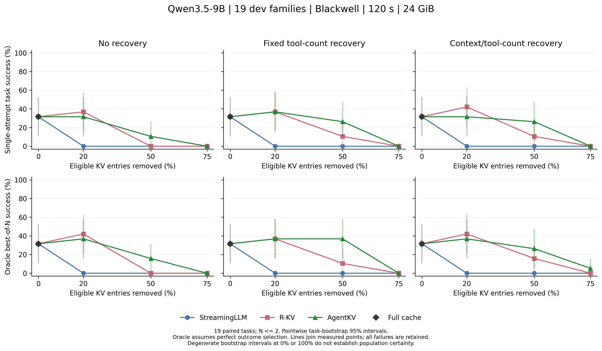

# Qwen3.5-9B: nineteen-family dev recovery findings

On 19 dev families, recovery raised success at 50% retention and changed
nothing at 80% or 25%. AgentKV at 50% went from 3/19 without recovery to 7/19
with the fixed trigger, matching or exceeding the full-cache controls (6/19).
R-KV and AgentKV at 80% were at full-cache level with or without recovery.
StreamingLLM solved nothing at any retention or policy. These are train/dev
observations with one seed; they do not open or retune the frozen test study.

[PDF](figures/dev19-recovery-aggressivity.pdf) |
[Recovery effects](figures/dev19-recovery-effects.png) |
[Compact evidence](dev19-recovery-summary.json) |
[Design](dev19-recovery-design.md)

## Oracle success within budget

The [declared configuration](../../../configs/qwen9b/blackwell/dev19-recovery-v1.json)
ran unchanged: 29 conditions, 19 tasks, seed 17, 120 seconds shared by at most
two attempts, 16K context and the 24 GiB cap on RTX PRO 6000 Blackwell GPUs.
All 551 cells and 963 attempts started from fresh task states and were scored
offline afterward.

| Method | Retained KV | Never | Fixed | Dynamic |
| --- | ---: | ---: | ---: | ---: |
| StreamingLLM | 80% | 0/19 | 0/19 | 0/19 |
| StreamingLLM | 50% | 0/19 | 0/19 | 0/19 |
| StreamingLLM | 25% | 0/19 | 0/19 | 0/19 |
| R-KV | 80% | 8/19 | 7/19 | 8/19 |
| R-KV | 50% | 0/19 | 2/19 | 3/19 |
| R-KV | 25% | 0/19 | 0/19 | 0/19 |
| AgentKV | 80% | 7/19 | 7/19 | 7/19 |
| AgentKV | 50% | 3/19 | 7/19 | 5/19 |
| AgentKV | 25% | 0/19 | 0/19 | 1/19 |

Full cache solved 6/19 with one attempt and 6/19 with two. Entries assume
perfect selection among attempts. First-attempt success differs from oracle
success by at most two tasks in any condition; the
[evidence](dev19-recovery-summary.json) lists both and the solved tasks.

## Recovery versus never

Paired task-bootstrap differences in oracle success, recovery minus never
within the same method and retention (10,000 draws):

| Condition | Fixed | Dynamic |
| --- | --- | --- |
| AgentKV 50% | **+21.1 points** [+5.3, +42.1] | +10.5 [0.0, +26.3] |
| R-KV 50% | +10.5 [0.0, +26.3] | +15.8 [0.0, +31.6] |
| AgentKV 25% | 0.0 [0.0, 0.0] | +5.3 [0.0, +15.8] |
| R-KV 80% | -5.3 [-21.1, +10.5] | 0.0 [-15.8, +15.8] |
| AgentKV 80% | 0.0 [-15.8, +15.8] | 0.0 [-15.8, +15.8] |

AgentKV 50% with the fixed trigger is the only comparison whose bootstrap
interval excludes zero; the conservative bounded intervals in the evidence
include zero for every comparison. No recovery arm lost more than one task
relative to never. StreamingLLM and the remaining 25% arms are 0/19 under both
policies; a degenerate interval there is not evidence of zero population
success. Against full-cache best-of-two, AgentKV 50% fixed is +5.3 points
[-15.8, +26.3] and AgentKV 50% never is -15.8 [-36.8, +5.3].

The four tasks AgentKV 50% gained under fixed recovery are `396c5a2_3`,
`50e1ac9_3`, `6c2c621_1` and `b119b1f_1`; it kept the three it already solved.
Without recovery that arm ended 24 of 38 attempts at the context limit; with
fixed recovery 19. This identifies where the gain occurred, not which tokens
caused it.

## Where recovery acted

From the saved cell records, without rerunning anything. At 50% retention
without recovery, 24 of AgentKV's 38 attempts ended because the raw transcript
reached the 16,384-token limit, after a median of five tool calls; full cache
had one such ending in 38 attempts. With fixed recovery that count was 19 and
with dynamic 21. The compressed agent therefore most often failed by filling
its context early, not by running out of time.

The fixed trigger rebuilt at the fourth tool call by definition, at a median
context of 5,539 tokens (10th-90th percentile 3,936-8,135) across all 228
admitted rebuilds; the dynamic trigger fired at a median of five tool calls and
6,447 tokens across 199. Median rebuild time was 1.9 and 2.2 seconds, with a
maximum of 6.1.

On the four tasks AgentKV 50% gained under fixed recovery, the solved attempts
finished in 8-16 tool calls after a rebuild at 5,483-9,179 context tokens,
similar to full-cache attempts on the same tasks (7-20 tool calls). Full cache
itself solved two of those four tasks (`396c5a2_3`, `6c2c621_1`) and not the
other two (`50e1ac9_3`, `b119b1f_1`). That the rebuild restores instructions
the compressed cache had lost is a hypothesis consistent with these counts, not
something this study isolates.

The [failure reading](dev19-task-characteristics.md) shows what those context
limits contain and which attempts the rebuild rescued.

## Cost and failures

All 427 requested rebuilds were admitted; none was refused by the memory cap.
For AgentKV 50% fixed, 30 rebuilds consumed 93.8 seconds in total, about 4% of
the cell budgets. Mean cell latency was 29 s for full cache with one attempt,
49 s with two, 47-58 s for the AgentKV 80% and 50% arms and 95-117 s for
StreamingLLM. Mean peak occupied attention KV fell from 284 MiB (full cache) to
252, 220 and 61 MiB for AgentKV at 80%, 50% and 25% without recovery; with
fixed recovery at 50% the peak returned to 280 MiB because the rebuild
transiently holds the full history. Mean peak total VRAM stayed at or below
23.1 GiB in every condition.

No attempt failed with a CUDA or out-of-memory error. Unsuccessful attempts
were timeouts, the agent's four-consecutive-failure stop and context limits;
all remain in the denominators and none received a replacement budget.

## Validation and provenance

Source `6164ba9` ran from its own checkout and managed hybrid runtime. Before
the study, 24 live checks passed on a Blackwell GPU at the 24 GiB cap (state,
compaction, recovery, AppWorld isolation and tool effects, and process
interruption), followed by the predeclared four-cell dev smoke, executed and
scored in research mode. The four condition groups then ran on one GPU each
without preemption or requeue and were scored and analyzed together through the
ordinary shared analysis. Run identifiers, configuration digests, scheduler job
numbers and the compact bundle hash are in the evidence record; complete run
directories remain in external project storage.

## Limits

One seed and 19 tasks; families `4ec8de5` and `396c5a2` had been used for dev
confirmation. The thresholds were inherited, not tuned here, and these
outcomes must not retune the frozen test study. Oracle success is an upper
bound, and with at most two attempts in 120 seconds the best-of-N contrast is
small. A seed replicate on the same tasks is the natural next measurement
before treating the 50% recovery gain as stable.
