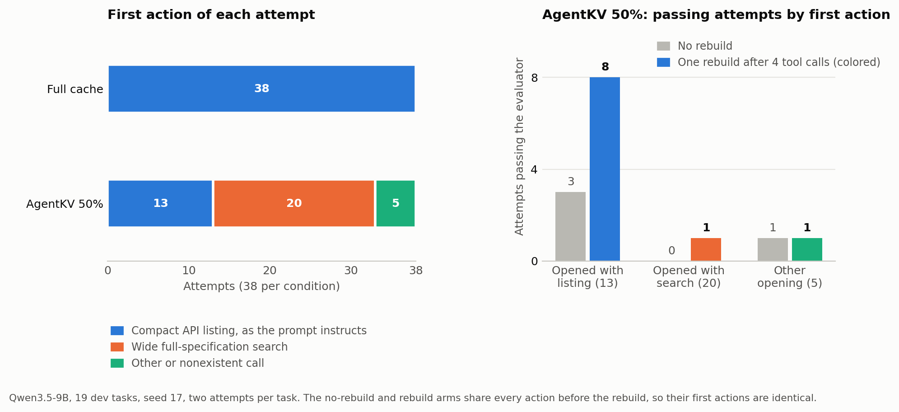
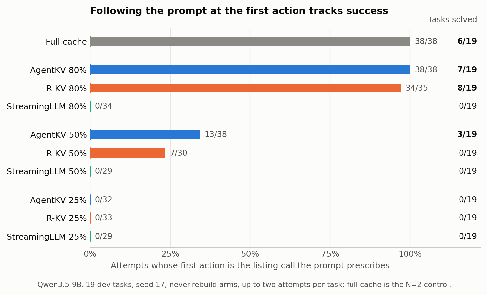

# Qwen3.5-9B: what fails at 50% retention, and which tasks tolerate compression

At 50% retention the compressed agent stops following the prompt's
documentation protocol before its first action. Full cache opened all 38
attempts with the compact API listing the prompt prescribes; AgentKV 50% did so
in 13 of 38 and opened 20 with a wide full-specification search whose results
fill the 16K context in two to five calls. Across all 29 conditions, 104 of
113 passing attempts began with that listing call, and no StreamingLLM attempt
did at any retention. One rebuild after four tool calls
raised passing attempts from 3 to 8 among the 13 that opened on protocol and
from 0 to 1 among the 20 that opened with the search. Across tasks, tolerance
to compression follows whether full cache solves the task at all; tool-call
count and documentation volume under full cache predict neither tolerance nor
recovery benefit. One seed, 19 dev tasks, read offline from the
[first recovery study](dev19-recovery.md); nothing was rerun.

The [seed replicate](#seed-replicate) repeats the first-action pattern at seeds
29 and 31: full cache opened every attempt with the listing, AgentKV 50% opened
15 and 18 of 37, and no StreamingLLM attempt did. It does not repeat the
concentration of the rebuild's gain in attempts that opened on protocol.

[PDF](figures/dev19-opening-call.pdf) |
[Compact evidence](dev19-task-characteristics.json) |
[Recovery findings](dev19-recovery.md)

## What fills the context

Read from every saved attempt of full cache (N=2), AgentKV 50% never and
AgentKV 50% fixed: 38 attempts each.

The system prompt with the task is about 3,400 tokens (3,360 in the attempt
inspected) and tells the agent that its first action
must list one app's API names (`show_api_descriptions`) and that it should then
read one API's documentation at a time (`show_api_doc`). Retention is applied
every 128 tokens as the prompt is prefilled, so at 50% half of the prompt's
attention KV is gone before the task has been read or any action generated.

| | Full cache | AgentKV 50% |
| --- | ---: | ---: |
| Attempts opening with the compact listing | 38/38 | 13/38 |
| Attempts opening with `search_api_docs` | 0 | 20/38 |
| Attempts opening with another or a nonexistent call | 0 | 5/38 |
| `search_api_docs` calls | 0 | 67 |
| Median / largest search observation (chars) | - | 15,125 / 41,396 |
| Median / largest listing observation (chars) | 5,477 / 9,306 | 9,306 / 9,306 |
| Attempts ending at the context limit | 1 | 24 |

`search_api_docs` is not mentioned in the prompt. It returns complete
specifications for up to 20 APIs, roughly 5,000 to 7,000 tokens per call, so
two results plus the prompt exceed 16,384 tokens. In the 24 never-rebuild
attempts that ended at the context limit, the largest observation was a
documentation result in 23 (the search in 20, the listing in 3) and
documentation was a median 98% of all observation characters. Eight of the 24
ended after two or three tool calls. The agent is not printing task data and,
with one exception, not repeating calls: one attempt looped over credential
lookups for 70 tool calls. The single full-cache context-limit ending was a
large transaction listing, not documentation.

The 5 "other" openings called names that do not exist
(`show_api_docs`, `show_api_description`) or read one API's documentation
before listing any.

## First action across all conditions

First actions were then read for all 963 attempts of the 29 conditions.

[PDF](figures/dev19-protocol-adherence.pdf)

| Never-rebuild arm | Opened with the listing | First action empty | First action uses an import, `requests` or a URL | Tasks solved |
| --- | ---: | ---: | ---: | ---: |
| Full cache (N=2) | 38/38 | 0 | 0 | 6/19 |
| AgentKV 80% | 38/38 | 0 | 0 | 7/19 |
| R-KV 80% | 34/35 | 0 | 0 | 8/19 |
| AgentKV 50% | 13/38 | 0 | 0 | 3/19 |
| R-KV 50% | 7/30 | 3 | 3 | 0/19 |
| AgentKV 25% | 0/32 | 6 | 5 | 0/19 |
| R-KV 25% | 0/33 | 15 | 8 | 0/19 |
| StreamingLLM 80% | 0/34 | 9 | 21 | 0/19 |
| StreamingLLM 50% | 0/29 | 8 | 17 | 0/19 |
| StreamingLLM 25% | 0/29 | 16 | 4 | 0/19 |

The prompt forbids imports, `requests` and HTTP URLs and requires one fenced
code block. Each method loses the protocol differently. AgentKV 50% still
reaches for the documentation app but through the wide search. R-KV 50% more
often skips documentation for credential calls or nonexistent names and stops
on four consecutive failures (16 of 30 attempts). At 25% no attempt of either
method opened on protocol. StreamingLLM opened on protocol in no attempt at any
retention, including 80%: it imported modules or called URLs in 21 of 34 first
actions there. StreamingLLM keeps a short sink and the most recent tokens, so
the first tokens it drops are the body of the system prompt; that this explains
its zero success at every retention is a hypothesis these counts fit.

Over all 29 conditions, 104 of the 113 passing attempts opened with the
listing: 104 of 336 listing openings passed and 9 of 627 others. The share of
attempts opening on protocol and tasks solved have rank correlation +0.91
across conditions; the three policies of a method and retention share their
first actions, so this is about 11 distinct points, not 29. At 80% and at 25% the
first action does not vary across tasks, so there it separates conditions, not
tasks.

## Where the rebuild helped

Never and fixed use the same seed, so their actions are identical until the
rebuild: every pair shared its first four actions, or all of them when the
attempt ended sooner. Opening calls are therefore the same in both arms, and
the comparison below is within the same starts.

| First action (AgentKV 50%) | Attempts | Passed, never | Passed, fixed | Context limit, never | Context limit, fixed |
| --- | ---: | ---: | ---: | ---: | ---: |
| Compact listing | 13 | 3 | 8 | 3 | 0 |
| Wide search | 20 | 0 | 1 | 18 | 17 |
| Other or nonexistent | 5 | 1 | 1 | 3 | 2 |

Fixed recovery's gain (4 to 10 passing attempts; 3 to 7 of 19 tasks) came
almost entirely from attempts that had started on protocol. Attempts that
opened with the search were not rescued: eight reached the context limit before
the fourth tool call, so no rebuild happened, and those that were rebuilt
already held one or two search results. After the rebuild the agent issued as
many searches as without it (18 in each arm across the 30 rebuilt pairs).
The [trigger-timing study](dev19-trigger-timing.md) later moved the rebuild to
the first tool call: 13 of the 20 search-opened attempts searched again on
their next action and one passed.

Opening on protocol at 50% is not independent of the task. The 13 on-protocol
attempts cover nine tasks, six of them Spotify-only (the prompt's own example
is a Spotify call) and one of the six Phone and Venmo tasks. On the same 13
task-attempt pairs and on the other 25:

| Condition | Passed, 13 on-protocol pairs | Passed, other 25 pairs |
| --- | ---: | ---: |
| Full cache (N=2) | 7 | 2 |
| AgentKV 80% never | 6 | 5 |
| AgentKV 50% never | 3 | 1 |
| AgentKV 50% fixed | 8 | 2 |
| AgentKV 50% dynamic | 6 | 2 |

Full cache itself passed only 2 of the 25 pairs on which AgentKV 50% opened off
protocol, so most of those search-opened attempts were on tasks with little to
lose. The measurable loss at 50% is on the pairs within the model's reach, 7
passes down to 3, and the rebuild restored it (8). The first-action counts
describe how the compressed agent fails; they overstate how much success that
failure costs.

In the hybrid engine a rebuild prefills the whole raw transcript without
intermediate eviction and then applies retention once, so the kept half is
chosen with the task and recent observations in view; ordinary compaction
chooses 128 tokens at a time. That the gain comes from this re-selection, and
that the opening search comes from prompt instructions evicted during prefill,
are hypotheses consistent with these counts. The saved runs do not record which
tokens were kept. The declared [trigger-timing study](dev19-recovery-design.md#supplemental-trigger-timing)
tests the timing part.

## Task characteristics

Per-task outcomes at seed 17 joined with AppWorld's dev task metadata and the
full-cache first attempt. Tolerance counts the never-rebuild arms that solved
the task among R-KV 80%, AgentKV 80%, R-KV 50% and AgentKV 50% (0 to 4).

| Group | Tasks | Full cache solved | Mean tolerance | AgentKV 50% never | AgentKV 50% fixed |
| --- | ---: | ---: | ---: | ---: | ---: |
| Question | 6 | 3 | 1.83 | 2 | 3 |
| State change | 13 | 3 | 0.54 | 1 | 4 |
| Spotify only | 10 | 4 | 1.30 | 2 | 5 |
| Phone and Venmo | 6 | 0 | 0.17 | 0 | 0 |
| Other apps | 3 | 2 | 1.33 | 1 | 2 |
| Difficulty 1 | 10 | 4 | 1.30 | 2 | 3 |
| Difficulty 2 or 3 | 9 | 2 | 0.56 | 1 | 4 |
| Solved by full cache | 6 | 6 | 2.17 | 2 | 4 |
| Not solved by full cache | 13 | 0 | 0.38 | 1 | 3 |

Rank correlations with tolerance (Spearman, 10,000-draw permutation p,
uncorrected): solved by full cache +0.76 (p = 0.001), question +0.54 (0.025),
number of required APIs -0.42 (0.07), number of apps -0.42 (0.08), difficulty
-0.35 (0.17), full-cache tool calls -0.33 (0.17), reference API calls -0.31
(0.19), full-cache documentation characters +0.11 (0.65). Only the first
survives a correction for the 48 correlations computed.

For the AgentKV 50% fixed-minus-never difference, no task property had
|rho| above 0.31 or p below 0.2. Gaining from either recovery policy at 50%
with either method was more common for questions (+0.57, p = 0.04) and for
tasks full cache solves (+0.57, p = 0.04), neither robust to correction.

Read plainly: the tasks compression tolerates are the ones within the model's
reach, questions more than state changes. Full cache solved none of the six
two-app Phone and Venmo tasks; one of them, `383cbac_1`, was solved by three
compressed arms (R-KV 80% never and dynamic, AgentKV 50% dynamic). How many tool calls
or how much documentation a task needs under full cache did not separate
tolerant from intolerant tasks or tasks that gained from recovery. What did
separate recovered from unrecovered attempts was a property of the compressed
run, its first action, not of the task.

## Seed replicate

The same offline summaries, computed separately for seeds 29 and 31 of the
[replicate](dev19-recovery.md#seed-replicate): 959 and 966 attempts, read for
first actions and endings, with complete trajectories read for the same three
conditions. Sampling differs by seed, so first actions are not shared across
seeds; within a seed the three policies of a method and retention still share
them.

| Never-rebuild arm | Opened with the listing, seeds 17 / 29 / 31 | Tasks solved, seeds 17 / 29 / 31 |
| --- | ---: | ---: |
| Full cache (N=2) | 38/38, 38/38, 38/38 | 6, 7, 9 |
| AgentKV 80% | 38/38, 37/37, 38/38 | 7, 7, 8 |
| R-KV 80% | 34/35, 37/37, 35/37 | 8, 5, 6 |
| AgentKV 50% | 13/38, 15/37, 18/37 | 3, 5, 4 |
| R-KV 50% | 7/30, 7/34, 13/30 | 0, 2, 0 |
| AgentKV 25% | 0/32, 0/33, 0/35 | 0, 0, 0 |
| R-KV 25% | 0/33, 0/29, 0/31 | 0, 0, 0 |
| StreamingLLM 80% | 0/34, 0/32, 0/31 | 0, 0, 0 |
| StreamingLLM 50% | 0/29, 0/29, 0/33 | 0, 0, 0 |
| StreamingLLM 25% | 0/29, 0/28, 0/30 | 0, 0, 0 |

Across its nine arms StreamingLLM opened with the listing in none of 276, 265
and 277 attempts and passed none. At 80% its first action used an import,
`requests` or a URL in 21 of 34, 24 of 32 and 18 of 31 attempts. Over all 29
conditions, attempts that opened with the listing passed 104 of 336, 109 of 351
and 105 of 374 times; all other attempts passed 9 of 627, 15 of 608 and 11 of
592 times. The rank correlation between a condition's share of listing openings
and its tasks solved is +0.91, +0.97 and +0.97. The
[retention frontier](dev19-frontier.md) adds the points between: at seed 17
AgentKV opened with the listing in 38 of 38 attempts at 70%, 30 of 37 at 60%, 4
of 35 at 40% and none at 30%.

At 50% retention AgentKV opened with the wide search in 20, 14 and 14 attempts.
Without a rebuild it ended 24, 19 and 17 attempts at the context limit; the
largest observation in those was documentation in 23, 17 and 16. Fewer ended
before the fourth tool call in the replicate (8, 3 and 4), and the median
search result was smaller (15,125, 6,983 and 8,348 characters). Full cache
ended 1, 2 and 1 attempts at the context limit, none on documentation.

Passing attempts of AgentKV 50% by first action, as passed / attempts. Never
and fixed share every first attempt; their second attempts exist only when the
first one failed with budget left, so the counts can differ by one.

| First action | Seed | Never | Fixed | Dynamic |
| --- | --- | ---: | ---: | ---: |
| Compact listing | 17 | 3/13 | 8/13 | 6/13 |
| Compact listing | 29 | 4/15 | 6/16 | 10/16 |
| Compact listing | 31 | 6/18 | 6/18 | 8/18 |
| Wide search | 17 | 0/20 | 1/20 | 1/20 |
| Wide search | 29 | 0/14 | 2/14 | 1/14 |
| Wide search | 31 | 0/14 | 1/13 | 1/14 |
| Other or nonexistent | 17 | 1/5 | 1/5 | 1/5 |
| Other or nonexistent | 29 | 2/8 | 1/8 | 4/8 |
| Other or nonexistent | 31 | 0/5 | 3/6 | 2/6 |

Two things hold in all three seeds. Attempts that opened with the search never
passed without a rebuild (0 of 48) and rarely with one (4 of 47 fixed, 3 of 48
dynamic); none of the 31 that were rebuilt under the fixed trigger called the
listing afterwards. Attempts that opened with the listing account for most
passes in every arm. What does not hold is the seed-17 reading that the fixed
rebuild's gain came almost entirely from listing-opened attempts. Those were
five of its six extra passing attempts there. At seed 29 listing and search
openings each added two and other openings lost one, and at seed 31 none of the
four extra passes came from listing openings. Over the three seeds the fixed arm's 13 extra passing attempts split seven, four and two
between listing, search and other openings. The first action still separates
attempts that can pass from attempts that almost never do; it does not locate
the rebuild's benefit as sharply as seed 17 suggested.

Task associations, as Spearman correlations at seeds 17 / 29 / 31 with
uncorrected permutation p-values (48 correlations per seed):

| Task property | With tolerance | With AgentKV 50% fixed minus never |
| --- | --- | --- |
| Solved by full cache | +0.76, +0.71, +0.55 (p = 0.001, 0.002, 0.020) | +0.20, +0.14, +0.34 |
| Question | +0.54, +0.30, +0.60 (p = 0.025, 0.24, 0.016) | -0.07, -0.07, 0.00 |
| Full-cache tool calls | -0.33, -0.22, -0.45 | +0.19, +0.31, +0.12 |
| Full-cache documentation characters | +0.11, +0.06, -0.04 | +0.31, +0.24, +0.51 (p = 0.22, 0.33, 0.03) |
| Number of apps | -0.42, -0.19, -0.20 | -0.13, +0.13, -0.47 |

Tolerance following whether full cache solves the task is the one association
present at every seed. No task property predicts the rebuild's benefit
consistently; the seed-17 associations of any recovery gain with questions and
with full-cache-solved tasks (+0.57 each) are +0.27 and +0.19 at seed 29 and
+0.11 and +0.39 at seed 31. Full cache solved 0, 0 and 1 of the six Phone and
Venmo tasks, and AgentKV 50% solved one of them once, with the fixed rebuild at
seed 29. Of the ten Spotify-only tasks full cache solved 4, 5 and 6, AgentKV
50% never 2, 4 and 2 and AgentKV 50% fixed 5, 4 and 6. Per-seed tables are in
the [evidence](dev19-task-characteristics.json) under `seed_replicate`.

## Limits

One seed, 19 tasks and two attempts per task; attempts within a task are not
independent, and counts by first action are descriptive. Complete trajectories
were read for three of the 29 conditions; the other 26 were read for first
actions and endings only. Task metadata was read for dev
tasks only. The correlations are exploratory and uncorrected. The summaries
come from `comet.task_characteristics`, which reads saved artifacts and runs no
model, tool or evaluator. The sections before the replicate describe seed 17
and are kept as written; the replicate section says where they did and did not
repeat. Three seeds repeat the same 19 tasks and add no families.
