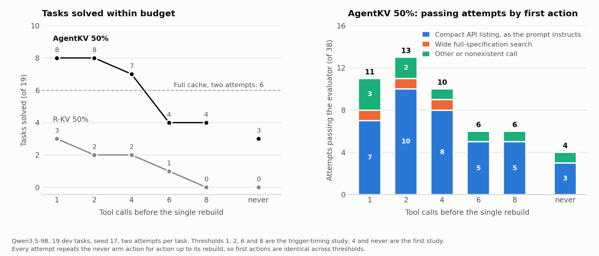

# Qwen3.5-9B: when the single rebuild happens at 50% retention

Moving AgentKV 50%'s one rebuild earlier than the fourth tool call changed
little; moving it later lost most of its benefit. With the rebuild after 1, 2
or 4 tool calls AgentKV solved 8, 8 and 7 of 19 dev tasks; after 6 or 8 calls
it solved 4, against 3 with no rebuild. An earlier rebuild did not bring
attempts that had opened with a wide documentation search back to the prompt's
lookup protocol: rebuilt after their first call, 13 of 20 searched again on the
next action and 1 of 20 passed. One seed, 19 dev tasks,
[declared before execution](dev19-recovery-design.md#supplemental-trigger-timing);
comparisons across thresholds are task-paired and descriptive.

[PDF](figures/dev19-trigger-timing.pdf) |
[Compact evidence](dev19-trigger-timing.json) |
[First study](dev19-recovery.md) |
[Failure reading](dev19-task-characteristics.md)

## Outcomes by threshold

Thresholds 1, 2, 6 and 8 are this study (four configurations of 38 cells, 152
in total); threshold 4 and never are the first study's arms for the same tasks and
seed 17. Each cell allows two attempts in 120 seconds.

| AgentKV 50%, rebuild after | Attempts rebuilt | Tasks solved | Solved on first attempt | Passing attempts | Ended at context limit | of which never rebuilt |
| --- | ---: | ---: | ---: | ---: | ---: | ---: |
| 1 tool call | 38/38 | 8/19 | 6 | 11 | 14 | 0 |
| 2 tool calls | 35/38 | 8/19 | 7 | 13 | 19 | 3 |
| 4 tool calls (first study) | 30/38 | 7/19 | 5 | 10 | 19 | 8 |
| 6 tool calls | 23/38 | 4/19 | 3 | 6 | 21 | 15 |
| 8 tool calls | 19/37 | 4/19 | 3 | 6 | 21 | 17 |
| never (first study) | 0/38 | 3/19 | 2 | 4 | 24 | 24 |

| R-KV 50%, rebuild after | Attempts rebuilt | Tasks solved | Passing attempts | Cells at the 120 s budget |
| --- | ---: | ---: | ---: | ---: |
| 1 tool call | 34/34 | 3/19 | 5 | 6 |
| 2 tool calls | 31/31 | 2/19 | 3 | 12 |
| 4 tool calls (first study) | 29/32 | 2/19 | 2 | 11 |
| 6 tool calls | 16/28 | 1/19 | 1 | 14 |
| 8 tool calls | 13/28 | 0/19 | 0 | 15 |
| never (first study) | 0/30 | 0/19 | 0 | 10 |

Paired by task against never, AgentKV gained five tasks and lost none at
thresholds 1 and 2 (exact sign test p = 0.06), four and none at 4 (p = 0.13),
and one and none at 6 and 8. Against threshold 4, threshold 1 gained two tasks
and lost one, threshold 2 gained one, and thresholds 6 and 8 each lost three.
No threshold lost a task that never solved. Thresholds 1, 2 and 4 differ by one
task and are not separated by this study; the drop is between 4 and 6. Full
cache with two attempts solved 6 of the same 19 tasks in the first study, which
two tasks at this size do not distinguish from 8.

## Against the recorded expectation

The design expected that, if an earlier rebuild restores the lookup protocol,
thresholds 1 and 2 would end fewer attempts at the context limit than threshold
4, and that thresholds 6 and 8 would approach never.

- Threshold 1 ended 14 attempts at the context limit against 19 at threshold 4.
  Threshold 2 ended 19, the same as 4. The first half held for one of the two
  thresholds.
- Thresholds 6 and 8 solved 4 tasks against never's 3 and ended 21 attempts at
  the context limit against 24. The second half held.
- The data do not support the premise for the attempts it was about. The
  rebuild restores the full transcript, prompt included, yet 13 of the 20
  search-opened attempts searched again on their next action and two ever
  called the listing (table below).

First actions are identical across thresholds, because every attempt repeats
the never arm until its rebuild. The same 38 starts are therefore compared
throughout: 13 opened with the compact listing the prompt prescribes, 20 with a
wide `search_api_docs` call, and 5 with another or a nonexistent documentation
call.

| First action (AgentKV 50%) | Passed at 1 | at 2 | at 4 | at 6 | at 8 | never |
| --- | ---: | ---: | ---: | ---: | ---: | ---: |
| Compact listing (13; 12 at threshold 8) | 7 | 10 | 8 | 5 | 5 | 3 |
| Wide search (20) | 1 | 1 | 1 | 0 | 0 | 0 |
| Other or nonexistent (5) | 3 | 2 | 1 | 1 | 1 | 1 |

| Rebuilt after one tool call, by first action | Rebuilt | Next action: search | Next action: listing | Listing at any later point | Passed |
| --- | ---: | ---: | ---: | ---: | ---: |
| Wide search | 20 | 13 | 1 | 2 | 1 |
| Other or nonexistent | 5 | 0 | 5 | 5 | 3 |
| Compact listing | 13 | 0 | 0 | 2 | 7 |

Search-opened attempts were all rebuilt at threshold 1, with one search result
in context. Thirteen issued another search immediately, two ever called the
listing, and they ended as 14 context limits, five completed failures and one
pass. At thresholds 2 and 4 the same group also passed once, and three and
eight of its attempts reached the context limit before any rebuild.

The five attempts whose opening call did not exist or was not the search went
to the listing on their next action in five of five cases when rebuilt after
one call, two of five after two calls and none after four or more. Three, two
and one of them passed. Among AgentKV attempts this is the only group that
moved to the listing after an early rebuild, and it has five attempts.

The 13 listing-opened attempts were rebuilt at every threshold from 1 to 6.
They passed 7 to 10 times at thresholds 1 to 4 and 5 times at threshold 6, so
the lower count at 6 is not a rebuild that failed to fire. A possible reading,
not tested here, is that by six calls the agent has already acted on a
degraded state, which a rebuild of the transcript does not undo: recovery never
replays tools or rolls back the environment.

R-KV 50% solved 3, 2, 2, 1, 0 and 0 tasks from threshold 1 to never. Its
attempts end in tool errors and timeouts, not context limits, and 25 of its 34
attempts at threshold 1 opened with neither lookup. After a rebuild at one call, 14 of those 25
called the listing next and 21 did at some later point, but four passed.

## Cost and consistency

Every requested rebuild was admitted and none was refused. At threshold 1 the
38 rebuilds took 80.9 seconds in total, 3.5% of the cell budgets; at threshold
2, 35 rebuilds took 95.4 seconds (4.2%); at 6 and 8, 72.3 and 64.8 seconds for
23 and 19 rebuilds. AgentKV cells averaged 49 to 58 seconds at every threshold.
Peak total GPU memory reached at most 23.12 GiB under the 24 GiB cap.

Every attempt matched its never-arm counterpart action for action up to its
rebuild: 38 of 38 AgentKV attempts at thresholds 1, 2 and 6 and 37 of 37 at 8,
and all 27 to 29 comparable R-KV attempts per threshold. The first study's
threshold-4 arms pass the same check. One R-KV attempt at each of thresholds 2
and 4 records a tool-call count that differs from its number of non-empty
actions. This study ran with the run directory and AppWorld root on node-local
disk, so on local storage every action before a rebuild reproduced the first
study's.

| Mean seconds per cell charged to the budget | Reset | Trajectory save | Tools | Cells at budget |
| --- | ---: | ---: | ---: | ---: |
| AgentKV, thresholds 1, 2, 6, 8 (this study) | 1.0-1.1 | 0.05-0.09 | 0.4-0.7 | 0, 0, 1, 2 |
| AgentKV, threshold 4 (first study) | 1.0 | 0.9 | 0.6 | 1 |
| AgentKV, never (first study) | 1.1 | 0.1 | 0.4 | 3 |
| R-KV, thresholds 1, 2, 6, 8 (this study) | 0.7-1.0 | 0.1-0.2 | 0.8-1.0 | 6, 12, 14, 15 |
| R-KV, threshold 4 (first study) | 0.9 | 0.4 | 3.0 | 11 |
| R-KV, never (first study) | 0.8 | 0.8 | 1.4 | 10 |

AgentKV cells in the two studies differ by about one second of charged I/O and
0 to 3 of 19 reach the budget per arm, so a second of I/O decides few of its
attempts. R-KV cells reach the budget in 6 to 15 of 19 cases per arm, and the
first study's threshold-4 arm carried about two seconds more I/O per cell than
its neighbours here; R-KV differences of one task should be read with that in
mind.

## Validation and provenance

Source `6164ba9` with the first study's runtime, device, cap and settings; only
the fixed threshold differs, in four separately digested configurations. Four
one-GPU workers ran the 152 cells on November 11, 2026 without preemption or
requeue, after two smoke runs of the node-local job scripts recorded in the
[design](dev19-recovery-design.md#node-local-execution-storage). Each
configuration was scored offline and analyzed as its own run through the shared
analysis; the tables above were then read offline from saved attempts and
scores with `comet.trigger_timing`. Run identifiers, configuration digests,
scheduler job numbers and the export hash are in the evidence record. Earlier
launches of this study were voided, as the design records, and are not used.

## Limits

One seed and 19 tasks, and the thresholds differ by a handful of tasks at
most; the [seed replicate](dev19-recovery.md#seed-replicate) since found the
threshold-4 gain at seeds 29 and 31 to be about half its seed-17 size. Oracle success is a best-of-two upper bound. The split by first action
is post hoc, and opening on protocol is not independent of the task. No fixed
threshold can change how an attempt opens, because the first action precedes
every rebuild; keeping the prompt's protocol through compression would be a
method change that needs its own research decision. These outcomes do not
retune the frozen test study.
