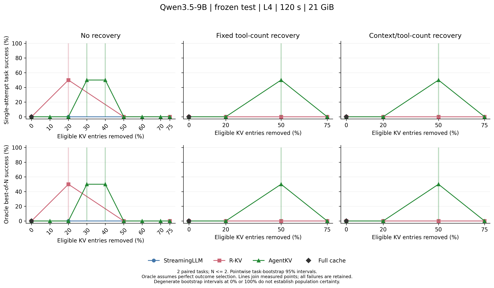
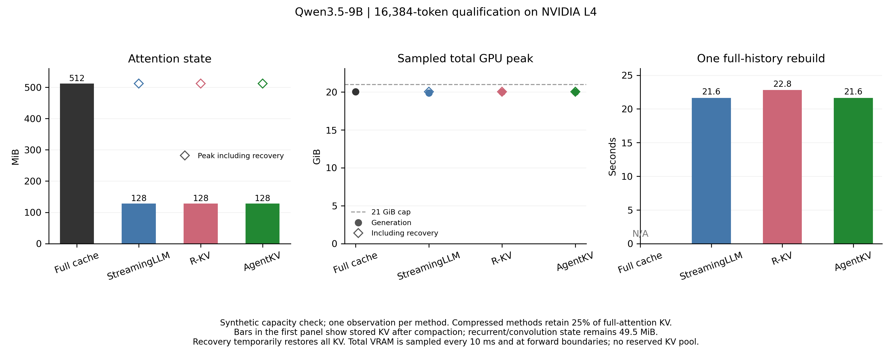

# Qwen3.5-9B: L4 findings

The frozen test found selective recovery benefits and harms. At 50% retention,
AgentKV recovery solved one of two tasks, versus zero without recovery or with
full cache. Recovery removed the only R-KV success at 80% retention. Additional
attempts added no test success, and the dynamic trigger did not outperform the
fixed trigger. Two task families and one seed do not establish a general ranking.

## Frozen test



The [frozen configuration](../../../configs/qwen9b/l4/final-v1.json) uses seed 17,
a shared 120-second budget per task/condition, a 21 GiB total-VRAM cap and at
most two sequential attempts, plus an N=1 full-cache control. All 68 cells and
101 attempts start from fresh task states and are scored afterward. The
[summary](final-summary.json) and [complete paired analysis](analysis/final-analysis.json)
retain every outcome.

| Method | Retained KV | Never | Fixed | Dynamic |
| --- | ---: | ---: | ---: | ---: |
| StreamingLLM | 80% | 0/2 | 0/2 | 0/2 |
| StreamingLLM | 50% | 0/2 | 0/2 | 0/2 |
| StreamingLLM | 25% | 0/2 | 0/2 | 0/2 |
| R-KV | 80% | 1/2 | 0/2 | 0/2 |
| R-KV | 50% | 0/2 | 0/2 | 0/2 |
| R-KV | 25% | 0/2 | 0/2 | 0/2 |
| AgentKV | 80% | 0/2 | 0/2 | 0/2 |
| AgentKV | 50% | 0/2 | 1/2 | 1/2 |
| AgentKV | 25% | 0/2 | 0/2 | 0/2 |

Entries are oracle successes within budget, assuming perfect outcome selection.
Full-cache N=1 and N=2 both score 0/2. All successes occur on first attempts,
so the first-attempt and oracle curves coincide. Supplemental AgentKV points
score 1/2 at 70% and 60%, and 0/2 at 90%, 40% and 30% retention. Competitors'
unmeasured intermediate points are not evidence.

AgentKV 50% recovery gains 50 percentage points versus never and full cache,
with a paired task-bootstrap 95% interval of [0, 100] points and a conservative
bounded interval of [-100, 100]. R-KV 80% recovery loses 50 points versus never
(bootstrap [-100, 0]; bounded [-100, 100]). Every successful cell concerns the
same playlist-update family. No settings or task selections changed after freezing.

The [trajectory case study](final-case-study.json) suggests recovery helps restore
authentication context in the AgentKV 50% condition. Fixed and dynamic rebuilds
cost 7.80 and 7.62 seconds; both continuations pass all six evaluator checks.
This does not identify causal tokens or establish a universally better trigger.

Of 101 attempts, nine completed (five correct), 60 timed out, 21 stopped on errors
and 11 reached the context limit. All 30 requested rebuilds were admitted, costing
3.58-8.35 seconds. Observed total VRAM peaked at 20.05 GiB. Maximum budget overshoot
was 0.77 seconds from in-flight work and cleanup; failures received no extra budget.
AgentKV 50% recovery fit fewer attempts than never-rebuild or full cache, so its
success did not come from more attempts.

## Train/dev and checkpoint diagnostic

The [v4 capability pilot](protocol-v4.json) solved 3/4 predeclared train tasks
at 16,384 tokens: file organization, arithmetic and phone deletion. Spotify review
editing failed. Earlier pilots scored [0/4](l4-baseline.json) and [1/4](protocol-v3.json);
prompt, context and backend changes prevent interpreting those differences as
the effect of any single intervention. Four families and one seed provide weak
population precision.

The [L4 train grid](analysis/train-finegrid-analysis.json) solved one arithmetic
task with full cache and AgentKV at 90/80/70/60/50% retention. AgentKV failed at
40/30/25%; StreamingLLM and R-KV failed at every compressed point. This locates
a transition on one fixture, not a population optimum.

The [independent budget sweep](analysis/independent-budgets.json) solved 1/2 train
tasks with full cache at 90 and 120 seconds and 2/2 at 150 seconds. Every 25%
compressed arm scored 0/2 at all three budgets. In separate
[dev confirmation](analysis/dev-confirmation-analysis.json), a second full-cache
attempt raised oracle success to 1/2 from 0/2 first attempts; all compressed
25% arms failed. The [pilot summary](pilot-summary.json) covers all 109 cells
and 125 attempts across six runs, including failures and budget overshoots.

The [28-arm Q1 diagnostic](analysis/q1-diagnostic-analysis.json) starts each branch
from the same arithmetic checkpoint after two tools. Its 90-second budget includes
9.11 seconds of preparation. Dynamic recovery changes failure to success at 25%
retention for R-KV and AgentKV; fixed recovery helps AgentKV at 50%. Recovery also
harms two previously successful settings. All 17 requests were admitted. These
are branches on one task, with degenerate bootstrap intervals and conservative
intervals spanning the full difference range; they cannot replace fresh-start test
results. See the separate [three-family Blackwell diagnostic](blackwell.md).

## Memory and qualification



The [16K capacity check](validation/l4-context-16384.json) uses the same synthetic
history for every method. At 25% retention, attention KV falls from 512 to 128 MiB;
recurrent/convolution state remains 49.5 MiB. Full-history recovery temporarily
rebuilds all 512 MiB and costs 21.6-22.8 seconds. Sampled total GPU peaks remain
20.05 GiB, below the 21 GiB cap. A 75% KV reduction is not a 75% total-VRAM reduction.

These are synthetic capacity observations, not task-quality measurements. Total
VRAM is sampled every 10 ms and at forward boundaries, so shorter external-memory
transients can be missed. FLOPs are estimates that omit recurrent updates,
eviction, elementwise operations and vision. Live [AppWorld recovery](validation/l4-appworld-recovery.json)
and [process-interruption](validation/l4-resume.json) checks establish their
recorded integration scope, not correctness for every later change.

## Reproduction

Frozen run `comet-run:b4c4ade9-2ab1-4c76-8863-6cc727920d8b` executed source
`cc9057a`; the v4/16K evidence used `0d438bf`. JSON records retain revisions and
portable artifact identities. Configurations were reorganized without changing
resolved values or hashes. The cloud's final bulk transfer timed out after the
scientific work completed; its closed per-plan archives were independently
retrieved. The optional Blackwell test was frozen but never executed because
queue estimates exceeded the deadline; it is not additional test evidence.

After [activating the CPU runtime](../../setup.md), regenerate any format:

```sh
comet plot-aggressivity documents/records/qwen9b/analysis/final-analysis.json \
  --output /path/to/figures/final-aggressivity.svg \
  --title 'Qwen3.5-9B | frozen test | L4 | 120 s | 21 GiB'
```

The same analysis feeds `plot-resources`, `plot-recovery`, `plot-triggers`,
`plot-attempts` and `plot-success-time`. The capacity figure uses
`scripts/plot_hybrid_qualification.py` with `validation/l4-context-16384.json`.
Selected PDF exports: [test curve](figures/final-aggressivity.pdf),
[capacity](figures/qualification-16k.pdf).
