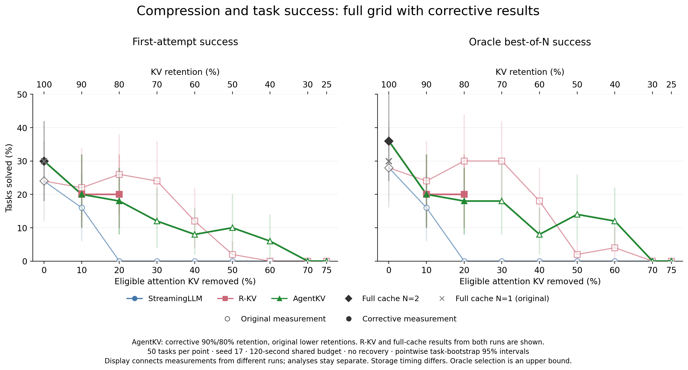
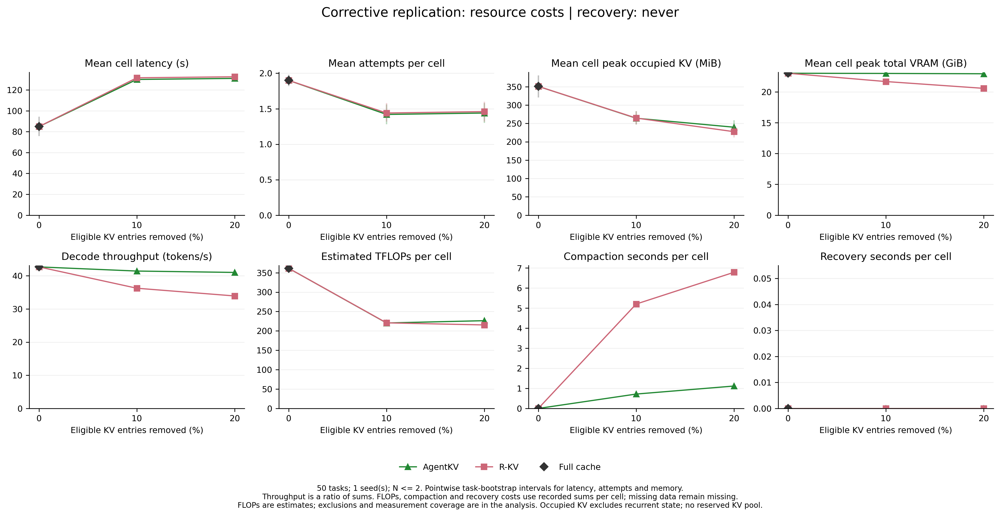

# Fifty-task CUDA repair replication

The corrective study completed on **November 11, 2026**, with all five
conditions and **250 task/condition cells** scored. AgentKV at 90% retention
reached **10/50 (20%)**, compared with 2/50 (4%) in the original run and
9/50 (18%) at 80% retention in this replication. There were **zero CUDA errors
and zero OOMs across all 383 attempts**. The original sharp drop did not recur.

This supports the [failure investigation](agentkv90-investigation.md): the
original 90% point was contaminated by execution bugs. It does not isolate the
effect of either repair. Process isolation, cache placement and storage delays
also changed. Shared-storage delays still materially affect the new success
measurements, particularly comparisons with full cache, which ran later.

This is a separate corrective cohort on previously inspected held-out tasks,
not a new blind test. The [original 26-condition study](test50-final.md) and all
its failures remain intact; the cohorts remain separate in the analyses. The
requested display below combines selected points without pooling observations.

## Success and uncertainty



The full-grid overview uses solid lines throughout. At the user's request,
the AgentKV curve uses the corrective 90% and 80% retention measurements in
place of the original points, followed by the original measurements below 80%.
It starts at the corrective full-cache N=2 control. The old AgentKV 90% and 80%
points are omitted from this display, but remain in the original analysis and
the table below. Original and corrective R-KV and full-cache measurements are
both shown; StreamingLLM was not rerun. Hollow markers identify original
measurements and filled markers identify corrective measurements. This is a
mixed-run display, not a newly measured complete grid or a pooled estimate.

[Full-grid 0-50% PDF](figures/test50-combined-aggressivity-y50.pdf) |
[Full-grid 0-100% PNG](figures/test50-combined-aggressivity.png) |
[Full-grid 0-100% PDF](figures/test50-combined-aggressivity.pdf)

The corrective cohort is also available by itself:

[0-50% PNG](figures/test50-cuda-repair-aggressivity-y50.png) |
[0-50% PDF](figures/test50-cuda-repair-aggressivity-y50.pdf) |
[Full-range PNG](figures/test50-cuda-repair-aggressivity.png) |
[Full-range PDF](figures/test50-cuda-repair-aggressivity.pdf) |
[CSV](test50-cuda-repair.csv) |
[Evidence and timing audit](test50-cuda-repair-summary.json) |
[Aggregate analysis](analysis/test50-cuda-repair-analysis.json)

Every denominator is 50 paired tasks, seed 17. First-attempt and oracle counts
include every failure. Oracle selection is the perfect-selection upper bound
among at most two attempts sharing 120 seconds, not an online policy.

| Condition | Original first; oracle | Corrective first; oracle | Corrective oracle 95% interval |
| --- | ---: | ---: | ---: |
| AgentKV 90% | 2/50; 2/50 | **10/50; 10/50** | 10-32% |
| AgentKV 80% | 7/50; 9/50 | 9/50; 9/50 | 8-28% |
| R-KV 90% | 11/50; 12/50 | 10/50; 10/50 | 10-32% |
| R-KV 80% | 13/50; 15/50 | 10/50; 10/50 | 10-32% |
| Full cache N=2 | 12/50; 14/50 | 15/50; 18/50 | 24-50% |

Within the corrected cohort, AgentKV 90% minus 80% is **+2 percentage points**,
with a paired task-bootstrap 95% interval of **[-10, +14] points** for both
metrics. This does not establish a retention ranking. Intervals use 2,000 draws
over tasks, keeping attempts and conditions paired; they are pointwise, not
simultaneous. All ten pairwise comparisons remain in the aggregate analysis.

Seven of AgentKV 90%'s ten successes are tasks whose original attempts both
failed in the poisoned CUDA context. Two others originally had only OOMs;
one originally completed execution. This is evidence that the original failures
hid solvable tasks, not an estimate of what every original attempt would have
achieved without a bug. The first illegal-access kernel remains unidentified,
and the historical OOM count attributable to retained exception frames remains
unknown.

## Remaining failures and storage effects

The 383 attempts comprise **155 completed executions, 205 timeouts, 18
context-limit stops and five agent protocol errors**. A completed execution is
not necessarily a successful task. There were no OOMs, CUDA errors,
interruptions, infeasible cells or zero-attempt cells. All observed peak total
VRAM measurements fit the unchanged 24 GiB cap; the maximum was 23.12 GiB.

| Condition | Attempts | Completed | Timeout | Context limit | Protocol error |
| --- | ---: | ---: | ---: | ---: | ---: |
| AgentKV 90% | 71 | 23 | 46 | 2 | 0 |
| AgentKV 80% | 72 | 22 | 50 | 0 | 0 |
| R-KV 90% | 72 | 21 | 48 | 2 | 1 |
| R-KV 80% | 73 | 21 | 48 | 2 | 2 |
| Full cache N=2 | 95 | 68 | 13 | 12 | 2 |

The checkout, runtime and generated AppWorld code cache were job-local, but
**run artifacts and AppWorld data remained on shared storage**. The four
compressed workers began together; the full-cache worker began two hours later,
as they finished. Measured timing differences are substantial:

| Condition | Mean cell time (s) | Reset (s/cell) | Trajectory saving (s/cell) | Tools (s/cell) |
| --- | ---: | ---: | ---: | ---: |
| AgentKV 90% | 130.03 | 5.89 | 39.20 | 38.68 |
| AgentKV 80% | 131.04 | 2.92 | 43.16 | 36.89 |
| R-KV 90% | 131.61 | 2.34 | 40.59 | 36.17 |
| R-KV 80% | 132.58 | 2.38 | 37.74 | 38.45 |
| Full cache N=2 | 84.89 | 1.18 | 14.84 | 15.13 |

Times sum recorded attempts within each cell before averaging over all 50
tasks. Tool times include actual tool work as well as any storage delay; these
are observations, not an attribution of all time to contention. Storage costs
consume the same budget as inference and limit opportunities for a second
attempt. Therefore the full-cache gap and historical before/after differences
cannot isolate algorithm quality or the effect of the repairs. The paired
AgentKV comparison shares the concurrent execution window but remains subject
to timing variability and the wide uncertainty above.

Of 250 cells, 208 exceeded 120 seconds by more than one second; the largest
overrun was 59.14 seconds. In-flight work, saving and cleanup can extend recorded
wall time. No successful attempt was credited after its budget; the latest
credited success was at 116.08 seconds. No failure or delayed task was replaced.



[Resource PDF](figures/test50-cuda-repair-resources.pdf). Configured retention is
the fraction of full-cache attention KV at the same raw-token step, not total
VRAM savings. The analysis separately preserves occupied KV, uncompressed
recurrent state, total VRAM, throughput, estimated FLOPs and metric coverage.
These resource measurements include the storage effects described above.

## Completion and validation

The [frozen configuration](../../../configs/qwen9b/blackwell/test50-cuda-repair-v2.json)
keeps all 50 original task IDs, Qwen3.5-9B, hybrid BF16, seed 17, prompts,
sampling, 16K context, 24 GiB cap and 120-second shared two-attempt budget.
Each condition uses one RTX PRO 6000 Blackwell Server Edition and four host CPU
threads. All five matching two-task dev gates completed without CUDA errors,
OOMs or infeasibility before their respective final runs. Two dev timeout
attempts lack peak-memory measurements; missing values are not counted as zero.

Array `13857623` completed all five workers. The first four allocations began
at 00:32:40 ET; full cache began at 02:32:33. The last worker finished at
03:52:40, and offline scorer `13857624` finished at **04:02:54 ET**, all on
November 11. All six study/scoring jobs exited successfully. The prior 18:00
planning ETA is superseded; no study jobs remain and no GCP resources were used.

Execution and evaluation used repaired source **`d97c49d`**, before the later
repository refactor. The reporting audit on the refactored `dev/yenna` checked
all 250 unique frozen task/condition/seed tuples, terminal/scored state, all
five dev gates, matching execution/evaluator source hashes and packages,
hardware, caps, failure accounting and 11 downloaded artifact hashes. Its
shared analysis API reproduces every saved condition aggregate and all ten
paired comparisons. It does not rerun offline evaluation or qualify the
refactored GPU runner. No new inference was needed for this reporting update.

Raw trajectories and evaluator-compatible environments remain in external
project storage. The evidence summary identifies each source run and its
hashes; the committed analysis omits only detailed observations and replaces
private source locations with portable run IDs. PNG and PDF plots use the
current shared plotting commands and were visually inspected.

After [activating the CPU runtime](../../setup.md), regenerate the full-grid overview:

```sh
python scripts/plot_corrective_comparison.py \
  documents/records/qwen9b/analysis/test50-final-analysis.json \
  documents/records/qwen9b/analysis/test50-cuda-repair-analysis.json \
  --output /path/to/figures/test50-combined-aggressivity-y50.png
```

Add `--y-max 100` for the 0-100% version. The script uses the shared series
extraction and checks matching tasks, seeds, stage and condition settings; it
selects the corrective AgentKV 90%/80% points for the display without combining
success estimates or bootstrapping across cohorts.

To regenerate the corrective-only views:

```sh
comet plot-aggressivity documents/records/qwen9b/analysis/test50-cuda-repair-analysis.json \
  --title "Corrective replication" --y-limits 0 50 \
  --output /path/to/figures/test50-cuda-repair-aggressivity-y50.png
comet plot-resources documents/records/qwen9b/analysis/test50-cuda-repair-analysis.json \
  --policy never --title "Corrective replication: resource costs" \
  --output /path/to/figures/test50-cuda-repair-resources.png
```

Omit `--y-limits` for the full-range view; use `.pdf` for vector exports.
