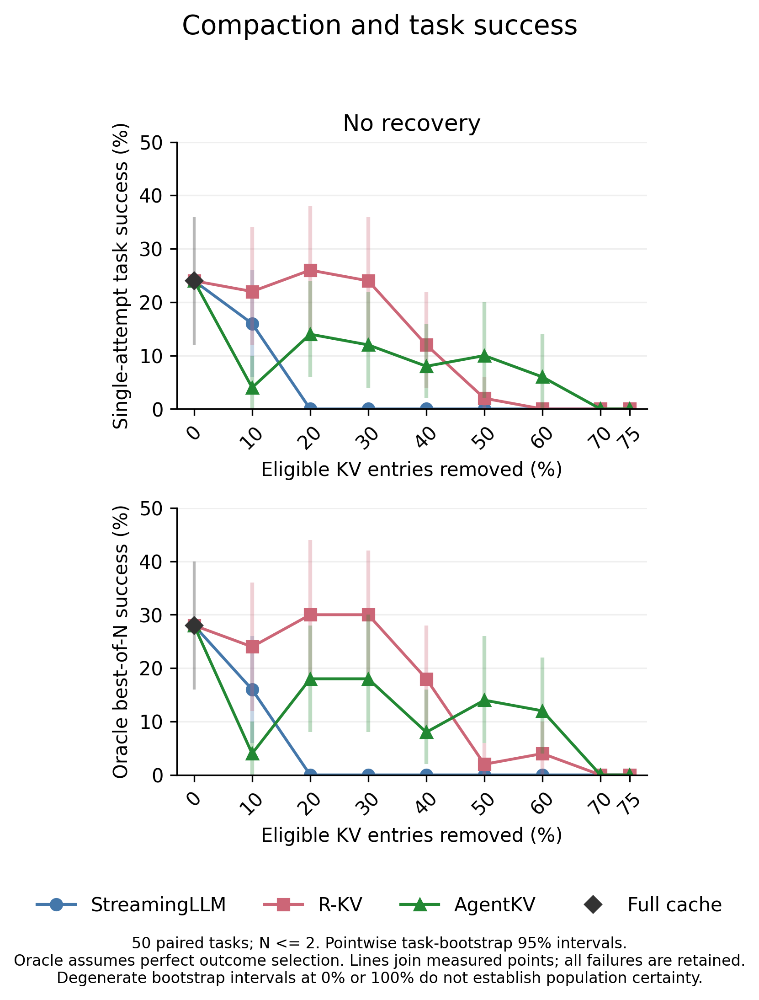
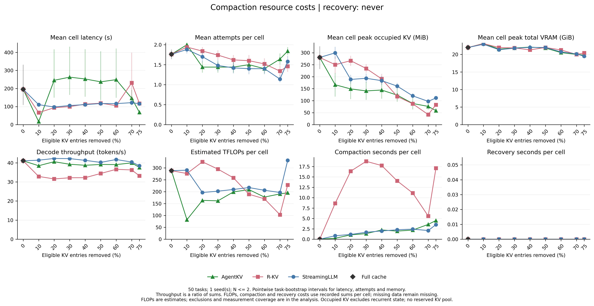

# Fifty-task final results

The frozen Blackwell expansion completed on November 10, 2026: **26 conditions,
50 paired held-out tasks per condition, and all 1,300 evaluations scored**.
The five remaining AgentKV points are now included. Their compatible resumes
finished at 16:29:59 ET; final scoring and plotting finished at 16:59:29 ET.
No GCP resources were launched. The earlier November 12 queue estimate is obsolete.

This study measures compression without recovery. It expands task coverage of
the fine grid; it does not enlarge the earlier recovery experiment or pool its
results with this cohort. The [frozen design](test50-design.md) specifies the
task selection and comparisons.

## Compression and task success



[0-50% PDF](figures/test50-final-aggressivity-y50.pdf) |
[Full-range PNG](figures/test50-final-aggressivity.png) |
[Full-range PDF](figures/test50-final-aggressivity.pdf) |
[All-condition CSV](test50-final.csv) |
[Evidence summary](test50-final-summary.json) |
[Aggregate analysis and paired comparisons](analysis/test50-final-analysis.json)

Both axis versions show the same measurements and confidence intervals. The
horizontal axis is the configured percentage of eligible attention KV entries
removed, not total-VRAM savings. Recurrent state is uncompressed; mandatory
floors, rounding and trajectory length affect realized KV occupancy.

Each entry below gives **first-attempt successes; oracle successes**, out of
the same 50 tasks. Oracle selection assumes perfect post-hoc outcome selection
among at most two attempts sharing 120 seconds. It is an upper bound, not an
online selection policy. All conditions use seed 17 and a 24 GiB total-VRAM cap.

| Retained KV | StreamingLLM | R-KV | AgentKV |
| ---: | ---: | ---: | ---: |
| 90% | 8/50; 8/50 | 11/50; 12/50 | 2/50; 2/50 |
| 80% | 0/50; 0/50 | 13/50; 15/50 | 7/50; 9/50 |
| 70% | 0/50; 0/50 | 12/50; 15/50 | 6/50; 9/50 |
| 60% | 0/50; 0/50 | 6/50; 9/50 | 4/50; 4/50 |
| 50% | 0/50; 0/50 | 1/50; 1/50 | 5/50; 7/50 |
| 40% | 0/50; 0/50 | 0/50; 2/50 | 3/50; 6/50 |
| 30% | 0/50; 0/50 | 0/50; 0/50 | 0/50; 0/50 |
| 25% | 0/50; 0/50 | 0/50; 0/50 | 0/50; 0/50 |

The matched full-cache N=2 control scores **12/50 (24%) first-attempt success**
and **14/50 (28%) oracle success**. This is the zero-removal point in both
panels. The separately executed N=1 control scores 15/50 (30%) and is retained
in the CSV and analysis. Its first-attempt difference from N=2 includes timing
and storage effects; it is not a causal estimate of allowing another attempt.

R-KV at 70% and 80% retention reaches 30% oracle success, compared with 28%
for full-cache N=2. Each paired difference is +2 percentage points with a
task-bootstrap 95% interval of **[-10, +14] points**, so these observations do
not establish superiority. AgentKV reaches 18% at 70% and 80% retention;
StreamingLLM reaches 16% at 90% and zero at every measured lower retention.
These are observed outcomes under this implementation and operating regime,
not a general ranking of the methods.

Uncertainty uses 2,000 paired task-bootstrap draws; attempts are not independent
samples. Intervals are pointwise, not simultaneous across the grid. Zero-width
bootstrap intervals at zero successes do not establish zero population success;
the analysis also retains conservative bounded-mean intervals. Fifty families
and one seed provide broader coverage than the pilots, but leave substantial
uncertainty. No test outcomes were used to change the frozen settings.

## Failures and resource costs

There are **2,026 attempts**: 437 completed executions, 822 timeouts, 529 errors,
174 context-limit stops, 59 OOMs and five interruptions. A completed execution
does not necessarily pass the offline evaluator. The errors comprise 470
agent protocol failures and 59 CUDA illegal-memory-access failures. All failures
remain unsuccessful in the denominators.

AgentKV at 90% retention accounts for all 59 CUDA illegal-access failures and
31 OOM attempts; only ten attempts completed there. R-KV at 90% has the other
28 OOM attempts. These points reflect runtime failures as well as task behavior
and cannot isolate reasoning quality. The [subsequent investigation](agentkv90-investigation.md)
confirmed that one CUDA fault poisoned the remaining 29 AgentKV tasks and found
a runner bug retaining failed-operation tensors. The completed
[corrective replication](test50-cuda-repair.md) scores AgentKV 90% at 10/50
(20%), with no CUDA errors or OOMs across its five conditions. It retains
storage-related limitations and preserves this original curve as a separate
cohort. The five interrupted attempts each keep
their original 120-second reservation, with no replacement attempt or budget.



[Resource PDF](figures/test50-final-resources.pdf). The analysis preserves metric
coverage, unavailable observations, estimated-FLOP exclusions, occupied KV and
uncompressed recurrent state separately from total VRAM. Resource means use
their recorded coverage; missing measurements are not zeros.

Recorded cell latency includes in-flight work, saving and cleanup. Of 1,300
cells, 462 exceeded the nominal 120-second budget by more than one second;
the largest recorded overrun was **3,914.06 seconds (65m14s)**. Shared-storage
stalls were observed during execution, so these latencies cannot be interpreted
as GPU-only compute costs or strict 120-second wall-time completion. No credited
successful attempt completed after its budget: the latest was at 119.07 seconds.
All overruns and failures remain in the evidence.

## Completion, validation and reproduction

Execution and the AppWorld evaluator remain pinned to source `f2413b4`, using
Qwen3.5-9B, the hybrid BF16 backend, 16,384-token context and one RTX PRO 6000
Blackwell Server Edition per worker. The parent configuration, all 50 task IDs,
seed and comparison settings are unchanged. The [validation repair](test50-validation-repair.json)
and [resume record](test50-resume-20261110.json) preserve the launch history.

Resume array `13853125` ran partitions 01 and 04-07 on the restored node starting
at 16:06:05 ET. It preserved the 1,246 previously terminal cells, settled five
interrupted journals and executed the 49 unstarted cells. All five workers
exited successfully. Scorer `13853128` then finalized all eight partitions,
scored saved outcomes offline and produced the complete parent analysis and
plots. It completed in 29m29s. All 21 previously reported conditions retain
their first-attempt and oracle success counts.

The final evidence audit verified all 1,300 unique task/condition/seed tuples
against the frozen parent, terminal/scored state, partition manifests, matching
evaluator source hashes and packages, retained failures and original interruption
charges. SHA-256 checks verified all 21 downloaded source artifacts. The plotting
change passed lint, shell syntax and two focused CPU checks; both y-axis bounds
and unchanged point coordinates were checked using the final data. No inference
or live GPU checks were rerun for this reporting update.

The committed aggregate analysis retains every condition, resource aggregate,
uncertainty estimate and all 325 paired comparisons. Per-cell and per-attempt
observations remain in the full external analysis, alongside original manifests,
scores, raw transcripts and evaluator-compatible environments. Portable run IDs
and source/export hashes are in the evidence summary. Superseded partial exports
remain available in Git history.

After [activating the CPU runtime](../../setup.md), regenerate either view:

```sh
comet plot-aggressivity documents/records/qwen9b/analysis/test50-final-analysis.json \
  --output /path/to/figures/test50-final-aggressivity.png
comet plot-aggressivity documents/records/qwen9b/analysis/test50-final-analysis.json \
  --y-limits 0 50 --output /path/to/figures/test50-final-aggressivity-y50.png
comet plot-resources documents/records/qwen9b/analysis/test50-final-analysis.json \
  --policy never --output /path/to/figures/test50-final-resources.png
```

Replace `.png` with `.pdf` for vector exports. The final study has no remaining
inference, scoring or plotting jobs.
