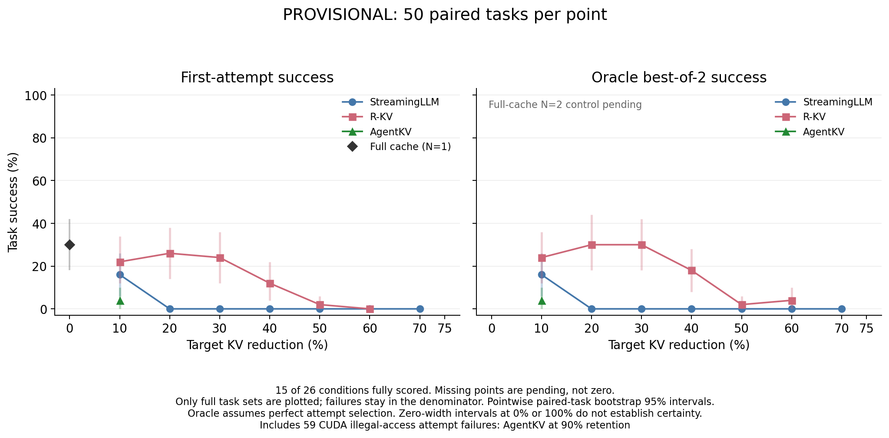

# Fifty-task provisional results

The November 9, 2026, 22:28:44 ET snapshot contains **15 of 26 conditions**, each
with the same 50 held-out tasks and seed 17: **750 task-condition evaluations**.
Every condition that had completed all 50 tasks at capture time is included.
Partially finished conditions are not scored on their faster subset. The study
remains frozen and these results do not guide ongoing execution.

[PDF](figures/test50-partial-aggressivity.pdf) |
[All-condition CSV](test50-partial.csv) |
[Compact evidence](test50-partial-summary.json)

## Observed success

The refresh adds R-KV at 60%, 50% and 40% retention, with oracle success of
9/50 (18%), 1/50 (2%) and 2/50 (4%), respectively. All 600 outcomes from the
previous 20:20 snapshot are unchanged. The stronger-compression points extend
the curve without changing the study or replacing failures.

| Method | Retained KV target | First attempt | Oracle within budget |
| --- | ---: | ---: | ---: |
| Full cache (N=1) | 100% | 15/50 (30%) | 15/50 (30%) |
| StreamingLLM | 90% | 8/50 (16%) | 8/50 (16%) |
| StreamingLLM | 80% | 0/50 (0%) | 0/50 (0%) |
| StreamingLLM | 70% | 0/50 (0%) | 0/50 (0%) |
| StreamingLLM | 60% | 0/50 (0%) | 0/50 (0%) |
| StreamingLLM | 50% | 0/50 (0%) | 0/50 (0%) |
| StreamingLLM | 40% | 0/50 (0%) | 0/50 (0%) |
| StreamingLLM | 30% | 0/50 (0%) | 0/50 (0%) |
| R-KV | 90% | 11/50 (22%) | 12/50 (24%) |
| R-KV | 80% | 13/50 (26%) | 15/50 (30%) |
| R-KV | 70% | 12/50 (24%) | 15/50 (30%) |
| R-KV | 60% | 6/50 (12%) | 9/50 (18%) |
| R-KV | 50% | 1/50 (2%) | 1/50 (2%) |
| R-KV | 40% | 0/50 (0%) | 2/50 (4%) |
| AgentKV | 90% | 2/50 (4%) | 2/50 (4%) |

All denominators include timeouts, memory failures, context limits and errors.
Oracle success assumes perfect selection among at most two attempts sharing
120 seconds. The full-cache N=1 control permits one attempt. The matched N=2
control is still missing, so the two 30% R-KV oracle rates cannot establish
parity with full-cache best-of-two performance. Uncertainty remains substantial:
the full-cache first-attempt bootstrap interval is 18-42%, and the R-KV 70%
oracle interval is also 18-42%. Pointwise intervals do not establish a ranking.

StreamingLLM records 8/50 successes at 90% retention and 0/50 at each measured
30-80% retention setting. Zero-width bootstrap intervals for all-failure samples
do not establish zero population success. Conservative bounded intervals are
retained in the compact evidence. The horizontal axis is the configured
100 times (1 minus retention), not measured total-VRAM savings; recurrent state
remains uncompressed and realized KV occupancy varies with floors and rounding.

## Runtime failures and missing comparisons

AgentKV at 90% retention has **59 CUDA illegal-access attempt failures** and
31 OOM attempts, with only ten completed attempts. Its 2/50 success point
therefore reflects substantial runtime failure as well as task behavior; it
cannot isolate the method's reasoning quality. R-KV at 90% retention has
28 OOM attempts. These failures remain in the data and receive no free retries.

The snapshot lacks full-cache N=2, all 25% retention conditions, R-KV at 30%
retention and AgentKV at 30-80% retention. The CSV distinguishes partial
execution coverage from fully scored conditions. Missing plot points are gaps,
not zero-valued measurements.

## Execution and reporting provenance

Execution and the shared AppWorld evaluator remain pinned to `f2413b4` with
Qwen3.5-9B, the hybrid BF16 backend, RTX PRO 6000 Blackwell Server Edition,
16K context and the 24 GiB total-VRAM cap. The parent configuration and task
selection are unchanged from the [study design](test50-design.md). No model
inference, task reset or task budget was repeated to create this report.

The completed-condition snapshot copies saved environments before offline
scoring. The refresh reuses 240 previously scored completed attempts after verifying
unchanged terminal-cell hashes and the same evaluator/runtime. It scores 37 newly
covered completed attempts through the ordinary AppWorld evaluator using four
isolated CPU processes; unsuccessful execution attempts retain failure outcomes.
The parent snapshot and score hashes are preserved. Both reports and the original
saved environments remain in external storage. The shared analysis uses 2,000 paired task-bootstrap
draws. All 15 conditions were audited to retain exactly the same 50 task/seed
pairs, and every execution failure was verified to remain unsuccessful.

Shared-filesystem reads stalled the initial scoring jobs. Scoring completed in
an isolated job-local workspace using base databases freshly downloaded from
the same official AppWorld data version 0.2.0, with the existing immutable task
assets. Database filenames and sizes match the installed data; copied file
hashes are retained in the compact evidence. Only copied snapshot references
were redirected and restored. Original task outcomes and environment references
were not rewritten.
Refresh job `13848410` scores and plots on Insomnia. The freshly downloaded
base-database hashes match the previous scorer's copies. No GCP resources were launched.

Partition 02 saved all 150 terminal cells before its process failed during CUDA
shutdown. Metadata-only finalization established that no eligible cells remained;
its failures and consumed budgets are preserved. The original final-report job
was cancelled by its success-only dependency. Replacement job **13847761** waits
for array 13845293 to exit, then finalizes all partitions before ordinary full
scoring. Missing or eligible cells still block that report. The other GPU workers
continue. At this snapshot, the formerly queued full-cache N=2 condition has
completed 7/50 cells and R-KV at 30% retention has completed 45/50; both remain
unplotted until the full paired task set is available.

The reporting implementation passed 354 CPU regression checks before the later
parallel/asset additions, with two optional Torch skips and 17 live checks
excluded. Five focused snapshot, process-isolation and asset tests passed;
the independent-asset fallback passed its updated test. The refresh passed six
focused checks and an exact comparison of all 600 prior scored cells. Plots were rendered and
visually inspected. Full scores, analyses, evaluator provenance and original
snapshots remain in external project storage; portable IDs and content hashes
are recorded in the compact evidence.
