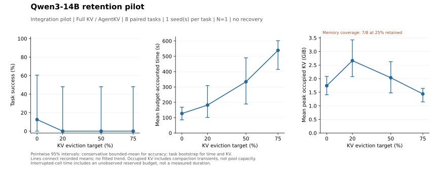

# Qwen3-14B retention pilot results

The repaired exploratory pilot completed execution, offline scoring, numerical
checks, and export on October 20, 2026. Review on October 31 reproduced the saved
analysis. Full cache solved **1 of 8 tasks**; AgentKV at 80%, 50%, and 25%
retention solved **0 of 8 each**. All 32 attempts remain in the comparison,
including ten timeouts and one interrupted attempt.

These are development results for Qwen3-14B on alternative hardware. With one
attempt per condition and recovery disabled, they do not answer the proposal's
recovery or best-of-N questions and cannot freeze the main Qwen3-8B/A100 study.
Low full-cache success and the small sample limit the accuracy comparison.

## Setup and scope

The [declared plan](retention-pilot-2026-10-17-plan.md) and
[configuration](../../configs/pilot-retention-qwen14b.json) specify eight task
families sampled from the 19 dev families without inspecting scores, using
variant `_1` and paired seed 17. Every cell starts a fresh environment and has
one attempt, a 600-second budget, a 32,768-token context limit, and the same
40 GiB peak total VRAM cap. Sampling uses temperature 0.6, top-p 0.95, reasoning
enabled, and up to 4096 generated tokens per response.

Execution used Qwen3-14B in BF16 through pinned AgentKV Mini-SGLang on one
NVIDIA RTX PRO 6000 Blackwell Server Edition at a time. The continuation changed
nodes after a driver stall, with identical device, driver, CUDA, source, and
configuration checks. The original 25 terminal cells were preserved. The
interrupted cell received no replacement attempt; the six untouched cells ran
on continuation. This is not an uninterrupted single-node timing run.

Run `f15c5c5b-7e6b-4134-bf36-454bb434f1a4` used clean source
`60ccf510a809c0b1dceafda52e4ba51d090a8123`. The
[evidence record](retention-pilot-2026-10-20.json) preserves the resolved config,
model/tokenizer and dependency revisions, patches, package versions, hardware,
job outcomes, and artifact hashes. The earlier
[quota-compromised run](retention-pilot-2026-10-17-quota-failure.json) remains
excluded in full; no outcomes from it were pooled into this comparison.

## Task outcomes

| Condition | Solved | Normal completions | Timeouts | Interrupted |
| --- | ---: | ---: | ---: | ---: |
| Full cache | 1/8 (12.5%) | 8 | 0 | 0 |
| AgentKV 80% | 0/8 | 7 | 1 | 0 |
| AgentKV 50% | 0/8 | 5 | 3 | 0 |
| AgentKV 25% | 0/8 | 1 | 6 | 1 |

Only full cache on `fac291d_1` passed the AppWorld evaluator. Normal completion
means that the agent ended the task, not that it solved it. All 21 normal
completions were evaluated after execution finished; the remaining 11 attempts
count as failures. Single-attempt and oracle success coincide because N=1.
Oracle success remains the perfect-selection upper bound defined in the proposal.

The conservative pointwise 95% bounded-mean intervals are **0-60.5%** for full
cache and **0-48.0%** for each compressed condition. The paired difference for
each compressed condition minus full cache is -12.5 percentage points, with
task-bootstrap interval [-37.5, 0.0]. This does not establish a reliable
accuracy ordering. The all-zero compressed samples have zero empirical SE and
collapsed bootstrap intervals; neither implies zero population uncertainty.

## Time and memory

Entries below are mean +/- task standard error, followed by the pointwise 95%
task-bootstrap interval. The analysis uses 10,000 draws with seed 20261017,
resampling tasks while preserving paired conditions. One replicate seed does
not measure seed-to-seed variability.

| Condition | Budget-accounted time, seconds | Peak occupied KV, GiB |
| --- | ---: | ---: |
| Full cache | 127.1 +/- 22.6 [85.7, 167.9] | 1.740 +/- 0.184 [1.409, 2.084] |
| AgentKV 80% | 182.0 +/- 61.6 [101.3, 309.3] | 2.663 +/- 0.380 [2.075, 3.429] |
| AgentKV 50% | 334.0 +/- 81.7 [189.1, 490.0] | 2.034 +/- 0.316 [1.475, 2.626] |
| AgentKV 25% | 538.8 +/- 62.0 [414.4, 601.5] | 1.438 +/- 0.145 [1.147, 1.642] |

Time includes reset, inference, tools, outcome saving, cleanup, and bookkeeping;
model initialization and offline evaluation are excluded. The 25% condition
includes a **600-second unobserved budget reservation** for the interrupted
attempt. Its measured duration is unavailable, not zero. Ten attempts timed
out; the largest measured deadline overrun was 3.56 seconds. These attempts
remain failures, and their recorded costs are retained.

Relative to full cache, mean paired time differences are +54.9 seconds at 80%
(95% CI [-28.0, 188.9]), +206.8 at 50% ([81.4, 331.1]), and +411.6 at 25%
([292.4, 496.6]). The last includes the interruption reservation. These are
observed pilot costs, not a general retention scaling law.

Memory and other resource metrics cover all eight attempts per condition except
25%, where coverage is **7/8**. The missing interrupted trajectory and resource
measurements are not imputed. Its failure remains in the success and time
denominators. Resource comparisons involving 25% use the seven shared observed
tasks, so their differences need not equal the difference of the displayed
unpaired condition means.

Peak occupied KV includes compaction transients; it is distinct from the common
preallocated KV pool and total VRAM. Trajectories evolve independently and reach
different lengths, so the 80% and 50% conditions can have larger observed peaks
than full cache. These measurements do not compare caches at a common token
position. The largest observed total VRAM peak was 34.27 GiB, below the 40 GiB
cap; the interrupted attempt has no peak measurement.



The 0% eviction point is the full-cache control; 20%, 50%, and 75% eviction are
AgentKV at 80%, 50%, and 25% retention. Lines only connect recorded means.
Accuracy intervals use the conservative bounded-mean estimate; time and KV
intervals use the task bootstrap. Intervals are pointwise, not simultaneous.

## Other recorded costs

| Condition | Decode tokens/second | Mean peak total VRAM, GiB | Estimated forward FLOPs, 10^15 | Resource coverage |
| --- | ---: | ---: | ---: | ---: |
| Full cache | 44.75 | 34.057 | 3.154 | 8/8 |
| AgentKV 80% | 30.32 | 34.108 | 2.943 | 8/8 |
| AgentKV 50% | 24.30 | 34.102 | 3.496 | 8/8 |
| AgentKV 25% | 27.49 | 34.085 | 4.153 | 7/8 |

Throughput is summed decode tokens divided by summed decode seconds. FLOPs are
summed architecture-level estimates over observed attempts, not hardware-counter
measurements; the 25% total is incomplete. The estimate counts dense forward and
attention arithmetic and excludes eviction selection, elementwise operations,
and sampling. Every condition started exactly one attempt per task. Definitions,
timing boundaries, and aggregation rules are in [evaluation.md](../evaluation.md).

## Ordinary trajectory observations

Post-hoc inspection of ordinary action/observation records found tool or format
errors in **28 of 31 available trajectories**. Eighteen of the 21 normally
completed attempts ended with a supervisor completion call after an earlier
error turn. These counts describe execution symptoms, not evaluator feedback
or proven failure causes.

| Condition | Available trajectories with errors | Error turns | Repeated action strings |
| --- | ---: | ---: | ---: |
| Full cache | 7/8 | 30 | 2 |
| AgentKV 80% | 6/8 | 48 | 30 |
| AgentKV 50% | 8/8 | 81 | 133 |
| AgentKV 25% | 7/7 | 161 | 245 |

Error categories include authentication failures, invalid action formatting,
unexpected parameters, and unknown APIs. An error turn contains `Execution
failed` or `Invalid action`; categories use a fixed first-match rule recorded
in the evidence JSON. Repeated action strings count total turns minus distinct
action strings within each attempt; they are not a semantic loop detector.
Counts are unnormalized and longer trajectories have more opportunities for
errors. None of these post-hoc summaries was used during execution.

## Validation and artifacts

- All **31 exported files** match the bundle's SHA-256 inventory. Local replay
  also rechecked all **460 preserved artifacts** from the 25 terminal cells.
- The six numerical compaction/position tests passed with no failures, errors,
  or skips. The export audit checked 191,893 retention events and reported no
  issues; all recorded recovery counts are zero.
- The shared analysis reproduced every original numerical result and uncertainty
  field. Condition and paired means and standard errors were independently
  checked against the per-attempt export. Only the private `source_runs` location
  is replaced by a portable run identifier in the committed analysis.

| Artifact | Contents |
| --- | --- |
| [Analysis JSON](retention-pilot-2026-10-20-analysis.json) | All condition estimates, standard errors, confidence intervals, paired differences, and coverage |
| [Attempt CSV](retention-pilot-2026-10-20-attempts.csv) | Selected fields for all 32 attempts; empty numeric cells mean unavailable |
| [Evidence JSON](retention-pilot-2026-10-20.json) | Resolved settings, provenance, audit and validation outcomes, trace aggregates, and original/derived artifact hashes |
| [Figure SVG](retention-pilot-2026-10-20.svg) | Exportable measured points and uncertainty |

The portable export identifier is `retention-export-13514420-13515534`.
Its `complete-run.tar.gz` contains the evaluator-compatible run;
`raw-metadata.tar.gz` contains trajectories and metadata. Large originals remain
outside tracked source. Hashes identify those artifacts but are not download
locations. Do not reconstruct missing measurements from placeholders or rerun
completed attempts to fill them.

With the complete-run archive available, verify its SHA-256 against the evidence
record, extract it into an empty ignored directory, and reproduce the analysis:

```sh
mkdir -p artifacts/retention-replay
tar -xzf /path/to/complete-run.tar.gz -C artifacts/retention-replay
uv run --frozen comet analyze artifacts/retention-replay \
  --output artifacts/retention-replay/recomputed-analysis.json \
  --bootstrap-samples 10000 --seed 20261017
```

The archive must retain its original manifest, cell files, and saved outcomes so
the execution digest can be verified. The resulting `source_runs` field reflects
the extraction location; all other fields should match the committed analysis.
Analysis needs no GPU or model loading. Regenerate the figure from committed data:

```sh
uv run --frozen --extra plots comet plot \
  documents/records/retention-pilot-2026-10-20-analysis.json \
  --output artifacts/retention-pilot-2026-10-20.svg \
  --title "Qwen3-14B retention pilot"
```

## Remaining research work

Investigate low full-cache success and ordinary tool-use failures on train/dev
before increasing the sample. Any changed prompt, budget, or sampling setting
requires a separate experiment version; this completed comparison stays intact.

The required Qwen3-8B/A100 80GB pilot, budget and trigger tuning and freeze,
complete checkpoint/recovery matrix, budget-matched best-of-N comparison, and
final test evaluation remain outstanding. This run does not meet the October 30
main-baseline milestone. The November 9 midpoint remains the next planned
check-in; no revised milestone dates have been agreed.
