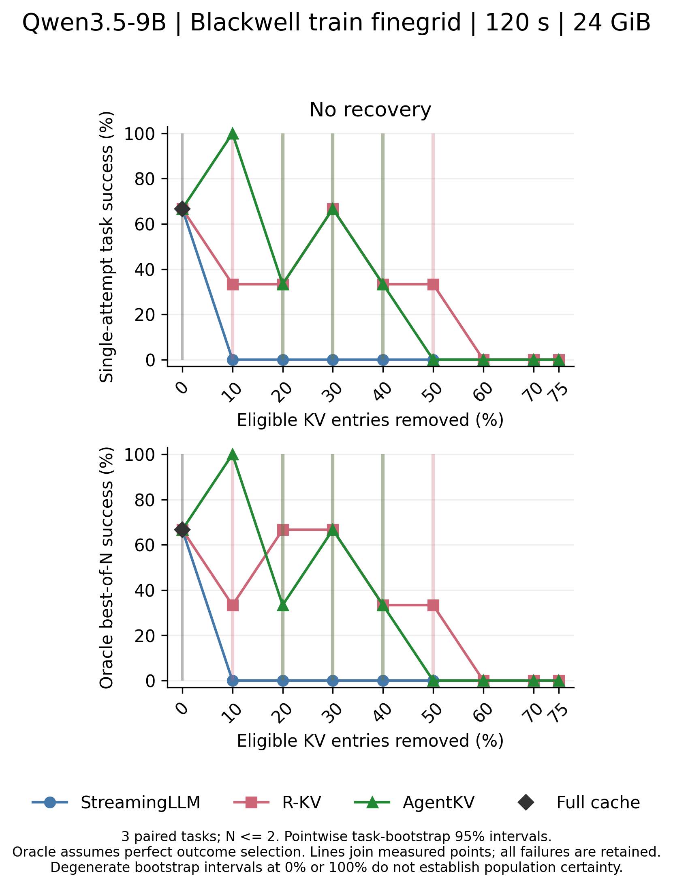
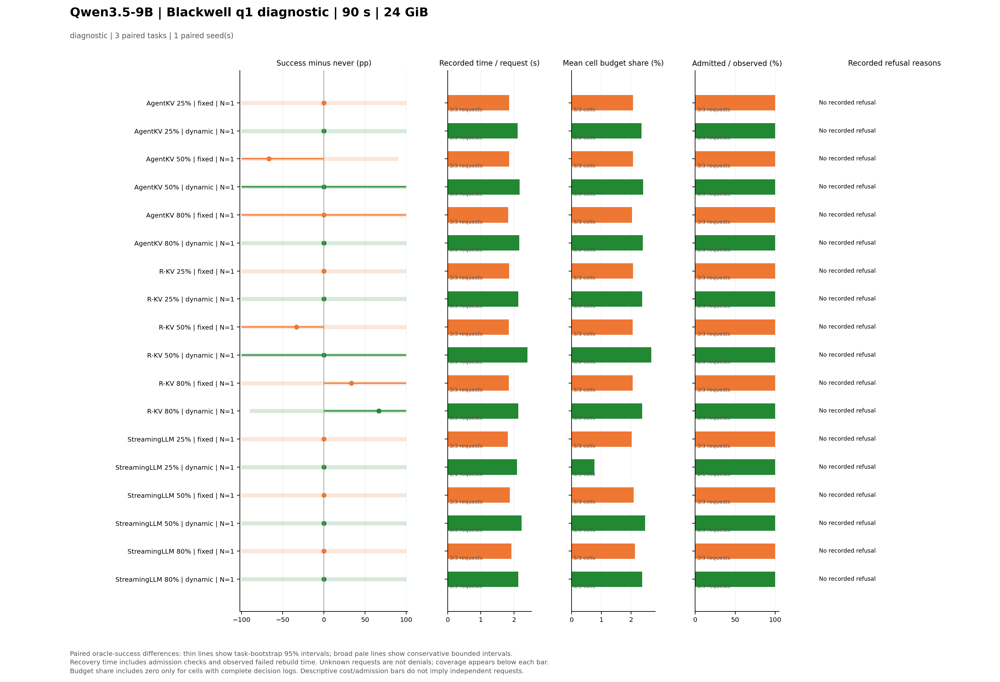

# Blackwell train and dev pilots

[Ledger index](README.md) | [Reproducibility](reproducibility.md)

**Completed and scored.** These small pilots established an informative
operating regime and supplied freeze evidence for the later 50-task study.
Recovery helped some conditions and harmed others. Three train families and
two dev families provide little population precision; these runs add no held-out
test observations and are not a controlled hardware comparison with L4.

All three use source `47596b5`, Qwen3.5-9B hybrid BF16, v4 prompt, 16,384-token
context, seed 17 and one RTX PRO 6000 Blackwell Server Edition with a 24 GiB cap.
Allocations use four CPUs and 24 GiB host RAM. Other pins, sampling and recovery
thresholds are in the [shared settings](reproducibility.md#shared-qwen35-9b-conditions).

## Run inventory

| Run | Config and cohort | Budget and starting state | Coverage | Evidence |
| --- | --- | --- | --- | --- |
| Fine grid | [`finegrid-v2.json`](../configs/qwen9b/blackwell/finegrid-v2.json); 3 train tasks | 120 s, fresh starts, N≤2 plus N=1 control | 26 conditions, 78 cells, 130 attempts | [Summary](../documents/records/qwen9b/train-finegrid-blackwell-summary.json), [analysis](../documents/records/qwen9b/analysis/train-finegrid-blackwell-analysis.json) |
| Q1 recovery diagnostic | [`diagnostic-v2.json`](../configs/qwen9b/blackwell/diagnostic-v2.json); same 3 train tasks | 90 s, saved checkpoint after 2 tools, N=1 | 28 conditions, 84 branches | [Summary](../documents/records/qwen9b/q1-diagnostic-blackwell-summary.json), [analysis](../documents/records/qwen9b/analysis/q1-diagnostic-blackwell-analysis.json) |
| Dev confirmation | [`dev-v1.json`](../configs/qwen9b/blackwell/dev-v1.json); 2 dev tasks | 120 s, fresh starts, N≤2 plus N=1 control | 7 conditions, 14 cells, 20 attempts | [Summary](../documents/records/qwen9b/dev-confirmation-blackwell-summary.json), [analysis](../documents/records/qwen9b/analysis/dev-confirmation-blackwell-analysis.json) |

Train tasks are file organization `34d9492_1`, arithmetic `76f2c72_1` and phone
deletion `771d8fc_1`. Exact dev IDs and every condition are in the linked config.
Each summary preserves its own portable run ID, source/runtime packages,
configuration digest, uncertainty and external manifest/score/analysis hashes.

## Fresh-start compression grid

Entries are oracle successes out of three tasks. Full-cache N=1 and N=2 both
score 2/3. R-KV 80% goes from 1/3 first-attempt to 2/3 oracle success; all other
compressed first-attempt counts equal their oracle counts.

| Retained KV | StreamingLLM | R-KV | AgentKV |
| ---: | ---: | ---: | ---: |
| 90% | 0/3 | 1/3 | 3/3 |
| 80% | 0/3 | 2/3 | 1/3 |
| 70% | 0/3 | 2/3 | 2/3 |
| 60% | 0/3 | 1/3 | 1/3 |
| 50% | 0/3 | 1/3 | 0/3 |
| 40% | 0/3 | 0/3 | 0/3 |
| 30% | 0/3 | 0/3 | 0/3 |
| 25% | 0/3 | 0/3 | 0/3 |

The 130 attempts include 35 completions, 43 timeouts, 44 errors and eight context
limits. Total VRAM peaks at 23.11 GiB. The largest cell overrun is 7.69 s in a
failed cell. Successful attempts finish within budget, including cells with later
unsuccessful work or cleanup that overruns. A 3/3 pilot is not evidence of certain
success in the population.

## Checkpoint recovery diagnostic

Each branch starts from its family's identical saved agent, environment, model
and RNG state after two tools, then evolves independently. The 90 s budget charges
preparation of 5.31, 6.06 or 6.85 s, respectively. These are continuation outcomes,
not fresh-task success estimates. With N=1, first-attempt and oracle success agree.

| Method | Retained KV | Never | Fixed | Dynamic |
| --- | ---: | ---: | ---: | ---: |
| StreamingLLM | 80% | 0/3 | 0/3 | 0/3 |
| StreamingLLM | 50% | 0/3 | 0/3 | 0/3 |
| StreamingLLM | 25% | 0/3 | 0/3 | 0/3 |
| R-KV | 80% | 1/3 | 2/3 | 3/3 |
| R-KV | 50% | 1/3 | 0/3 | 1/3 |
| R-KV | 25% | 0/3 | 0/3 | 0/3 |
| AgentKV | 80% | 2/3 | 2/3 | 2/3 |
| AgentKV | 50% | 2/3 | 0/3 | 2/3 |
| AgentKV | 25% | 0/3 | 0/3 | 0/3 |

Full cache scores 2/3. R-KV 80% dynamic versus never gains 66.7 points
(bootstrap [0, 100]); AgentKV 50% fixed versus never loses 66.7 points
([-100, 0]). Conservative bounded intervals include zero for every comparison.

All 52 requested rebuilds are admitted: 27 fixed and 25 dynamic. Fixed rebuilds
cost 1.61-2.04 s and dynamic rebuilds 2.04-3.06 s. The 84 branches include 42
completed executions, 20 timeouts, 18 errors and four context limits. No measured
peak exceeds 24 GiB. The largest overrun is 10.48 s in a timeout with substantial
saving time, so these timings cannot be read as GPU-only costs.

## Separate dev confirmation and qualification

Full-cache N=2 improves from 0/2 first-attempt to 1/2 oracle success on the two
dev tasks; all tested 25% compressed conditions fail. All five rebuild requests
are admitted. The same families appeared in L4 dev confirmation; this is not a
larger independent sample.

The [qualification ledger](qualification.md) preserves both the failed 21 GiB
check and successful 24 GiB check. An optional small Blackwell frozen test was
not executed because of queue capacity; it is distinct from the later completed
50-task study. See the [full pilot report](../documents/records/qwen9b/blackwell.md).
