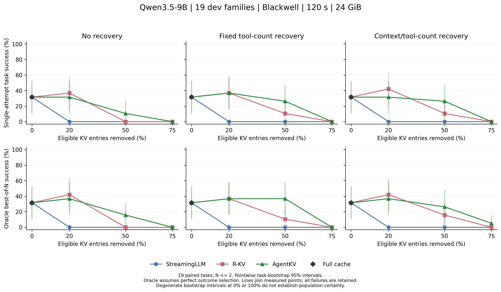

# Nineteen-family recovery study

[Ledger index](README.md) | [Reproducibility](reproducibility.md)

**Completed and scored on November 10, 2026; dev evidence, one seed.** At 50%
retention, AgentKV oracle success rose from 3/19 without recovery to 7/19 with
fixed recovery. The +21.1-point paired bootstrap interval is [+5.3, +42.1], but
the conservative bounded interval includes zero. Against full-cache N=2, the
difference is +5.3 points [-15.8, +26.3]. This motivates replication rather than
a claim of established superiority or a change to frozen test settings.

## Comparison and settings

| Field | Value |
| --- | --- |
| Study | `qwen9b-dev19-recovery-blackwell-v1` |
| Question | Does one full-history rebuild improve fresh-start success at a fixed retention, time budget and total-memory cap? |
| Cohort | All 19 dev families, one variant per family, seed 17 |
| Conditions | Full KV N=1 and N=2; 3 eviction methods × 3 retentions (80/50/25%) × 3 policies (never/fixed/dynamic) |
| Recovery | Fixed after 4 tools; dynamic at both 6,144 context tokens and 3 tools; at most once per attempt |
| Execution | Fresh starts; 120 s shared per cell; at most 2 sequential attempts except N=1 control |
| Hardware | One RTX PRO 6000 Blackwell Server Edition per worker; 24 GiB cap; 4 host CPUs and 24 GiB host RAM |
| Model and protocol | Qwen3.5-9B hybrid BF16, v4 prompt, 16K context; [shared settings](reproducibility.md#shared-qwen35-9b-conditions) |
| Coverage | 29 conditions; 551 cells; 963 attempts; 4 condition groups |
| Source | `6164ba9`, owned checkout and hybrid runtime |
| Configuration | [Parent](../configs/qwen9b/blackwell/dev19-recovery-v1.json), [four groups](../configs/qwen9b/blackwell/dev19-recovery-v1-parts/) |

The [selection record](../documents/records/qwen9b/dev19-recovery-selection.json)
contains all task IDs, the split hash and the variant selection rule. The sample
has six variant-1, six variant-2 and seven variant-3 tasks. Families `4ec8de5` and
`396c5a2` had already appeared in dev confirmation and remain flagged. The
thresholds were inherited from earlier pilots, not tuned on these outcomes.

## Results

Each entry is **first-attempt successes / oracle successes**, with 19 tasks in
each denominator. The full-cache N=1 and N=2 controls both score 6 / 6. Thus the
table and controls cover all 29 conditions, including every all-failure arm.

| Method | Retained KV | Never | Fixed | Dynamic |
| --- | ---: | ---: | ---: | ---: |
| StreamingLLM | 80% | 0 / 0 | 0 / 0 | 0 / 0 |
| StreamingLLM | 50% | 0 / 0 | 0 / 0 | 0 / 0 |
| StreamingLLM | 25% | 0 / 0 | 0 / 0 | 0 / 0 |
| R-KV | 80% | 7 / 8 | 7 / 7 | 8 / 8 |
| R-KV | 50% | 0 / 0 | 2 / 2 | 2 / 3 |
| R-KV | 25% | 0 / 0 | 0 / 0 | 0 / 0 |
| AgentKV | 80% | 6 / 7 | 7 / 7 | 6 / 7 |
| AgentKV | 50% | 2 / 3 | 5 / 7 | 5 / 5 |
| AgentKV | 25% | 0 / 0 | 0 / 0 | 0 / 1 |

Recovery's largest changes occur at 50% retention. At 80% and 25%, changes in
oracle success are at most one task. StreamingLLM solves no task under any
tested policy. The plotted intervals use 10,000 paired task-bootstrap draws,
seed 20261109; they are pointwise and do not correct for the whole grid.

| Recovery minus never, oracle success | Fixed, points [95% interval] | Dynamic, points [95% interval] |
| --- | --- | --- |
| AgentKV 50% | +21.1 [+5.3, +42.1] | +10.5 [0.0, +26.3] |
| R-KV 50% | +10.5 [0.0, +26.3] | +15.8 [0.0, +31.6] |
| AgentKV 25% | 0.0 [0.0, 0.0] | +5.3 [0.0, +15.8] |
| R-KV 80% | -5.3 [-21.1, +10.5] | 0.0 [-15.8, +15.8] |
| AgentKV 80% | 0.0 [-15.8, +15.8] | 0.0 [-15.8, +15.8] |

The [recovery-effects figure](../documents/records/qwen9b/figures/dev19-recovery-effects.png)
shows the paired effects. Conservative bounded intervals include zero for all
recovery comparisons. Degenerate intervals on all-failure arms do not establish
zero population success.

## Behavior, resource costs and failures

AgentKV 50% fixed recovery keeps its three never-rebuild successes and gains
`396c5a2_3`, `50e1ac9_3`, `6c2c621_1` and `b119b1f_1`. Without recovery, 24/38
attempts hit the raw context limit, versus 19/38 with fixed and 21/38 with dynamic
recovery. Restoring useful instructions is a hypothesis consistent with the
trajectories, not an isolated causal finding. The
[task-characteristics analysis](../documents/records/qwen9b/dev19-task-characteristics.md)
and its [data](../documents/records/qwen9b/dev19-task-characteristics.json) examine
the failed and rescued attempts offline.

| Cost or reliability measure | Observation |
| --- | --- |
| Recovery requests / admitted / refused | 427 / 427 / 0 |
| Fixed / dynamic admissions | 228 / 199 |
| Median rebuild time | Fixed 1.9 s; dynamic 2.2 s; maximum 6.1 s |
| AgentKV 50% fixed recovery | 30 rebuilds, 93.8 s total, about 4% of its cell budgets |
| Mean cell latency | Full N=1: 29.04 s; full N=2: 48.91 s; AgentKV 50% never/fixed/dynamic: 57.58 / 56.55 / 52.40 s |
| Mean peak occupied attention KV | Full: 284 MiB; AgentKV never at 80/50/25%: 252 / 220 / 61 MiB; AgentKV 50% fixed: 280 MiB |
| Largest condition mean peak total VRAM | 23.11 GiB |
| CUDA or OOM attempt failures | 0 |

Recovery transiently restores full-history memory, explaining why its peak KV
can approach full cache despite subsequent compression. Other unsuccessful
attempts include timeouts, protocol stops and context limits. All remain in the
denominators; no replacement budgets were granted. The complete per-condition
attempt statuses, latency and available memory metrics are in the summary.

## Evidence and reproducibility

The [summary](../documents/records/qwen9b/dev19-recovery-summary.json) maps
`part-00` through `part-03` to run IDs, source and configuration digests. It records
24 passing live checks, the four-cell dev smoke and offline scoring. The external
`dev19-recovery-compact.tar.gz` bundle contains the full analysis and each group's
manifest, scores and cell records; its hash is in the summary. Complete raw runs
also retain trajectories and evaluator-compatible environments.

The committed summary is sufficient to audit the tables above, but is not itself
the input schema for the shared plotting commands. Retrieve the bundle's full
analysis to [regenerate the plots](reproducibility.md#regenerating-the-main-figures).
See the [report](../documents/records/qwen9b/dev19-recovery.md) and
[design](../documents/records/qwen9b/dev19-recovery-design.md) for details.

This is a fresh-start dev cohort, separate from the checkpoint diagnostics and
50-task test. The [seed, retention and trigger followups](followups.md#dev-recovery-followups)
have no valid completed results in this repository snapshot.
