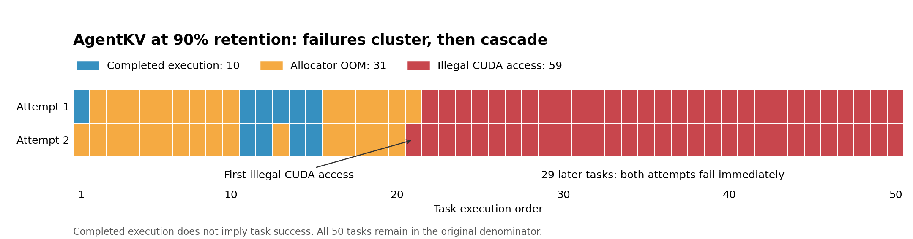

# Investigations and followup studies

[Ledger index](README.md) | [Reproducibility](reproducibility.md)

This entry records what the synchronized `main` snapshot establishes. The CUDA
audit is complete, but this snapshot contains no committed corrected 50-task
results and no valid completed results for the dev seed, retention or timing
followups. Their submission records are dated November 10-11, 2026; they are not
live job status. An absent result is not a zero-success measurement.

## AgentKV CUDA investigation and corrective replication

The original AgentKV 90% condition scores 2/50 oracle successes and has 100
attempts: ten normal completions, 31 allocator OOMs and 59 CUDA illegal accesses.
The first illegal access occurs in the second attempt on the 21st task,
`fd1f8fa_3`; the next 58 attempts on 29 tasks fail almost immediately. This is
one initial fault and a poisoned-process cascade, not 59 independent accuracy
failures. The originating kernel remains unidentified.

The audit also confirms retained exception tracebacks holding failed-operation
tensors. Repairs stop after fatal CUDA faults, preserve charged failure journals,
release exception frames and retain traceback text. Fresh-process synthetic and
saved-history replays succeed without CUDA errors or OOMs, but do not reproduce
the original long-lived process or prove the cause of each historical OOM.

| Corrective study field | Declared value |
| --- | --- |
| Config | [`test50-cuda-repair-v2.json`](../configs/qwen9b/blackwell/test50-cuda-repair-v2.json), [five partitions](../configs/qwen9b/blackwell/test50-cuda-repair-v2-parts/index.json) |
| Coverage | Same 50 previously inspected test tasks; 5 conditions; 250 planned cells |
| Conditions | AgentKV 90/80%, R-KV 90/80%, full-cache N=2; never rebuild |
| Matched settings | Qwen3.5-9B hybrid BF16, seed 17, v4 prompt, 16K context, 120 s shared by N≤2, Blackwell at 24 GiB |
| Changed execution | Repaired source `d97c49d`; separate process/GPU per condition; job-local owned checkout, runtime and generated AppWorld code cache |
| Gate | Matching [two-task dev check](../configs/qwen9b/blackwell/cuda-repair-dev-v1.json) for each worker; gate and final execution use separate processes |
| Recorded submission | Array `13857623`, offline scorer `13857624`; completion not established by the committed record |
| Evidence | [Audit and launch JSON](../documents/records/qwen9b/agentkv90-investigation.json), [investigation report](../documents/records/qwen9b/agentkv90-investigation.md) |

This replication must remain a separate cohort on previously examined tasks.
Changed process lifetime and cache placement also affect historical before/after
comparisons. Retain the original contaminated point and failures; compare 90%
with 80% within the corrective cohort once complete results are available.
Do not import a score from another branch or an ETA as if it were verified here.

## Dev recovery followups

All three studies retain the original 19 dev tasks and Blackwell 24 GiB,
120-second, 16K, hybrid BF16 regime unless noted. Their declarations preserve
the source/runtime of the seed-17 study (`6164ba9`), with new configuration
versions staged separately. Counts below are planned, not completed evidence.

| Study | Change and purpose | Planned coverage | Config |
| --- | --- | --- | --- |
| Seed replicate | Repeat the full recovery matrix with seeds 29 and 31 to assess stability | 29 conditions × 19 tasks × 2 seeds = 1,102 cells; 8 groups | [`dev19-recovery-v2.json`](../configs/qwen9b/blackwell/dev19-recovery-v2.json) |
| Retention frontier | R-KV and AgentKV at 70/60/50/40/30%, never/fixed, plus full N=2; seed 17 | 21 conditions × 19 tasks = 399 cells; 7 groups | [`dev19-frontier-v1.json`](../configs/qwen9b/blackwell/dev19-frontier-v1.json) |
| Trigger timing | R-KV and AgentKV 50%, fixed after 1, 2, 6 or 8 tools; seed 17 | 4 separate threshold configs × 2 methods × 19 tasks = 152 cells | [`dev19-trigger-v1/`](../configs/qwen9b/blackwell/dev19-trigger-v1/) |

The original seed-17 study supplies the threshold-4 and never comparisons for
trigger timing. Those are historical controls with potentially different I/O
conditions, not newly randomized concurrent controls. The frontier repeats 50%
as a consistency check; neither it nor the replicate can retune frozen test settings.

### Preserved unsuccessful launches

| Launch | Recorded outcome | Treatment in comparisons |
| --- | --- | --- |
| Initial seed replicate, November 10-11 | Stopped after 28 cells; shared-storage save/tool stalls consumed budgets | Whole launch void; no resume or pooled success estimate |
| Concurrent followups, November 11 | Up to 16 workers; severe AppWorld reset stalls; 152 trigger, 438 replicate and 57 frontier cells written before cancellation | All three launches void; these cells are not scored or pooled |
| Guarded trigger relaunch, November 11 | Stopped after 38 cells when saving delays exceeded the declared guard; queued replicate/frontier cancelled unstarted | Whole launch void; not selective removal of bad cells |
| Node-local storage smoke, November 11 | Two cells; 0.03 s save per cell, 0.5 s reset per attempt; 3/3 saved environments scored | Integration evidence outside the studies, not a task-success estimate |

The subsequent declaration places run directories and AppWorld roots on node-local
disk, mirrors outputs to shared storage, uses at most four workers, and executes
one study at a time. It retains the timing guard and charges resets, tools and
saves. The smoke preserves observed actions, but lower I/O costs change effective
compute time within the same 120 s budget. Any completed comparison must report
those costs alongside the original shared-storage cohort.

The [design and launch history](../documents/records/qwen9b/dev19-recovery-design.md)
is the source for these statuses, storage conditions and guard thresholds. At the
next ledger sync, add independently verified result records and figures for valid
completed cohorts while retaining these voided launches and their rationale.
