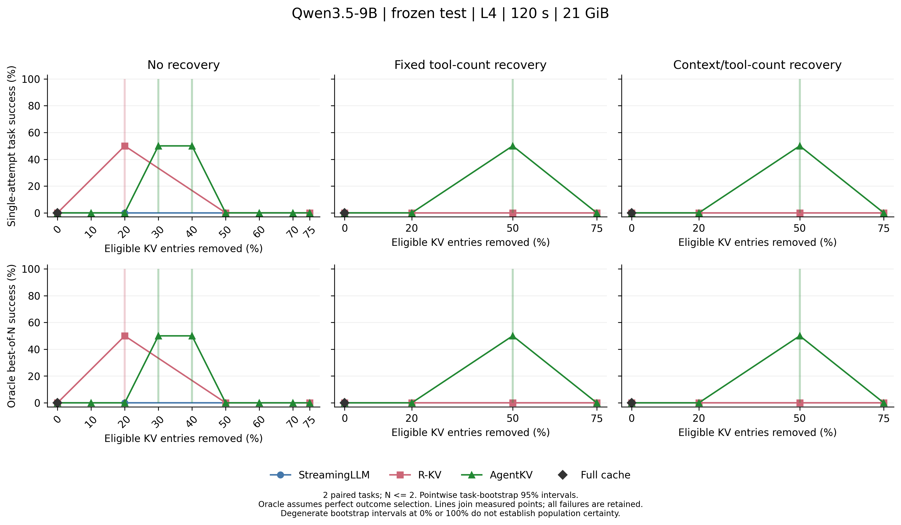

# L4 capability, pilot and frozen-test studies

[Ledger index](README.md) | [Reproducibility](reproducibility.md)

**Completed and scored.** The two-family frozen test found both benefits and
harms from recovery: AgentKV 50% improved from 0/2 to 1/2, while recovery removed
R-KV 80%'s only success. Every successful test cell concerns the same family.
The sample is useful for a case study, not a general ranking.

These runs use one NVIDIA L4 with a 21 GiB total-VRAM cap. Keep them separate
from Blackwell measurements, which differ in device, cap and execution costs.
The v4 and subsequent runs use the [shared 9B conditions](reproducibility.md#shared-qwen35-9b-conditions).

## Frozen test

| Field | Value |
| --- | --- |
| Study | `qwen9b-final-l4-v1` |
| Configuration | [`final-v1.json`](../configs/qwen9b/l4/final-v1.json) |
| Cohort | `test_normal`: `59fae45_1`, `042a9fc_1`; seed 17 |
| Conditions | 29-condition core recovery matrix plus 5 AgentKV never-rebuild points at 90/70/60/40/30% retention |
| Budget and starting state | 120 s shared per cell, fresh starts, N≤2 plus N=1 full-cache control |
| Coverage | 34 conditions, 68 cells, 101 attempts |
| Execution source | `cc9057a` |
| Raw run identity | `comet-run:b4c4ade9-2ab1-4c76-8863-6cc727920d8b` |
| Evidence | [Summary](../documents/records/qwen9b/final-summary.json), [analysis](../documents/records/qwen9b/analysis/final-analysis.json), [case study](../documents/records/qwen9b/final-case-study.json) |

All successes occur on first attempts, so first-attempt and oracle success
coincide. Full-cache N=1 and N=2 both score 0/2.

| Method | Retained KV | Never | Fixed | Dynamic |
| --- | ---: | ---: | ---: | ---: |
| StreamingLLM | 80% | 0/2 | 0/2 | 0/2 |
| StreamingLLM | 50% | 0/2 | 0/2 | 0/2 |
| StreamingLLM | 25% | 0/2 | 0/2 | 0/2 |
| R-KV | 80% | 1/2 | 0/2 | 0/2 |
| R-KV | 50% | 0/2 | 0/2 | 0/2 |
| R-KV | 25% | 0/2 | 0/2 | 0/2 |
| AgentKV | 80% | 0/2 | 0/2 | 0/2 |
| AgentKV | 50% | 0/2 | 1/2 | 1/2 |
| AgentKV | 25% | 0/2 | 0/2 | 0/2 |

The five supplemental AgentKV never-rebuild points are 0/2 at 90%, 1/2 at 70%,
1/2 at 60%, 0/2 at 40% and 0/2 at 30%. Other methods were not measured at those
intermediate retentions in this test.

AgentKV 50% recovery minus never gains 50 points (paired bootstrap [0, 100]);
R-KV 80% recovery loses 50 points ([-100, 0]). Both conservative bounded
intervals span [-100, 100]. Additional attempts add no successes, and dynamic
recovery does not outperform fixed recovery here. The saved trajectory suggests
restored authentication context in AgentKV 50%; it does not identify causal tokens.

Of 101 attempts, nine complete normally, five of those are correct, 60 time out,
21 stop on errors and 11 hit the context limit. All 30 rebuild requests are
admitted, costing 3.58-8.35 s. Observed total VRAM peaks at 20.05 GiB and maximum
budget overrun is 0.77 s. Failed work receives no extra budget.

## Capability and protocol development

The predeclared capability sample comprises four train families: file organization,
arithmetic, phone deletion and Spotify review editing. The initial
[baseline](../documents/records/qwen9b/l4-baseline.json) scores 0/4;
[v3](../documents/records/qwen9b/protocol-v3.json) scores 1/4;
[v4](../documents/records/qwen9b/protocol-v4.json) scores 3/4. These are separate
versions with prompt, context and backend changes, not an isolated treatment effect.

The [v4 config](../configs/qwen9b/l4/baseline-v4.json) uses 300 s, N=1, seed 17,
16K context and the 21 GiB cap. Its prompt adds explicit observed-credential
login, token-variable reuse and concise printing; v3 used an 8K context limit.
V4 source is `0d438bf`, run
`comet-run:1fb4b489-1af3-42f1-b754-f998fb6b3aa1`. The initial baseline uses
`ebd58fb` and its own recorded configuration. Recover older declarations from
their saved manifests/Git history; do not substitute the v4 settings for them.

## Six subsequent train and dev runs

These use source `0d438bf`, seed 17 and the 21 GiB cap. The
[pilot summary](../documents/records/qwen9b/pilot-summary.json) maps each named
plan below to its run ID, configuration digest, manifest and scores. Together
they contain 109 cells and 125 attempts; they are not one pooled cohort.

| Plan and config | Split and sample | Time / attempt ceiling | Cells / attempts | Analysis |
| --- | --- | --- | ---: | --- |
| 06 compression; [`compression-v1.json`](../configs/qwen9b/l4/compression-v1.json) | Train, 2 tasks | 150 s / N≤2 | 14 / 20 | [Compression](../documents/records/qwen9b/analysis/train-compression-analysis.json) |
| 07 Q1; [`diagnostic-v1.json`](../configs/qwen9b/l4/diagnostic-v1.json) | Train, arithmetic checkpoint after 2 tools | 90 s / N=1 | 28 / 28 | [Diagnostic](../documents/records/qwen9b/analysis/q1-diagnostic-analysis.json) |
| 08 budget; [`budget-120-v1.json`](../configs/qwen9b/l4/budget-120-v1.json) | Train, same 2 tasks | 120 s / N≤2 | 14 / 18 | [120 s](../documents/records/qwen9b/analysis/train-budget120-analysis.json) |
| 09 budget; [`budget-90-v1.json`](../configs/qwen9b/l4/budget-90-v1.json) | Train, same 2 tasks | 90 s / N≤2 | 14 / 18 | [90 s](../documents/records/qwen9b/analysis/train-budget90-analysis.json) |
| 10 fine grid; [`finegrid-v1.json`](../configs/qwen9b/l4/finegrid-v1.json) | Train, arithmetic | 120 s / N=1 | 25 / 25 | [Fine grid](../documents/records/qwen9b/analysis/train-finegrid-analysis.json) |
| 11 confirmation; [`dev-v1.json`](../configs/qwen9b/l4/dev-v1.json) | Dev, `4ec8de5_1`, `396c5a2_1` | 120 s / N≤2 | 14 / 16 | [Dev](../documents/records/qwen9b/analysis/dev-confirmation-analysis.json) |

The [independent budget analysis](../documents/records/qwen9b/analysis/independent-budgets.json)
reports full-cache success of 1/2 at 90 and 120 s and 2/2 at 150 s. Every tested
25% compressed arm scores 0/2. These are independently executed budgets, not
cuts through the timestamps of a single run.

The arithmetic fine grid succeeds with full cache and AgentKV at 90/80/70/60/50%
retention. AgentKV fails at 40/30/25%, and both other methods fail at every
compressed point. The Q1 diagnostic charges 9.11 s of preparation to each
90 s branch. Dynamic recovery changes failure to success for R-KV and AgentKV
at 25%; fixed recovery helps AgentKV at 50%, while recovery harms two other
previously successful settings. All 17 requests are admitted. These are
one-task diagnostics with degenerate bootstrap precision.

In separate dev confirmation, a second full-cache attempt raises success from
0/2 to 1/2; all tested 25% compressed arms fail. Exact per-condition outcomes,
resources, failures and uncertainty remain in each linked analysis.

## Evidence and reproduction

The [full L4 report](../documents/records/qwen9b/findings.md) links the measured
state, 16K capacity, AppWorld recovery and interruption checks. The
[qualification ledger](qualification.md) explains their scope. Per-plan archives
were retrieved after a final bulk transfer timed out; summaries retain portable
artifact identities, while complete raw runs remain outside tracked source.
Use each run's own source/runtime and config for reproduction. Config files were
reorganized without changing their resolved values or hashes.
