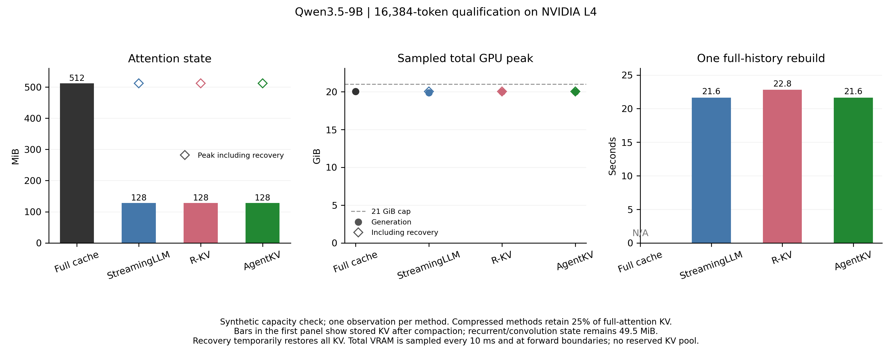

# Hardware and integration qualifications

[Ledger index](README.md) | [Reproducibility](reproducibility.md)

Qualification measures whether the recorded implementation can preserve state,
apply compression/recovery and respect its declared limits. It does not measure
population task quality. A pass applies to its source, runtime, device, cap and
workload; a later study still needs matching evidence.

## Recorded checks

| Device and check | Result and scope | Evidence |
| --- | --- | --- |
| RTX A6000, early Qwen3.5 hybrid state check | 24 method/retention branches and cap refusal; 8K synthetic capacity. Chat-template integration failed, so this is partial qualification only. Source `ae801bc`. | [State record](../documents/records/qwen9b/validation/a6000-state-check.json) |
| L4, 21 GiB state check | Numerical/reference, persistent compressed state and replay branches; inspect the record for its exact capacity scope. | [State record](../documents/records/qwen9b/validation/l4-state-check.json) |
| L4, 21 GiB, 16K synthetic capacity | Passed full-history prefill and compressed recovery with tiled R-KV; source `0d438bf`. | [Capacity record](../documents/records/qwen9b/validation/l4-context-16384.json) |
| L4, real AppWorld tool effects | Passed forced tool mutation, independent restore and recovery fixture; integration evidence, not agent success. Source `0d438bf`. | [AppWorld record](../documents/records/qwen9b/validation/l4-appworld-recovery.json) |
| L4, interruption and resume | Passed preserved completed/interrupted work, paired first turn, fresh environments and refusal of incomplete scoring. | [Resume record](../documents/records/qwen9b/validation/l4-resume.json) |
| Blackwell, 21 GiB, 16K | Failed: allocator refused a 120 MiB full-cache attention allocation; 12 focused checks passed but no task attempt ran. Source `47596b5`. | [Failed qualification](../documents/records/qwen9b/validation/blackwell-cap21-failure.json) |
| Blackwell, 24 GiB, 16K | Passed qualification at source `47596b5`. That allocation then failed in model staging before task execution; qualification success does not mean that job produced research results. | [Passed qualification and later launch failure](../documents/records/qwen9b/validation/blackwell-cap24.json) |
| Blackwell, 50-task execution source | 24 live checks plus four-condition dev smoke; the study subsequently experienced CUDA failures retained in its results. | [Test validation history](../documents/records/qwen9b/test50-validation-repair.json), [results](test50-compression.md) |
| Blackwell, 19-family execution source | 24 live checks plus four-cell dev smoke in its own checkout/runtime. | [Dev summary](../documents/records/qwen9b/dev19-recovery-summary.json) |

The failed 21 GiB Blackwell qualification led to a separately declared 24 GiB
cohort. It does not authorize raising another run's cap during execution.

## What the 16K capacity measurement shows

At 16,384 tokens and 25% retention, occupied attention KV falls from 512 MiB to
128 MiB; recurrent/convolution state remains 49.5 MiB. Rebuilding the full history
temporarily restores 512 MiB of attention KV and costs 21.6-22.8 s. Sampled total
GPU peaks remain 20.05 GiB under the 21 GiB cap. Thus a 75% reduction in this
KV component is not a 75% reduction in total GPU memory.

This uses one fixed synthetic history and does not establish recovery benefit
on AppWorld. Memory sampling occurs every 10 ms and at forward boundaries;
brief external-memory transients can be missed. The later task studies also
have different recovery contexts and costs.

## Reproduction and limits

Each JSON record preserves its artifact identity or raw-evidence hash and source
details. Complete raw check output remains external. Recreate the matching
runtime and use the [validation guide](../documents/validation/README.md),
[`run_checks.sh`](../scripts/run_checks.sh) and
[`qualify_hybrid.sh`](../scripts/qualify_hybrid.sh) with a fresh evidence directory.
Synthetic checks, forced tool fixtures and CPU regression checks remain distinct
from completed, offline-scored task runs.

The capacity figure can be regenerated from the committed 16K JSON using
[`plot_hybrid_qualification.py`](../scripts/plot_hybrid_qualification.py) in the
activated CPU plotting environment. Preserve the input's source and device label.
No qualification or GPU run was repeated for this ledger update.
