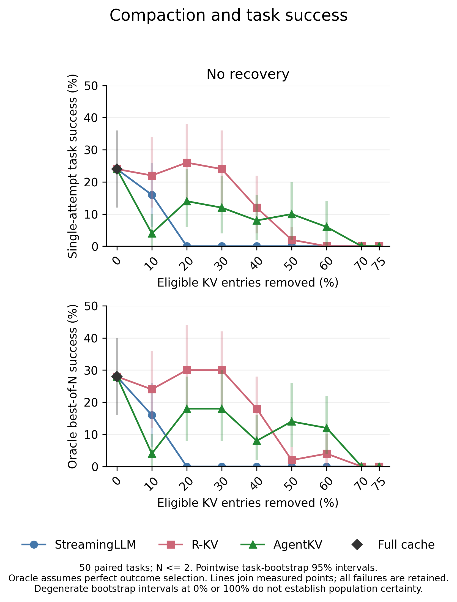
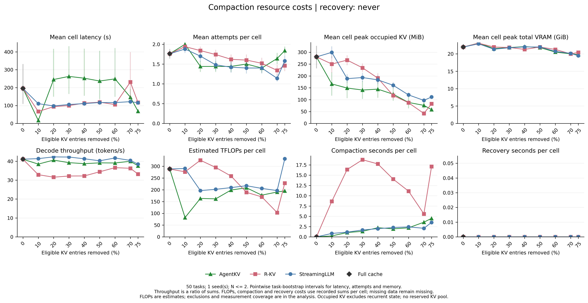

# Fifty-task compression study

[Ledger index](README.md) | [Reproducibility](reproducibility.md)

**Completed and scored on November 10, 2026.** This frozen test measures
compression without recovery. R-KV at 70% and 80% retention solved 15/50 tasks
with oracle selection, compared with 14/50 for full-cache N=2. The paired
difference is +2 percentage points with a 95% bootstrap interval of [-10, +14];
it does not establish superiority. The AgentKV 90% result includes a confirmed
CUDA cascade and cannot isolate an effect of retention on task quality.

## Comparison and settings

| Field | Value |
| --- | --- |
| Study | `qwen9b-test50-finegrid-blackwell-v1` |
| Question | How does success change as each method retains less attention KV, with matched time and memory limits? |
| Cohort | 50 `test_normal` families, one task per family, seed 17 |
| Conditions | Full KV N=1 and N=2; StreamingLLM, R-KV and AgentKV at 90/80/70/60/50/40/30/25% retention, never rebuild |
| Execution | Fresh starts; 120 s shared per cell; at most 2 sequential attempts, except N=1 control |
| Hardware | One RTX PRO 6000 Blackwell Server Edition per worker; 24 GiB total-VRAM cap; 4 host CPUs/threads, 24 GiB host RAM |
| Model and protocol | Qwen3.5-9B hybrid BF16, v4 prompt, 16,384-token context; all [shared settings](reproducibility.md#shared-qwen35-9b-conditions) |
| Coverage | 26 conditions; 1,300 scored cells; 2,026 attempts; 8 condition partitions |
| Source | Execution and evaluator `f2413b4`; preserve recorded source hashes and runtime |
| Configuration | [Frozen parent](../configs/qwen9b/blackwell/test50-v1.json), [partition index](../configs/qwen9b/blackwell/test50-v1-parts/index.json) |

Task selection used split identifiers only. It excluded families `042a9fc` and
`59fae45`, examined in the earlier L4 test, ranked the other families using the
declared SHA-256 namespace, selected 50 and chose one hashed variant per family.
The [selection record](../documents/records/qwen9b/test50-selection.json) contains
the exact task list and input split hash. Settings were frozen from the completed
Blackwell train grid and separate dev confirmation before this test ran.

## Results

The vertical axis is restricted to 0-50% for readability; the
[full-range view](../documents/records/qwen9b/figures/test50-final-aggressivity.png)
contains the same points. The horizontal axis is KV removed, not total memory
saved. Lines connect measured settings only. At zero removal, the figure uses
the N=2 full-cache condition, including its first-attempt result.

Each entry is **first-attempt successes / oracle successes**, with 50 tasks in
each denominator. Both full-cache controls are separately executed conditions.

| Retained KV | StreamingLLM | R-KV | AgentKV |
| ---: | ---: | ---: | ---: |
| 90% | 8 / 8 | 11 / 12 | 2 / 2 (CUDA-contaminated) |
| 80% | 0 / 0 | 13 / 15 | 7 / 9 |
| 70% | 0 / 0 | 12 / 15 | 6 / 9 |
| 60% | 0 / 0 | 6 / 9 | 4 / 4 |
| 50% | 0 / 0 | 1 / 1 | 5 / 7 |
| 40% | 0 / 0 | 0 / 2 | 3 / 6 |
| 30% | 0 / 0 | 0 / 0 | 0 / 0 |
| 25% | 0 / 0 | 0 / 0 | 0 / 0 |

| Full-cache control | First attempt | Oracle |
| --- | ---: | ---: |
| N=1 | 15/50 (30%) | 15/50 (30%) |
| N=2 | 12/50 (24%) | 14/50 (28%) |

The N=1 versus N=2 first-attempt difference includes timing and storage effects;
it is not a causal estimate of another attempt's value. StreamingLLM fails below
90% retention in this measured regime. No compressed arm succeeds at 30% or 25%.
These statements describe this implementation, workload and budget, not a general
method ranking. Uncertainty uses 2,000 paired task-bootstrap draws and one seed.

## Resource costs and failures

| Attempt outcome | Count |
| --- | ---: |
| Completed execution, not necessarily successful | 437 |
| Timeout | 822 |
| Agent protocol error | 470 |
| CUDA illegal-memory-access error | 59 |
| Context limit | 174 |
| OOM | 59 |
| Interrupted | 5 |

AgentKV 90% accounts for all 59 CUDA errors and 31 OOMs; R-KV 90% accounts for
the remaining 28 OOMs. The five interrupted attempts keep their original
120-second reservations. All remain in the denominators. The
[investigation](followups.md#agentkv-cuda-investigation-and-corrective-replication)
preserves the original results and identifies a separate corrective cohort.

Storage stalls are material: 462 of 1,300 cells exceeded 120 seconds by more
than one second; the largest recorded overrun was 3,914.06 seconds. No credited
successful attempt finished late; the latest finished at 119.07 seconds.
Latency includes in-flight work and cleanup and is not GPU-only time. Resource
means use their recorded coverage, and missing measurements are not zero.

## Evidence and reproducibility

The [evidence summary](../documents/records/qwen9b/test50-final-summary.json)
identifies bundle `qwen9b-test50-finegrid-blackwell-v1-launch3` and maps all eight
partitions to portable run IDs, configuration digests, manifest and score hashes.
The [CSV](../documents/records/qwen9b/test50-final.csv) retains all 26 conditions;
the [compact analysis](../documents/records/qwen9b/analysis/test50-final-analysis.json)
retains their resource aggregates, uncertainty and all 325 paired comparisons.
Complete per-cell/per-attempt data, transcripts and environments remain external.

The final coverage audit found all 1,300 unique expected cells terminal and scored
with matching execution/evaluator provenance. Qualification passed 24 live checks
and a four-condition dev smoke on the matching source/runtime/device/cap;
identical workers reused that evidence. The
[validation repair](../documents/records/qwen9b/test50-validation-repair.json) and
[compatible resume record](../documents/records/qwen9b/test50-resume-20261110.json)
preserve failed launches and interruption accounting. Their existence does not
remove the later CUDA failures from the results.

Read the [full report](../documents/records/qwen9b/test50-final.md) and
[frozen design](../documents/records/qwen9b/test50-design.md) for execution history.
Use the [figure commands](reproducibility.md#regenerating-the-main-figures) for
the committed analysis. This study has no recovery arms and must remain separate
from the dev recovery study, L4 test and corrective replication.
